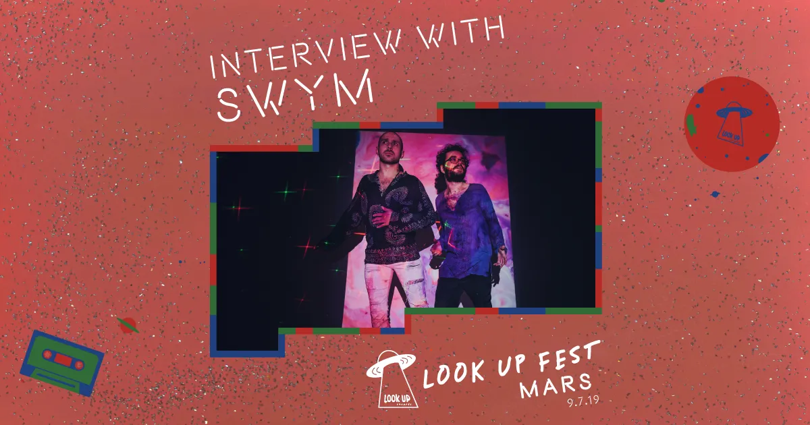
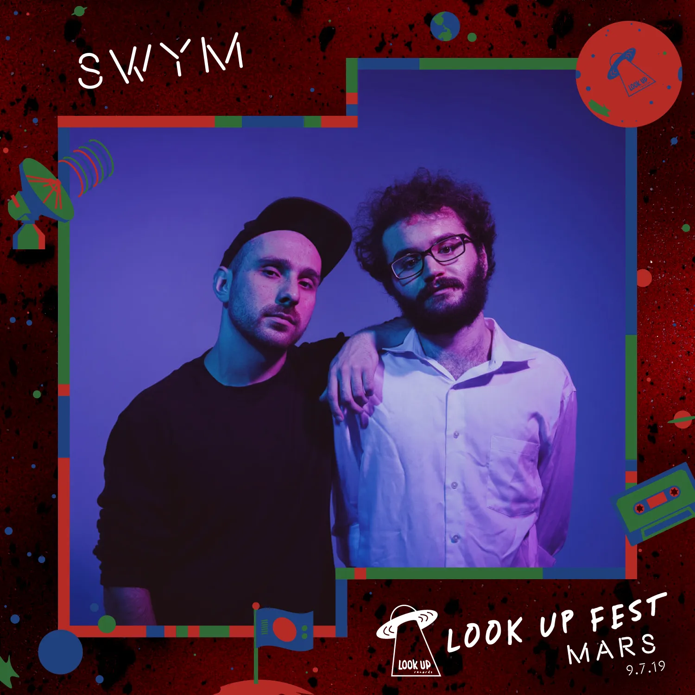

Dreamy psychedelic journeys flow from every SWYM track. Jesse Holden and Ryan Brum take on this sonic form and provide listeners with strange hallucinations. I was able to explore this ethereal inspiration and find out from SWYM what they have in store for the Mars Look Up Festival.

***Mirror Box provides a clear psychedelic experience to the listener. What was the driving inspiration behind it?***

In a way, Mirror Box was a sort of retelling of our adventure to Seattle; with so much time on our feet there was plenty of time for self reflection. Once we got our practice space worked out

we pretty much jumped right into writing songs and most of those songs made it onto this album. It's kind of funny because they were written individually at first with no clear picture for the album in mind at that time, but when we decided that we were going to release a full length album it was apparent which songs belonged on it.

***Strange Hallucinations really packs a punch in terms of sound. What did you notice changed about your sound and inspiration since Mirror Box?***

Strange Hallucinations was a more relaxed production when compared to Mirror Box. We did a lot more pre-production, something we kind of skimmed over with the last release, and with a smaller track list the whole experience is just a lot more focused. Mirror Box being our first production by ourselves, we touched upon the psychedelic elements we liked and wanted from our first album and honed them into something slightly more well rounded and tightly mixed.

***What can listeners expect from your set at the Mars Look Up Festival?***

Their faces will melt. Their souls will buzz. Their ears will ring.

<iframe src="https://open.spotify.com/embed/artist/0zEVFsgknDLxViwtwczNkE" title="Spotify artist" height="352" loading="lazy" allow="autoplay; clipboard-write; encrypted-media; fullscreen; picture-in-picture"></iframe>

<figure><figcaption><strong>SWYM</strong> — Catch SWYM at Look Up Fest: Mars on 9/7!</figcaption></figure>

## Listen to other bands playing on Mars:

<iframe src="https://open.spotify.com/embed/playlist/1qFoOoG5BXuKqOFrHhQSnp" title="Spotify playlist" height="352" loading="lazy" allow="autoplay; clipboard-write; encrypted-media; fullscreen; picture-in-picture"></iframe>

