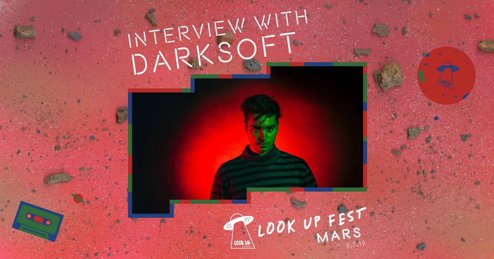
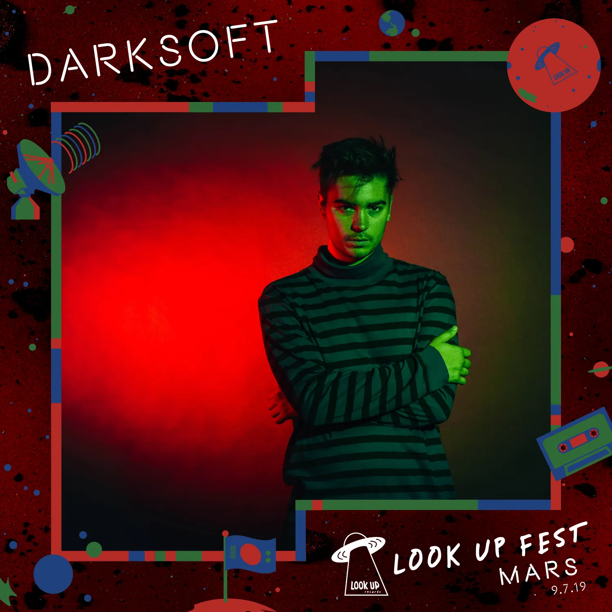

Darksoft provides strong guitar driven hooks that haunt audiences to the very core. Bill Darksoft, also founder of Look Up Records, has used his music to digitize his soul, and provide an encrypted sound into each track. I was very fortunate to get my questions about his latest projects answered, and find out what’s in store for the [Mars Look Up Festival](https://lufm.eventbrite.com).

***Wannacry has been a perfect summer jam. What was your inspiration when writing it?***

Aw thank you. Sonically, my inspiration was to create just that - a summery sounding release. The bittersweet aspect is the darker meaning in the lyrics. It's named after the Wannacry ransomware, a virus that captures your computer and demands cryptocurrency in exchange for decrypting files.

***What is your favorite track to perform off of Brain and what inspired you to write it?***

My favorite to perform is becoming Conficker. It's our most high tempo, and moves around with some licks we like playing as a band. I was reading a book about real Men in Black encounters, and wrote a little bit of that into the lyrics which is fun to sing. What if all your memory was erased? How would you know? Who's in control of your reality?

***Are you working on any new projects and what can we expect from you set at the Mars Look Up Festival?***

At Mars we’ll debut a music video for Wannacry. I partnered with Collin Snider of DreamboatVISTA to produce it, and he’s done a fantastic job. It’s from the perspective of an astronaut traveling to Mars. Very excited to share it! I have a new album in the works, working name "Meltdown." So far there are more synths and dreamy blue love. Casually working on some cybernetic implants too for the band, hopefully, they'll be done by this Look Up Fest…

<iframe src="https://open.spotify.com/embed/artist/5pD33SUgX5GQ8NvqZ6IdeE" title="Spotify artist" height="352" loading="lazy" allow="autoplay; clipboard-write; encrypted-media; fullscreen; picture-in-picture"></iframe>

<figure><figcaption><strong>Darksoft</strong> — Catch Darksoft at Look Up Fest: Mars on 9/7!</figcaption></figure>

## Listen to other bands playing on Mars:

<iframe src="https://open.spotify.com/embed/playlist/1qFoOoG5BXuKqOFrHhQSnp" title="Spotify playlist" height="352" loading="lazy" allow="autoplay; clipboard-write; encrypted-media; fullscreen; picture-in-picture"></iframe>

