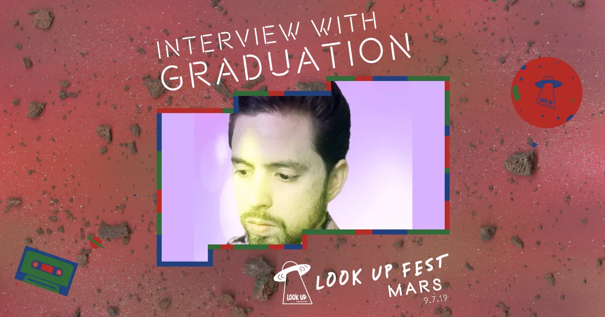
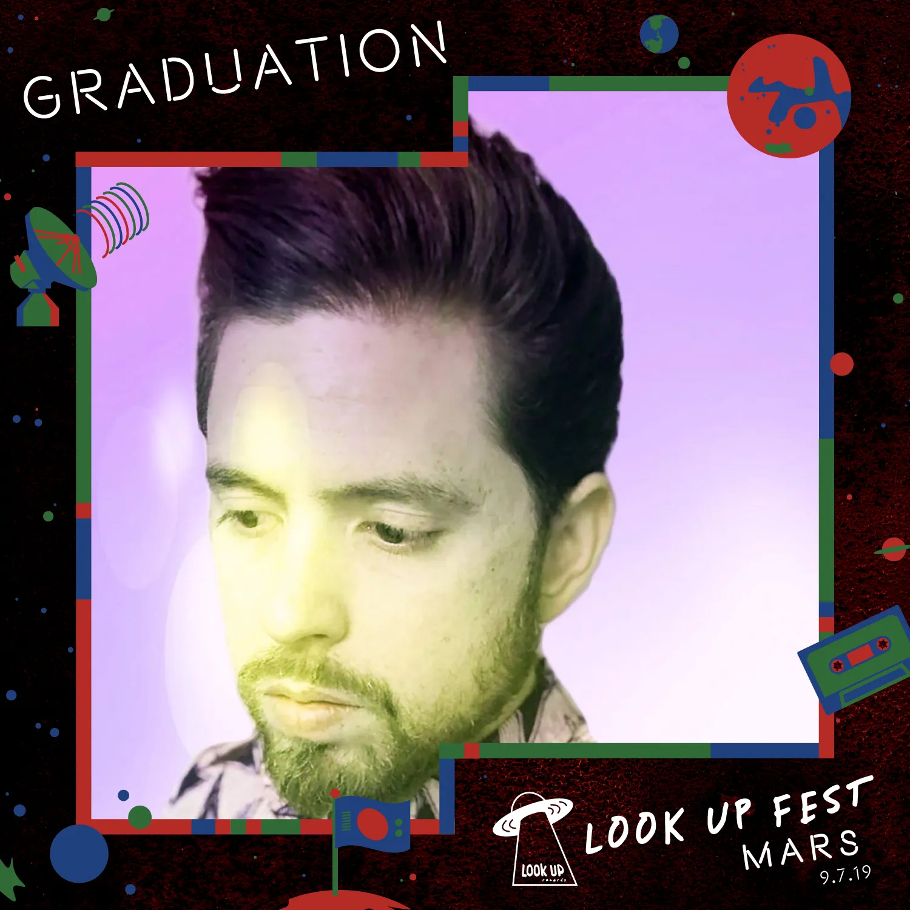

Listening to Graduation is like popping a shoegaze pill and becoming a dreamy wall of sound. The power behind Adam Piddington’s sonic exploration comes from a mixture of psychedelic harmonies, and smooth glassy melodies. I was able to find out more about the inspiration behind Back When I was Pretty and all the cool things we can expect from Graduation at the Mars Look Up Festival.

**Back When I Was Pretty is a wonderfully chill psych/shoegaze experience. What was the driving inspiration behind the project?**

Thanks! Back When I Was Pretty started out as a production project when I was living in Los Angeles. I guess you could say the album's driving inspiration was an attempt to reinvent myself as an artist I had parted ways with my previous band and was working in some studios and learning the ropes. I was at a crossroads artistically, personally, and wasn't sure if I wanted to pursue music anymore. Back When I Was Pretty became about overcoming myself, and taking my artistic ability to its limits. Creatively, my goal was to meld all of the things I liked into one album borrowing influences that range from Shoegaze to Hip Hop.

**Do you have a favorite track to perform off of the project?**

My favorite song to perform is A Split Second. The song ends in a lush crescendo, where the drums switch up into a Dilal-esque beat. I really just like listening to my drummer, Alex Coleman. It allows the space for him to go off. It's a crowd-pleaser for sure.

**What can your fans expect from your set at the Mars Look Up Festival?**

We are playing some songs that we have not played live yet including an unreleased track. The set will be more grandiose than most of our sets. We are definitely preparing something special and the festival has been a great impetus to expand what we do live. We are really looking forward to it!

<iframe src="https://open.spotify.com/embed/artist/6ZcwYWJ0C9QRQSkBoNNpHW" title="Spotify artist" height="352" loading="lazy" allow="autoplay; clipboard-write; encrypted-media; fullscreen; picture-in-picture"></iframe>

<figure><figcaption><strong>Graduation</strong> — Catch Graduation at Look Up Fest: Mars on 9/7!</figcaption></figure>

## Listen to other bands playing on Mars:

<iframe src="https://open.spotify.com/embed/playlist/1qFoOoG5BXuKqOFrHhQSnp" title="Spotify playlist" height="352" loading="lazy" allow="autoplay; clipboard-write; encrypted-media; fullscreen; picture-in-picture"></iframe>

