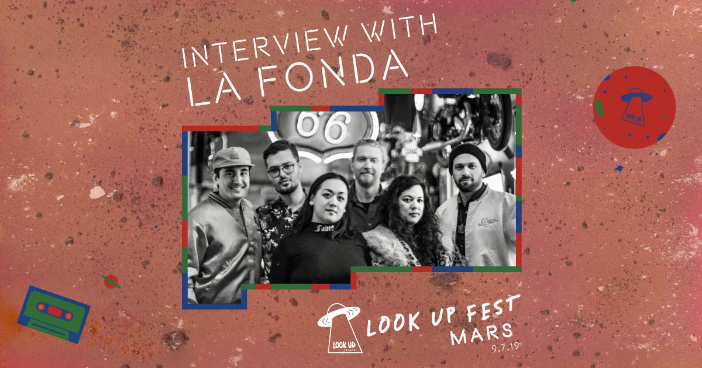

La Fonda transports listeners to a dreamy lyric-driven world of sound. Sisters Veronica and Valerie Topacio explore all things love, loss, and longing with their rich vocals and surf-pop guitars. I was fortunate enough to find out where they draw their inspiration from, and what they have in store for the Mars Look Up Festival.

***Time is such a wonderfully melodic song and really has some beautiful lyricism. What inspired the writing of the single?***

Time is one of the first songs we (Valerie and Veronica) ever wrote and it is truly the foundation of what brought us sisters & La Fonda together. We were living on opposite sides of the state (Valerie in Spokane and Veronica in Seattle) when the lyrics to the song were completed. During the process we both felt that we desperately needed music in our life, and we also felt like we needed each other but we weren’t sure what that meant and to what capacity. Writing this song guided us to our current path as shortly after it was written Valerie moved back to Seattle from Spokane and we both left long & toxic relationships and moved into a cool ass apartment in Belltown. Many songs were written in the living room of that apartment and our song “TIME” continues to remind us how truly blessed we are to have a platform to express ourselves through music and writing.

***What has been your favorite track to play for audiences off of Good Love?***

Seasons Change! It’s a fun and upbeat song about a lover that keeps coming in and out of your life but never wants to actually commit and then you ultimately decide that you’re not going to go back to that cycle. It’s about understanding your worth and turning a situation that could be sad one into a positive. Sort of like when another door closes… another one opens.

***Are you working on any new projects and what can we expect from your set at the Mars Look Up Festival?***

We just got done recording our debut album which is set to be released in early 2020. We will be playing some of these songs at Look Up Fest and we are excited for people to see a different and slightly darker side of us. We feel we have matured as a band during the recording process of this album and we are feeling positive about the work we put into it.  We can’t wait!!

<iframe src="https://open.spotify.com/embed/artist/3zP9upuX813FOJ4uxYLQZT" title="Spotify artist" height="352" loading="lazy" allow="autoplay; clipboard-write; encrypted-media; fullscreen; picture-in-picture"></iframe>

<figure><figcaption><strong>La Fonda</strong> — Catch La Fonda at Look Up Fest: Mars on 9/7!</figcaption></figure>

## Listen to other bands playing on Mars:

<iframe src="https://open.spotify.com/embed/playlist/1qFoOoG5BXuKqOFrHhQSnp" title="Spotify playlist" height="352" loading="lazy" allow="autoplay; clipboard-write; encrypted-media; fullscreen; picture-in-picture"></iframe>

