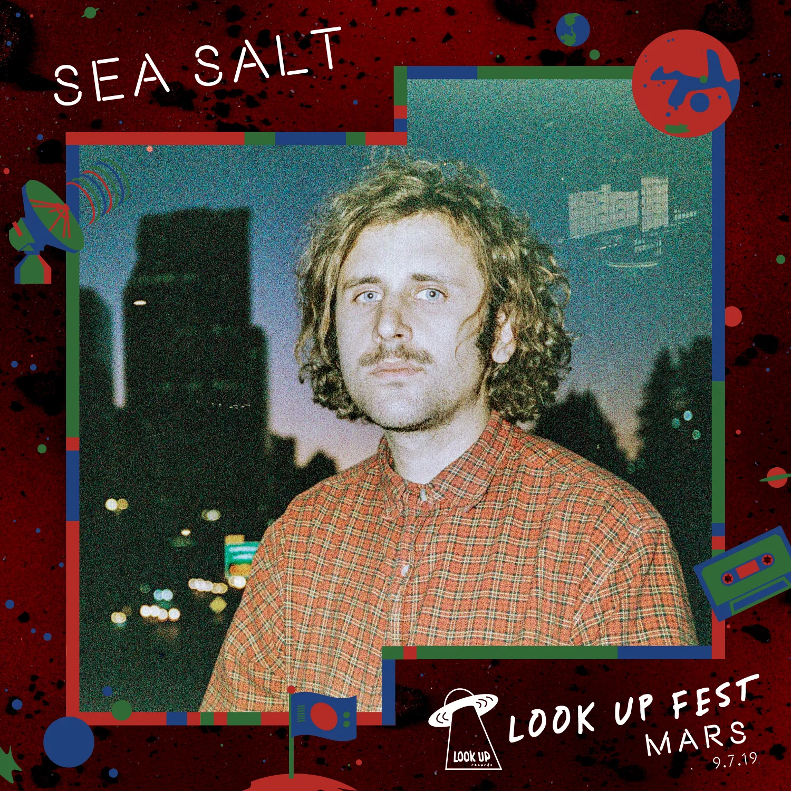

Sea Salt delivers smooth indie pop that glistens across the sound waves and puts a smile on the face of the audience. Kurt Roy began recording and mixing on his own after studying at Chicago Recording Company. I was able to find out more about the inspiration behind Kurt’s sound and what he has in store for the Mars Look Up Festival.

***Frames takes a small departure in sound from your two previous releases same and Songs You Can Sing Underwater. What inspired the redefinition of your sound?***

Great question! I released Songs You Can Sing Underwater and same in 2012, and 2015 respectively. I had a different approach to music back then. I really was making music with no direction or reason. I really didn’t spend much time on song structure or figuring out better ways to get my ideas across. I basically started writing a song and didn’t have any sort of reflection or self-editing habits. It was really a “one and done” type thing. With these new songs, I really wanted to dive into my influences and really try and hone in a different sound, because it seemed like a challenge for me. I wanted to be a better musician and really start thinking about my songwriting structure, my production style and the overall vibe of the songs. This naturally led to a different sound, which I’m really happy about :)

***Can listeners expect the same sound as Frames for your upcoming release Block It Out?***

Yeah! While every song is different and unique, the whole record has a very similar feel throughout. I’m keeping the chain (recording process, instruments, mixing engineer, mastering) as similar as possible in order to have one work of music. I’ve never tried to do something like that before and I’m really excited about it. I used to just write really random, different sounding songs, but for this release, I’m really focusing on it being one cohesive thing.

**What do you have planned for your set at the Mars Look Up Festival?**

We are going to be busting out some new songs off the album that we’ve never played before which I’m really stoked about! We’ll finally be cutting out some of the older stuff that I’ve mentally become tired of playing.

<iframe src="https://open.spotify.com/embed/artist/5AahDCyki46rJWc8EcxbwM" title="Spotify artist" height="352" loading="lazy" allow="autoplay; clipboard-write; encrypted-media; fullscreen; picture-in-picture"></iframe>

<figure><figcaption><strong>Sea Salt</strong> — Catch Sea Salt at Look Up Fest: Mars on 9/7!</figcaption></figure>

## Listen to other bands playing on Mars:

<iframe src="https://open.spotify.com/embed/playlist/1qFoOoG5BXuKqOFrHhQSnp" title="Spotify playlist" height="352" loading="lazy" allow="autoplay; clipboard-write; encrypted-media; fullscreen; picture-in-picture"></iframe>

