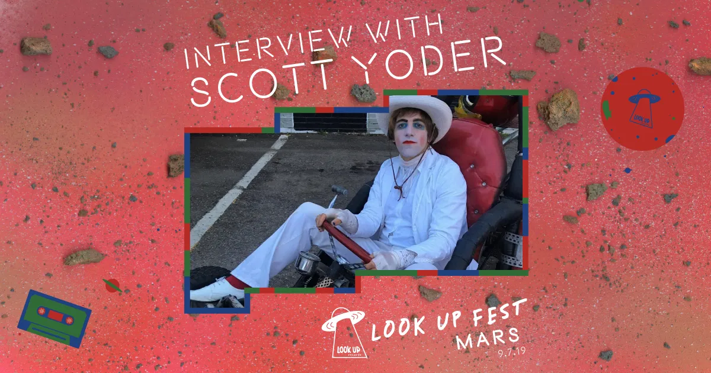

Scott Yoder has refined the art of glam rock. The crooning melodies with groovy distorted guitar brings elements of garage to the sultry sound. I had the privilege of finding out about Scott’s inspiration behind his sound and what he has in store for Mars Look Up Festival.

***Silver Screen Starlet has such a wonderfully timeless feel. What was your driving inspiration behind it?***

Oh this one came together real quick and natural. I think I wrote it in just an afternoon. There were a few extra embellishments to make it more about one particular actress. It’s also a bit of a companion to my other Hollywood themed single “How’s It Gonna End?”

***What has been your favorite track to perform for audiences?***

Gold In The Hills has always been ticking in the back of my head in one form or another and I’m super proud of what my band & I did to get it into touring shape. Always excited to play this. Especially at Look Up where we’ll have copies of the single available for the first time.

***Are you working on any new projects and what do you have in store for the Mars Look Up Festival?***

It’s smack dab in the middle of an 11 week tour so I’m really focused on the live show at the moment. We fly straight to Europe 36 hours after we’re on stage. Look out for one more single before this year’s end.

<iframe src="https://open.spotify.com/embed/artist/7IiH41ymNM437kLg3tUryC" title="Spotify artist" height="352" loading="lazy" allow="autoplay; clipboard-write; encrypted-media; fullscreen; picture-in-picture"></iframe>

<figure><figcaption><strong>Scott Yoder</strong> — Catch Scott Yoder headline Look Up Fest: Mars on 9/7!</figcaption></figure>

## Listen to other bands playing on Mars:

<iframe src="https://open.spotify.com/embed/playlist/1qFoOoG5BXuKqOFrHhQSnp" title="Spotify playlist" height="352" loading="lazy" allow="autoplay; clipboard-write; encrypted-media; fullscreen; picture-in-picture"></iframe>

