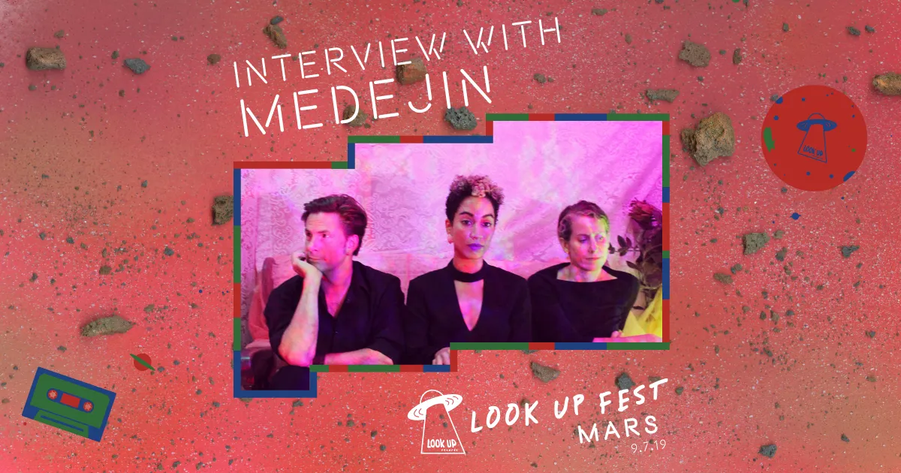
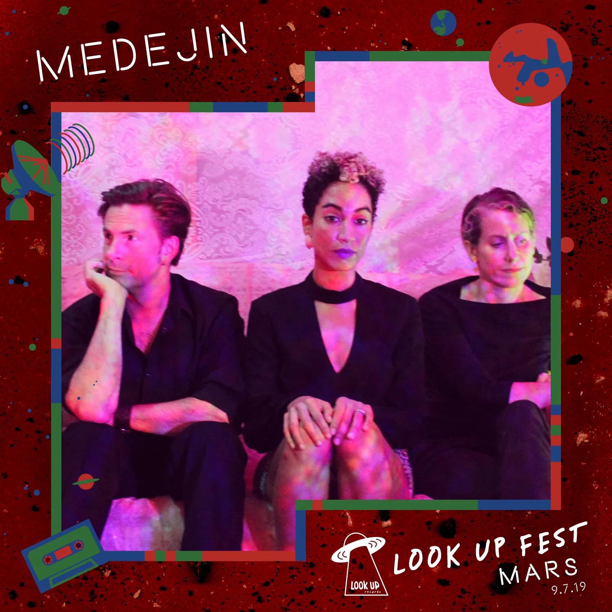

Medejin delivers hypnotic dream pop that dazzles the senses. Jenn Taranto put together a team of musicians that mix nostalgia and melancholy to create this stunning sound. I had the opportunity to ask more about the inspiration behind their latest project Eleni, and what the band has in store for us at the Mars Look Up Festival.

***Eleni delivers such wonderful emotions through sound. What was the driving inspiration behind writing it?***

Thank you! The songs were written over about a two year time span. Untitled 4 and July were the first songs I wrote, Not Around was the second to last and Oneiroi was the final. My life at the time of writing the last two was much different compared to what was happening around Untitled 4 and July. I always can access the feeling of loss and that often runs through a lot of the songs. Though the end of "Eleni" dealt with the feelings and what was happening as I was losing my mom. My band is wonderfully sensitive and made up of all water signs and I'm a taurus, haha and that inspires the kind of music we create, too.

***Have you had a favorite track to perform off that project for audiences?***

Hmm, it depends on the mood I'm in and how the audience is feeling too. I always love singing harmonies with Matthew and because "Oneiroi" is a bit more stripped down, they get to come out more and I love that.

***What can your fans expect from your set at the Mars Look Up Fest?***

We're super jazzed to debut a new song, "Our Apartment." That's what I'm calling it for now.

<iframe src="https://open.spotify.com/embed/artist/2POYq65ujfjrWbrRqr9Ciw" title="Spotify artist" height="352" loading="lazy" allow="autoplay; clipboard-write; encrypted-media; fullscreen; picture-in-picture"></iframe>

<figure><figcaption><strong>Medejin</strong> — Catch Medejin at Look Up Fest: Mars on 9/7!</figcaption></figure>

## Listen to other bands playing on Mars:

<iframe src="https://open.spotify.com/embed/playlist/1qFoOoG5BXuKqOFrHhQSnp" title="Spotify playlist" height="352" loading="lazy" allow="autoplay; clipboard-write; encrypted-media; fullscreen; picture-in-picture"></iframe>

