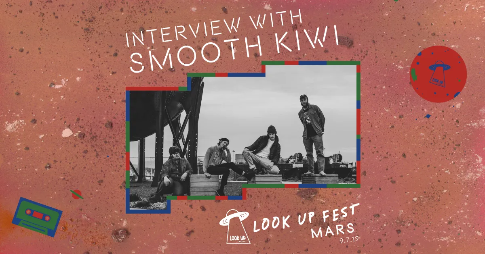

Smooth Kiwi provides a unique minimal shoegazey experience. Their psychedelic infused guitar riffs are addictive to listen to. I had the pleasure of interviewing them about their inspiration and what they have in store for the Mars Look Up Fest.

***Your sound is pretty unique and has a depth of emotions to it. Where do you find your inspiration to write that way?***

We find our strongest inspiration from listening to the music that touches our souls! It's the most profound experience. Listening to incredible music makes us want to write. What we end up writing about is very in the moment and will depend on our day-to-day mood and surroundings.

***Do you have a favorite track to play for audiences?***

We really enjoy the entire journey of our set. We often transition one song to the next via somewhat improvised jams, so it's fun for us to play our composed and well rehearsed songs intertwined with free and spontaneous moments. One of our favorite songs to play is called Those Words, which has an improvised section written into a 15/8 groove in the second half. It's pretty cool to see an audience sway and groove to an odd meter like that!

***What can the audience look forward to from your set at the Mars Look Up Fest?***

Our set at Mars Look Up Fest will feature some of the new material we've been working on. This will be our Seattle debut, so the audience might not know it, but we'll be bringing fresh energy and excitement with the new tracks! We're really looking forward to playing and sharing the stage with all of the awesome bands!

<iframe src="https://open.spotify.com/embed/playlist/1qFoOoG5BXuKqOFrHhQSnp" title="Spotify playlist" height="352" loading="lazy" allow="autoplay; clipboard-write; encrypted-media; fullscreen; picture-in-picture"></iframe>

<figure><figcaption>Smooth Kiwi Catch Smooth Kiwi at Look Up Fest: Mars on 9/7!</figcaption></figure>

## Listen to other bands playing on Mars:

<iframe src="https://open.spotify.com/embed/playlist/1qFoOoG5BXuKqOFrHhQSnp" title="Spotify playlist" height="352" loading="lazy" allow="autoplay; clipboard-write; encrypted-media; fullscreen; picture-in-picture"></iframe>

