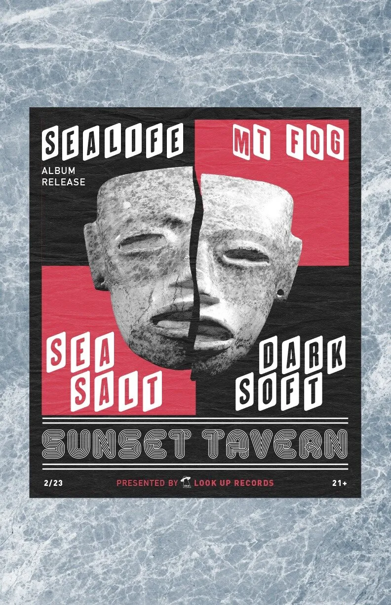

Tickets are now on sale for our winter showcase! We’re holding it at **The Sunset** on 2/23. Really excited about this lineup… We’ve got a Sealife album release and more sounds from the Sound.

## [RSVP](https://www.facebook.com/events/435538463995900/) - [BUY TICKETS](https://www.ticketweb.com/event/sealife-darksoft-sea-salt-youth-sunset-tavern-tickets/10276305)

[Sealife](https://www.facebook.com/sseeaalliiffee/) (album release)  
Sealife, a project led by Brennan Mooring (Peyote Ugly), brings a love-coated psychedelic synth pop from Seattle straight to your heart. Sealife's sophomore album, Tan Camel, is more bluesier than the sands of time.  
[https://www.look-up-records.com/sealife](https://l.facebook.com/l.php?u=https%3A%2F%2Fwww.look-up-records.com%2Fsealife%3Ffbclid%3DIwAR11QixR1ltlvKnugIIYX5xNBE7DUexRt1kS8tPoIB0ikMf3UL93I6NiyNM&h=AT33D8E8aWmOEHaZmccEFh7uMQSRVmZb8DZ8gt-K9OXFPqaLfLmObcMzYcyWKMtNLcokxL2FVhcQ2bCdSvy97cARL8KqpMCF3vyFuTpSFDV4hu0lWqIFlW1IMxByVcPh_zPG1gA)  
  
[Darksoft](https://www.facebook.com/DARKS0FT/) (SEA)  
Darksoft, a Seattle-based project led by singer-songwriter Bill Darksoft, plays dreamy alternative rock as a three-piece band. With guitar driven hooks, crystalline vocal melodies, and powerful songwriting, Darksoft will haunt your very digital mainframe.  
[https://www.darksoft.band/](https://l.facebook.com/l.php?u=https%3A%2F%2Fwww.darksoft.band%2F%3Ffbclid%3DIwAR1zL43XpZ-BpX8o6qd2ab99T_iaVey1jwutvbpWHihP98gV_fAwBomgA6Q&h=AT2yj7B4BO4_E6ODx_ADGlCzPWVRtE5RvQXghw20yL-OulfVEiXB1x0n0eqXKovjcmFwORkmy4zsKZfba8h7_AGYnATGr6Bayvyi-zkPPFYpFmgWqf1zrESooa1_c9NpVGkw8RU)  
  
[Sea Salt](https://www.facebook.com/seasaltmusic/) (SEA)  
Sea Salt is an indie pop band founded by Kurt Roy. Kurt's first debut album ”Block It Out”, draws heavy influence from bands like Wild Nothing, Beach Fossils and No Vacation.  
[https://seasalt.bandcamp.com/](https://seasalt.bandcamp.com/?fbclid=IwAR0gY4P8avwfJNOZMi8MKiEWWZcFqIlSPRUeInI5f2MYiwJRdLgN4wiZBZg)  
  
[Mt. Fog](https://www.instagram.com/mt.fog/)

Mt. Fog is the experimental electronic forest pop project by Carolyn B.

https://mtfog.bandcamp.com/releases  
  
2/23 8PM Sunset Tavern  
21+ $10
