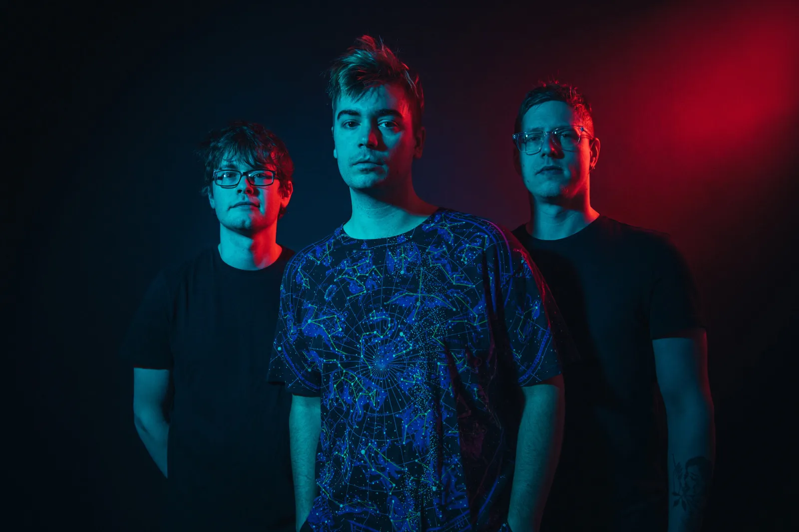

### Darksoft 2020 West Coast Tour - CANCELED

Would have been cool! Now it’s all canceled. Stay safe.

3/27 - Seattle, WA - Central Saloon

3/28 - Portland, OR - The Firkin Tavern

3/29 - San Francisco, CA - The Knockout

3/30 - Los Angeles, CA - TBA

3/31 - Santa Ana, CA - FTG Warehouse

4/1 - Indio, CA - Little Street Studios

4/2 - Phoenix, AZ - Lunchbox

4/3- Albuquerque - Gold House

4/4 - Denver, CO - TBA

4/5 - Salt Lake City, UT - Twilite Lounge

4/6 - Boise, ID - Regal Beaver

4/7 - Spokane, WA - Baby Bar

Announcing more dates soon...
