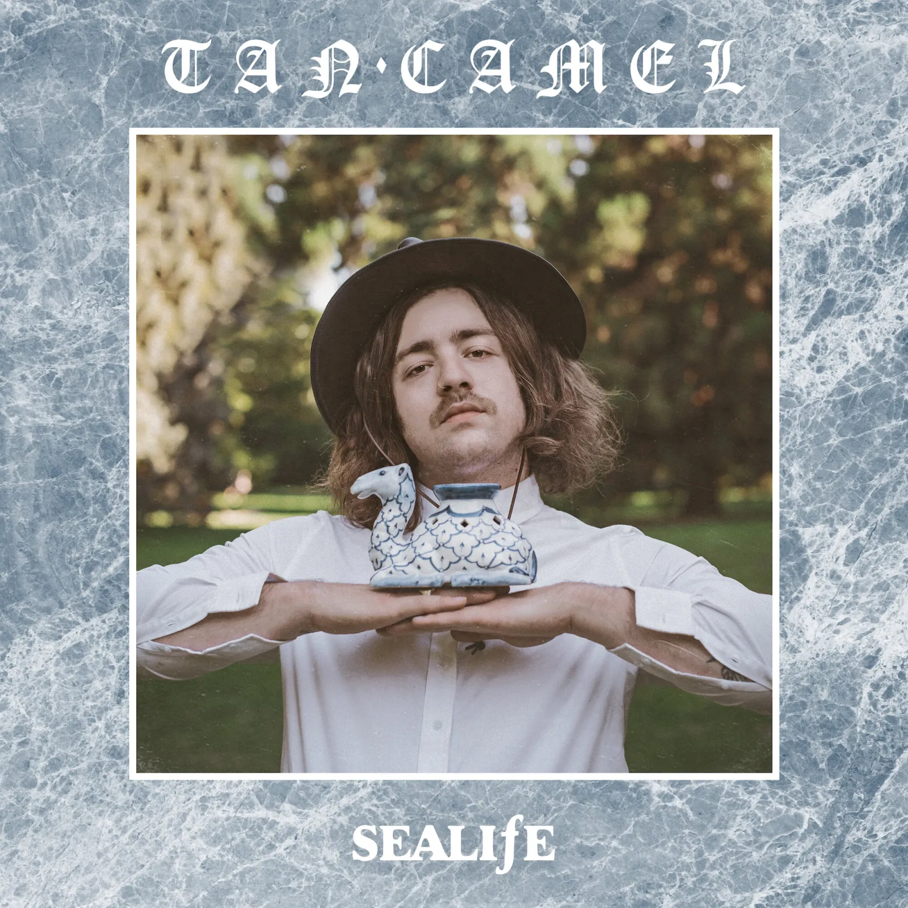

Sealife graces our ears with the sophomore release Tan Camel this February, and the mix of mesmerizing melodies and lyrical poeticism is here to dance in our ears all spring.

With 13 tracks this album is packed full of sunshine coated synth pop on the verge of blues and funk. The cascading swinging melodies and tumultuous bass put the rhythm behind all the emotions packed into this project.

This album takes a deeper dive into the world of psych synth pop since the freshman project A Paler Shade of White. Several songs in this project, including Aux Blood and Starboard Hotel, pull at the psyche and relax the soul, while others explore the journey that Brennan Moring has created with Sealife is irresistible and ecstatic inducing.

Sealife is a psych induced dream pop experience that continues ringing in your ears for days. Don’t miss this release of smooth lyrical genius.

## LISTEN TO THE ALBUM: SPOTIFY / APPLE MUSIC

*Available on all other streaming platforms*
