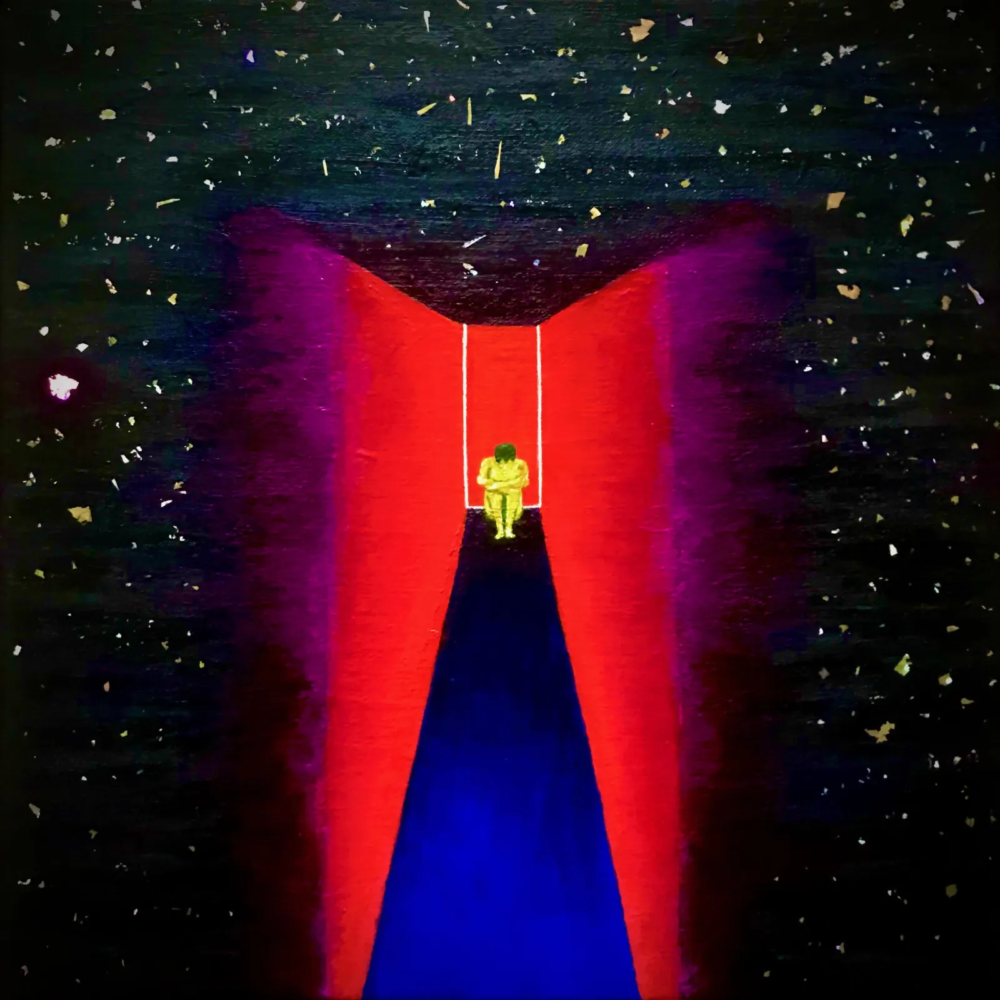

Look Up Records artist Banadu and poet/composer Timothy Arliss O’Brien team up for “8100 Polls,” a spoken word jam from the age of quarantine. Timothy is a prolific Look Up Records blogger and we are super honored to release his work more intimately through the label.

<a class="button" href="https://open.spotify.com/track/29Ypou3rgv3uJ5cylCZVPP?si=PzTjeQ9USdqUu6M3Ag3QIA">LISTEN ON SPOITFY</a>

## Credits

Poem by Timothy Arliss O’Brien

Produced & Mixed by Banadu

Mastered by Mathew Halliday

Artwork by Nicholas Yandell

## 8100 Polls

by Timothy Arliss O’Brien

Stuck.

Indoors .

Inside.

Stuck.

Locked in a cocoon.

They’ve taken eighty-one hundred polls from the people.

Near and wide.

But we are still out of control.

A census gone rogue.

Lost in space like our ancestors, and forefathers before them.

We are full,

Filled to the brim,

With a need for adventure,

A need for sole victories.

A symphony without song,

A song without music.

8100: the angels number,

Of connecting,

Of relationship

But we are quarantined alone, together.

You can find us searching the cosmos,

Looking for answers,

Looking for purpose,

Looking for ourselves,

Looking for a melody.
