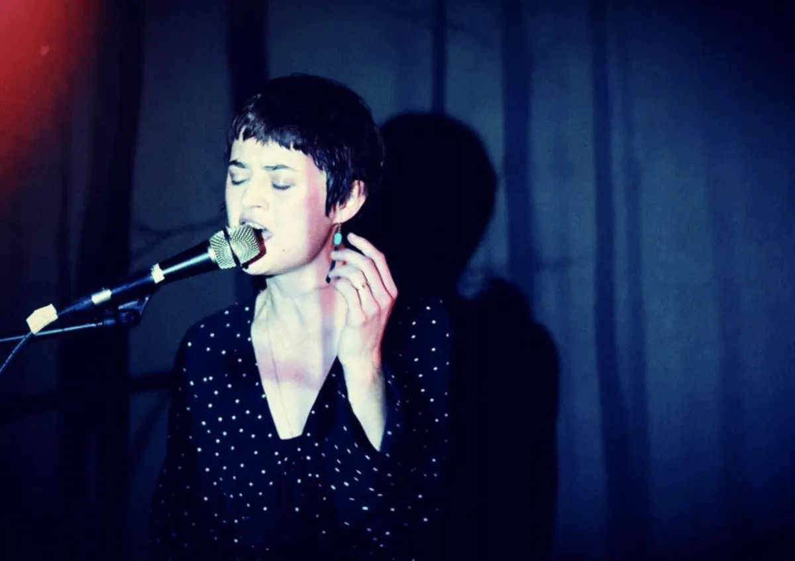
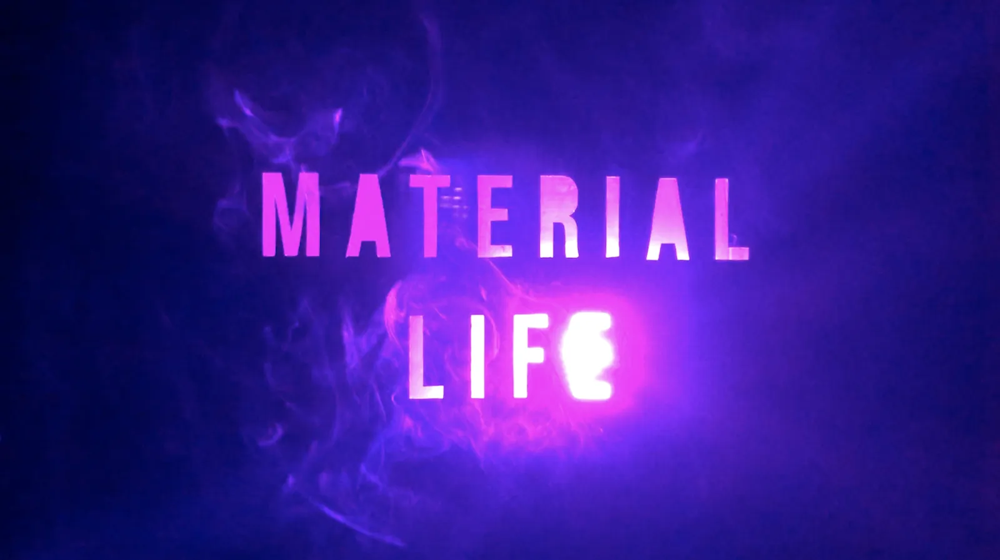

<figure><figcaption>Artwork by Collin Snider, DreamboatVISTA</figcaption></figure>

**Mt Fog** and **Banadu** collab on their new single, **Material Life**. Featuring an impressive vocal delivery by Seattle sing-songwriter Mt Fog, supported by warm 80s synths, and reverberating drums by Banadu. ⁣In Material Life, Mt Fog and Banadu channel a medieval ghost haunting a mall. This track was mastered by **Resonant Mastering** in Seattle. Artwork by Collin Snider of **DreamboatVISTA**.

### R.I.Y.L: Cocteau Twins, Kate Bush, M83, Craft Spells

* * *

<a class="button" href="https://open.spotify.com/album/2Y4znhFpRL9g96QgqZHWFY?si=7O5lwG9zRN2j42QyDOpmrw">SPOTIFY</a>

APPLE MUSIC

<a class="button" href="https://banadu.bandcamp.com/track/material-life">$ SUPPORT ARTISTS ON BANDCAMP $</a> <a class="button" href="https://soundcloud.com/banadu/material-life-mt-fog">SOUNDCLOUD</a>

**Lyrics**

I saw her by the fountain

A medieval vision

Material life, and not in my head

From another plane

Material life, a medieval vision

From another plane

Repeating pattern of the mall around me

It surrounds me

But I feel a presence

Of someone that doesn't belong

Your somber face in the ferns

Material life, and not in my head

A medieval vision

Material world, a daydreamer vision

I can't look away, no

Facing the fountain

Vines grow around you

They surround you

Softly ascending on

Reflections of the past

Your face in the mirror

The ghost follows

The ghost follows

But do you know me?

Material life and not in my eyes

A medieval vision

Are we alone?

A daydreamer vision

I can't look away, yah

The ghost follows

* * *

<figure><figcaption>New artist: Mt Fog debut single with Look Up Records!</figcaption></figure>

<figure></figure>
