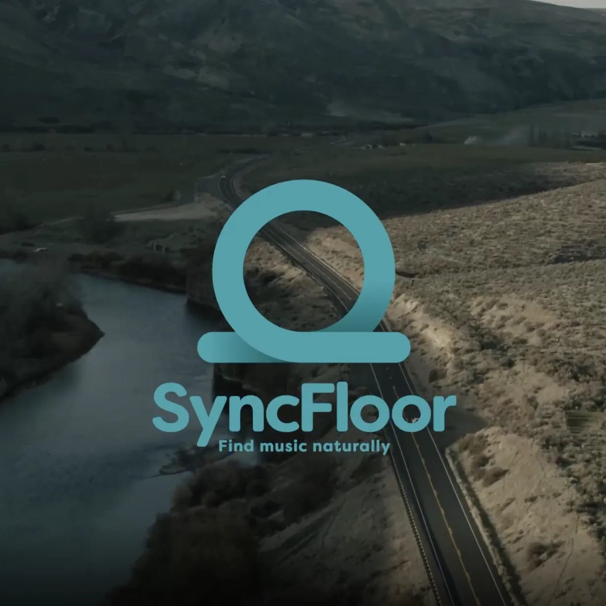
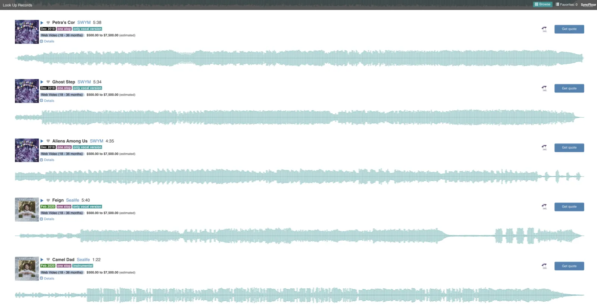
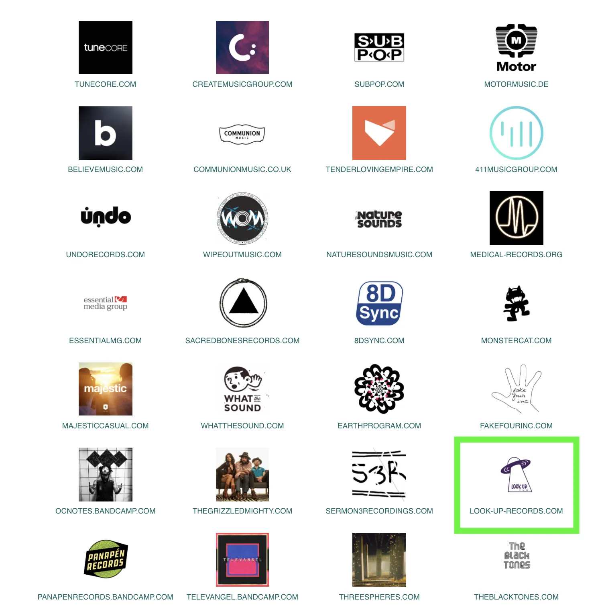
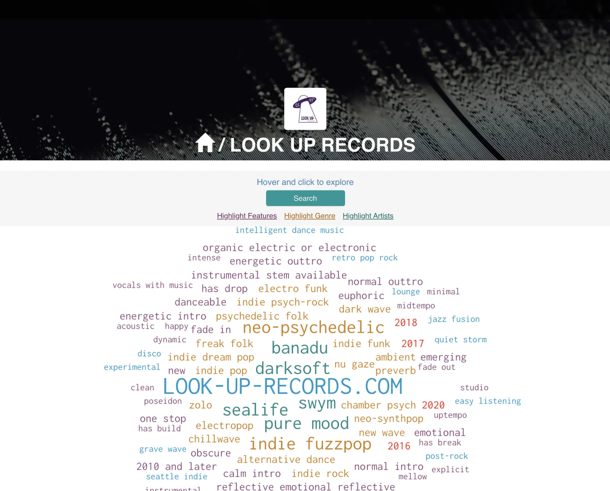

Excited to announce that we've partnered with Seattle-based [**SyncFloor**](https://www.syncfloor.com/) for sync licensing! After years of development, they've unveiled their curated marketplace where music supervisors can search for and license quality tunes for placement in film, TV, ads, games, or podcasts. Look Up Records artists are now in their catalog! [Check out our SyncFloor page here](https://syncfloor.com/CatalogDomainPage/look-up-records.com).

<a class="button" href="https://syncfloor.com/CatalogDomainPage/look-up-records.com">Visit Our SyncFloor Page</a>

We’re excited about SyncFloor because it has the potential to disrupt the way music licensing is typically handled, making it more self-service and democratic. This could open indie labels and artists up to placement in more projects.

Congratulations on the release, SyncFloor crew. Thank you especially to SyncFloor CEO Kirt Debique and Senior Music Analyst Benjamin Verdoes for partnering with us and bringing more exposure to Look Up artists.

Here we come, Netflix 📽️
