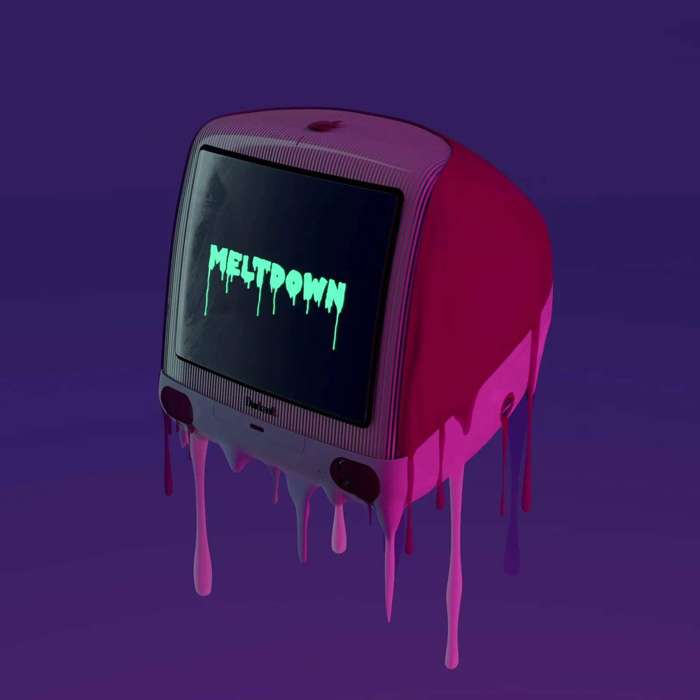
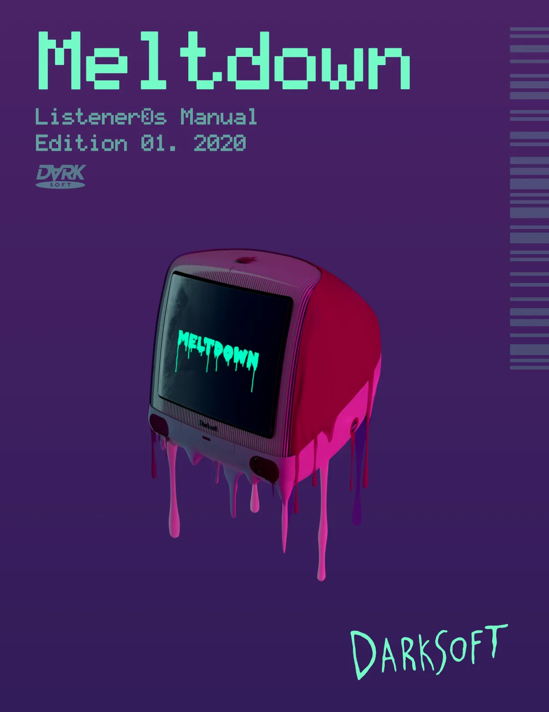
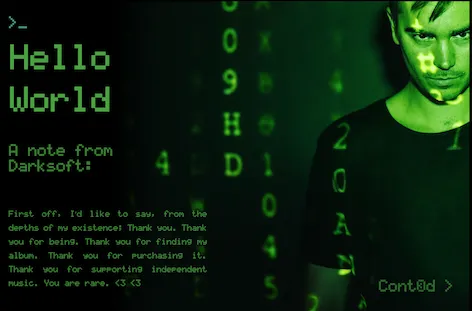
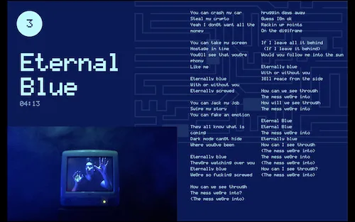
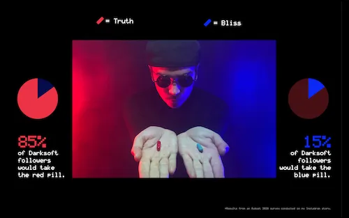

Pre-order is NOW AVAILABLE for the **Darksoft** sophomore album, **Meltdown**, out Oct 2. Get highest-quality audio, plus bonus cyber material crafted by Darksoft.

<a class="button" href="https://darks0ft.bandcamp.com/album/meltdown">PRE-ORDER MELTDOWN</a>

<figure><figcaption><a href="https://darks0ft.bandcamp.com/album/meltdown">Meltdown Pre-Order now available on Bandcamp!!</a> Out Oct 2.</figcaption></figure>

Meltdown Pre-Orders get 2 tracks now (streaming via the free Bandcamp app and also available as a high-quality download in MP3, FLAC and more), plus the complete album the moment it’s released.  
  
BONUS CONTENT:  
🎶 1 secret bonus song that will NEVER be streamable  
📖 PDF booklet welcoming investors to the Darksoft Multiverse, with all song lyrics  
🌟🌟 ALL previously released music. So, you get my full album Brain (2018) as well.  
🖥️ 3 screensavers designed by Darksoft  
📼 3 full-length music videos  
🥰 That feeling of goodness from undermining corporate Spotify trolls.  
🎧 Highest quality audio quality. 100% lossless

*Exclusive* Darksoft cyber thoughts ONLY in the pre-order

***Exclusive* Darksoft cyber thoughts ONLY in the pre-order:**

## ABOUT

### "Lyrics inspired by computer viruses, beautiful melodies, outstanding guitar work, and stunning vocals" - [Eclectic Music Lover Blog](https://eclecticmusiclover.com/2019/02/15/darksoft-ep-review-brain/)

*Originating out of the tech-driven mist of the Emerald City, a city in constant limbo between digital futurism and watery introspection, Darksoft naturally materializes as a half cyber-auteur, half lo-fi indie poet; a sensitive mastermind poised to haunt your digital and emotional mainframes.*

*Lush with infectious melodic progressions, 90’s rock undertones, and a deftly executed vocals, Darksoft embraces the aesthetic of alternative pop-rock anthems. As a kid who grew up with a software company in his basement (in a house surrounded by evergreens) while grunge ruled the streets, Darksoft reveals his roots in this in-between. Meltdown is 90s sadcore communicated through the language of computer viruses, algorithms, and human emotion pure enough to pass the Turing Test.*

*Following the release of his debut album Brain in late 2018, Darksoft’s sophomore album Meltdown is set to publish in fall 2020. While Meltdown stands as a sequel to and continuation of Brain, crafting the record was not without challenges. “Producing a sophomore album is a mind f\*\*k” says Darksoft. “You want to retain the original vibe but take it in new directions. For all my songs, I use nearly the identical process. I write and record a song in a 48 hour period. If I can’t get it done, I don’t end up using it. I tried to continue in the sound established in the first album. But, naturally, deviations are nearly impossible to avoid.”*

*Of note, Meltdown contains what might be the first-ever song written fully by the subconscious. “While asleep and dreaming, I will hear songs I wish I had written,” tells Darksoft. “When I wake, I realize that they were actually unique, but they fade away. “Jelly” was the first song I was able to successfully remember upon waking. I wrote it out in bed and recorded it all on the same day.” Darksoft himself played and recorded the entire record, apart from a guest cello appearance from his mother on the song “Dark Mode.” The record was mixed and mastered by Mathieu Riede at L453RL4Dy.*

*Thematically, the records are of a pair. Brain refers to the first-ever computer virus that went loose on floppy disks in 1986. Every song on Brain is named after an infamous computer virus or vulnerability that followed. “I read up as much as I can on the purported backstories, the readme.txt files, screenshots of ransom notes, and old news coverage” explains Darksoft. “I immerse myself in all that as inspiration and write the songs in that language.”*

*Meltdown, named after the infamous hardware vulnerability discovered in 2018, follows in that ilk. While Darksoft hadn’t planned for a literal societal meltdown when he named the album in 2019, looking back it feels a bit like foreshadowing. The world is literally in meltdown. “We are living in an unprecedented age. Digital occultism is pervasive. Massive groups are shepherded to the new trend of the day.” says Darksoft. “In 2020, reality has completely liquified. What will replace it is uncertain. The binary divide we live in is a thorn that is unsustainable. At the same time, I believe there is a lot of positive change happening now. People are really revisiting what matters to them and exorcising what doesn’t.”*

*Darksoft, though Meltdown, is striving to further that transmutation. “The binary of black = bad / white = good is not helpful,” he explains. “There are never just two sides. We contain multitudes. When technology is used irresponsibly, it seems to make it all worse. Funny how all devices offer dark mode now too...”*

*Darksoft is currently based out of Georgetown, Seattle with a studio at the Old Rainier Brewery. He studied creative writing at the University of Washington and has played with a few Seattle acts over the years. In his downtime, he likes to look up at the sky and watch planes fly into Boeing Field behind his house.*

*​*

*- Ever Kipp, Tiny Human*
