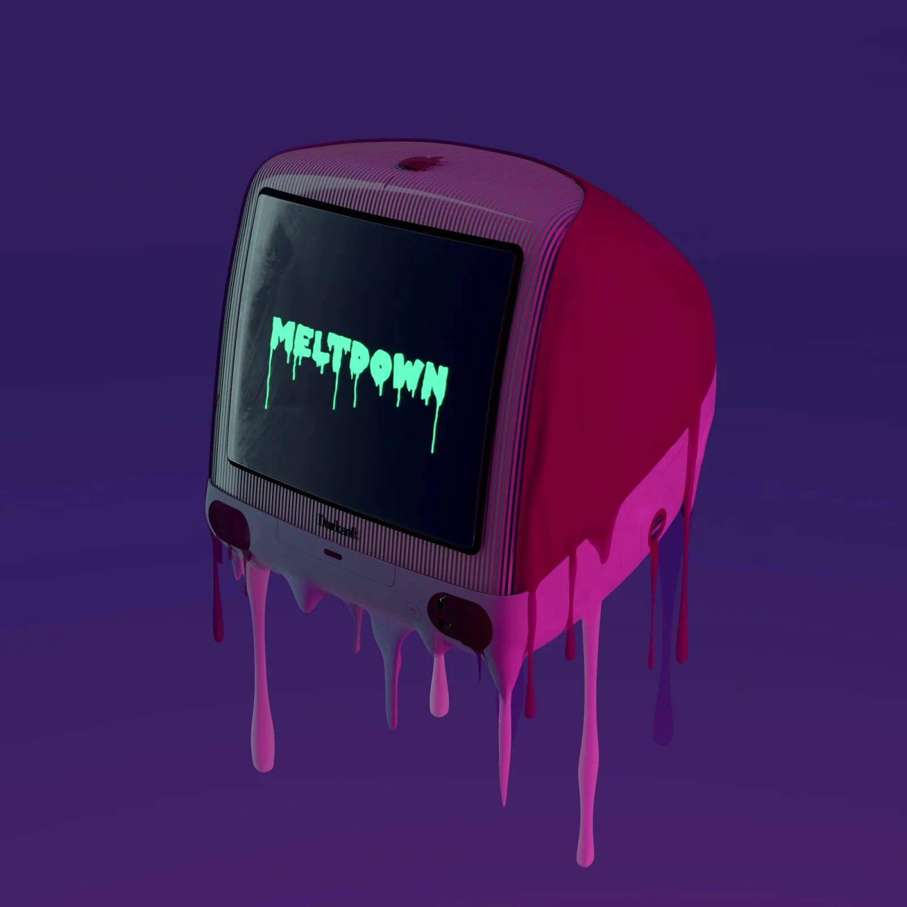

In Foreshadow, Darksoft crashes on an alien world and finds his way to the Darksoft Multiverse. Storyboarded by Darksoft, Foreshadow was Directed and Produced by Collin Snider, DreamboatVISTA, and filmed in Eastern Washington and at The Rendezvous in Seattle.

<iframe src="https://www.youtube-nocookie.com/embed/pTzoGJ6mlvs" title="YouTube video" loading="lazy" allow="accelerometer; encrypted-media; gyroscope; picture-in-picture; web-share" referrerpolicy="strict-origin-when-cross-origin" allowfullscreen></iframe>

[V13 blog debuted Foreshadow on 9/12](https://v13.net/2020/09/darksoft-previews-his-meltdown-album-with-the-foreshadow-music-video-premiere/). “He openly embraces the aesthetic of alternative pop-rock, influenced by the grunge and alternative rock he grew up on,” said Christopher Gonda, writing for V13. “Over the years, he has become a staple of the Seattle music scene, thanks to his futuristic take on alternative rock that finds inspiration in the hidden motives that wind up influencing modern society, love, and communication. “

*“In the ‘Foreshadow’ music video, Darksoft crashes on an alien planet and finds his way to the multiverse with his tricorder. I see it as part two from the one preceding video for my song ‘Wanna Cry.’ After I write and record a new song, I like going for walks and listening to my stuff and getting all introspective (laughs). This reminds me of that but just way more expansive.*

*Wait until two-thirds of the way through the video for a surprise… ‘I contain multitudes,’ said Whitman. I agree. We maintain many personas. Especially during social distancing, we sort of hang out with multiple versions of ourselves more often… might as well try to get to know them, right?*

*The video is pretty DIY. I storyboarded the video storyline, and Collin Snider, aka DreamBoatVISTA filmed, directed, and produced it. We filmed in Easter Washington and at The Rendezvous in Seattle. Ironically, we didn’t film in fire season, although it may look that way with the filtering.*

*The ‘Foreshadow’ lyrics ‘bait the shadow’ is a reference to shadow work. Essentially, examining the darker parts of yourself to create positive change. ‘Foreshadow’ is also foreshadowing of Darksoft’s sophomore Meltdown, out 10/2.*

*- Darksoft*

<figure><figcaption><strong>Pre-Order ‘Meltdown’</strong> — Cyber download Darksoft’s sophomore album for special surprises <a href="https://darks0ft.bandcamp.com/album/meltdown">Pre-Order Album on Bandcamp</a></figcaption></figure>

### Listen to Foreshadow:

<a class="button" href="https://open.spotify.com/album/7nodVcuzdRYKYDii59vBpJ?si=2BvQzxZORaqCveViHsWC5w">SPOTIFY</a>

