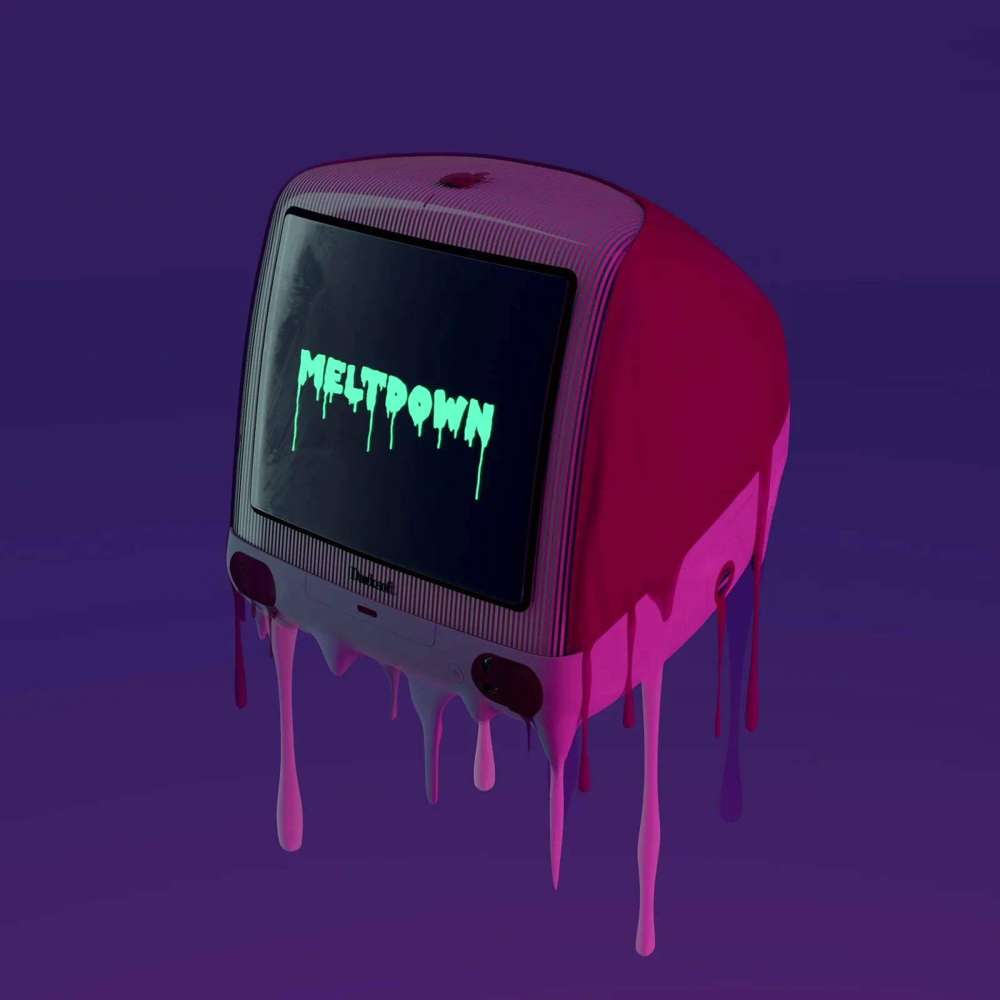
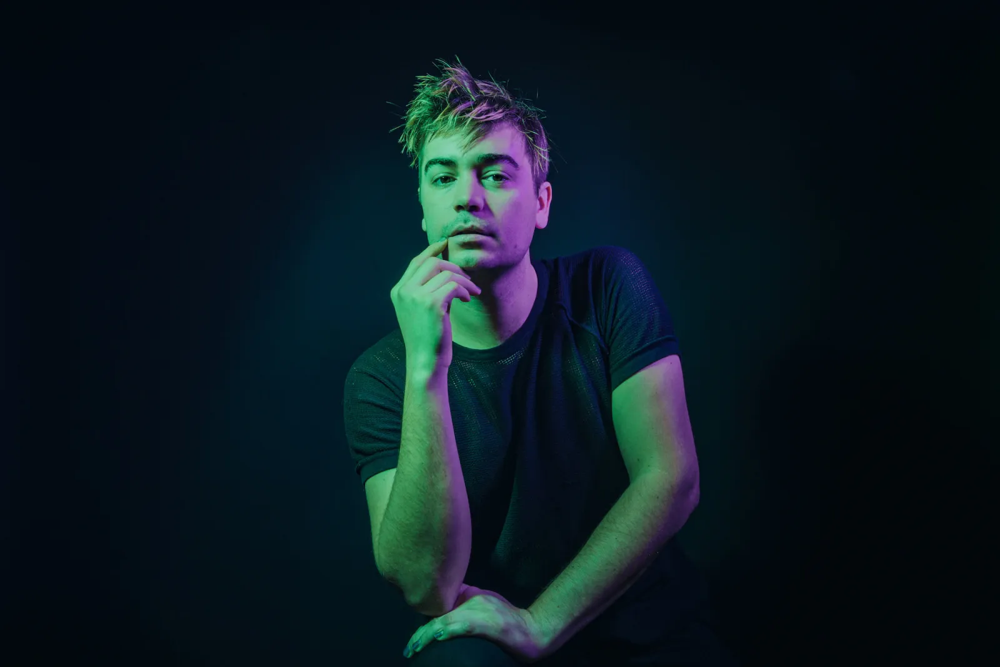

**Darksoft** follows up his 2018 album “Brain” with the 2020 sophomore album “**Meltdown**” just in time for a drizzly dark fall. Gifting us these crystalline sounds from the emerald city, **Darksoft** doubles down on his tech-driven language, smooth dreamy synths, and sad guitar riffs with sounds of longing.

Combining his first three singles released over the course of 2019, “**Wannacry**”, “**Eternal Blue**”, and “**Cybersecurity**”, **Darksoft** adds seven new tracks and one bonus track only available through [digital download](https://darks0ft.bandcamp.com/album/meltdown) to bring Meltdown to forty-five glorious minutes of whiny guitars and luscious vocals. “**Foreshadow**” was released as a single in September leading up to the October second release date and is accompanied by an amazing music video that involves a crash landing, a dystopian landscape, and a show-stopping guitar performance. Directed by **DreamboatVISTA**, the music is described as part two in the Darksoft Shadow Quest saga following the part one release of the “Wannacry” music video last December.

Fusing together traditional indie rock vibes in “**White Rose**”, “**Bad Rabbit**”, and “**Lights Out**” with the digital futuristic synthetic grooves in “**Dark Mode**”, “**Gh0st**”, and the opening track “**Jelly**”, Darksoft downloads his emotional mainframe right into our auditory technology and leaves a one of a kind interstellar experience.

Be sure to check out **Meltdown** streaming on all platforms October 2nd 2020, and be sure to support Darksoft by obtaining a [digital download](https://darks0ft.bandcamp.com/album/meltdown) so you can experience the magic of the bonus track “**Summer of ‘05**”.

### Listen to Meltdown:

<a class="button" href="https://darks0ft.bandcamp.com/album/meltdown">Bandcamp</a> <a class="button" href="https://open.spotify.com/artist/5pD33SUgX5GQ8NvqZ6IdeE?si=SaXXWhggQg6XULHRdsQX6g">Spotify</a> <a class="button" href="https://www.youtube.com/channel/UCYGODf2pvnV88yuoNnDFWfw">YouTube</a> <a class="button" href="https://music.apple.com/us/artist/darksoft/1438263529">Apple Music</a>

### Music Videos

<iframe src="https://www.youtube-nocookie.com/embed/pTzoGJ6mlvs" title="YouTube video" loading="lazy" allow="accelerometer; encrypted-media; gyroscope; picture-in-picture; web-share" referrerpolicy="strict-origin-when-cross-origin" allowfullscreen></iframe>

<iframe src="https://www.youtube-nocookie.com/embed/LiEdi0L9kRA" title="YouTube video" loading="lazy" allow="accelerometer; encrypted-media; gyroscope; picture-in-picture; web-share" referrerpolicy="strict-origin-when-cross-origin" allowfullscreen></iframe>

