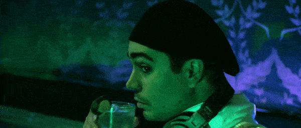

*Timothy O’Brien interviews Darksoft on the latest album “Meltdown” and visual direction*

Darksoft’s sophomore release “Meltdown” combines futuristic synth grooves with dreamy shoegaze guitar riffs. Darksoft has taken the pandemic forced quarantine as a challenge to hone his sound and provide an album that infuses these dark turbulent times with relatable lyrics and memorable melodies. I had the opportunity to ask more about the inspiration behind this new album and how his sound has changed since the last album.

**Meltdown is packed full of phenomenal lyrics, melodies, and explosive instrumentals. What did you learn about how your sound was evolving since your 2018 release of "Brain"?**

*I usually just try to write music that I myself would want to listen to. I liked how Brain turned out, but I wanted a more lush sound in Meltdown, one that emphasized synths and other instrumentals a bit more.*

*I wanted to expand the sound, and I think that is evident in Dark Mode, for which I arranged a string quartet to accompany the standard 3-piece band set up. That one is dear to me because I recorded my mom playing the parts on cello.*

**You really expanded your aesthetic into a visual component in working with DreamboatVISTA on The Darksoft Shadow Quest saga. What inspired you to share your sound journey with the music video saga?**

*The way I see it, visuals are just as important as the sonic element. Textures and visual concepts build new worlds and expand things beyond the songs. I also love storytelling and inviting others to enter alternate realities. If you keep developing a concept, you can leave Easter eggs too...*

*For example, in Foreshadow, we cloned Darksoft so there can now be parallel, intertwined narratives with these other characters. This summer, I worked with Kyle Tolero to film a short backstory for the hacker-looking Darksoft in the hood. It's being edited by DreamboatVISTA and will be a music video for Bad Rabbit, released sometime after the album is out.*

<iframe src="https://www.youtube-nocookie.com/embed/pTzoGJ6mlvs" title="YouTube video" loading="lazy" allow="accelerometer; encrypted-media; gyroscope; picture-in-picture; web-share" referrerpolicy="strict-origin-when-cross-origin" allowfullscreen></iframe>

**It was enthralling to experience the singles being released between the albums. Do you have a favorite single from this album that just always gets stuck in your head?**

*Thank you! I didn't want to give away too much before Meltdown. But, since it was a couple of years between album releases, I wanted to share how my sound was progressing. If I had to choose a favorite of these, I would select Eternal Blue.*

**The album has a bonus track that is only available with digital download, "Summer of '05". What inspired this track and really set it apart from this album?**

*Summer of '05 is a joke. It's dedicated to my live band. Specifically, the bassist Jesse Cohen, who made fun of a chord progression I was playing while jamming at practice. He sang, "it was the summer of '05" over it in this terrible LFO-sounding delivery. I thought it was hilarious and decided to develop it into a song.*

*Summer of '05 is all about a bittersweet nostalgia for simpler times, full of cultural references and things I did back then. Driving down I5 with friends, summer sunshine, beat boxing' round a fire, listening to Eminem, Gorillaz, watching American Pie or Twilight.*

*For this one, I went all-in on the mid-2000s alt-rock delivery. Listen to this song if you want to remember the person you were when you had Wheatus, Sublime, No Doubt, or Smash Mouth on repeat. If you don't, stay away from it.*

*I personally scratched that vinyl sound FX, and used my friend's vinyl album for it (Sorry for fucking up your album, Hibou). It turns out vinyl scratching is pretty difficult! This was the first time I had tried it.*

*Thematically, Summer of '05 exists on its own. It has absolutely nothing to do with hackers, the worry of the modern age, sadness, societal division, etc... It's just really dumb. Yet honest too. It might be my favorite work. Regardless, I didn't really want it in the "Darksoft canon" but wanted to share it as a bonus with listeners who might understand where I'm coming from.*

### Listen to Meltdown:

<a class="button" href="https://darks0ft.bandcamp.com/album/meltdown">Bandcamp</a> <a class="button" href="https://open.spotify.com/artist/5pD33SUgX5GQ8NvqZ6IdeE?si=SaXXWhggQg6XULHRdsQX6g">Spotify</a> <a class="button" href="https://www.youtube.com/channel/UCYGODf2pvnV88yuoNnDFWfw">YouTube</a> <a class="button" href="https://music.apple.com/us/artist/darksoft/1438263529">Apple Music</a>

<iframe src="https://www.youtube-nocookie.com/embed/LiEdi0L9kRA" title="YouTube video" loading="lazy" allow="accelerometer; encrypted-media; gyroscope; picture-in-picture; web-share" referrerpolicy="strict-origin-when-cross-origin" allowfullscreen></iframe>

