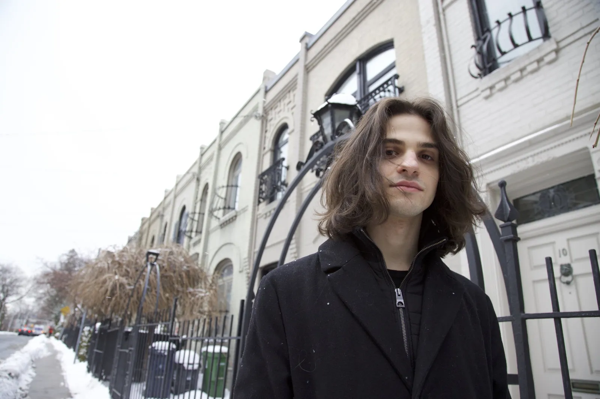

Abandoned mills, running away forever, and Aliens bringing us back to Earth. In this post, we ask Joe from Elephants and Dogs five questions to see what it's **all** about.

<a class="button" href="/elephants-and-dogs">Listen to Elephants and Dogs</a>

**What does "Elephants and Dogs" stand for?**

EAD a mnemonic for memorizing the strings on the guitar. Elephants And Dogs Grow Big Ears (EADGBe). This EP has been a kind of "back-to-basics" project for me, so I felt it was fitting to name it after the first step in learning guitar. As a musician and in my main band JIMBO, I always gravitate towards writing longer, more complicated songs that I wrestle with for a couple of months before showing to my bandmates, recording them, or playing them live. Though that style of songwriting will always be a part of who I am, it became apparent to me that it sometimes took the fun out of everything, and I'd get too tangled in my thoughts. With the three songs on this EP, most of the parts and lyrics you hear were written on the spot in the studio. I hope listeners see these songs as just fun little slices of sound. On these tracks, I just combined all my favorite things about the music I love. I am a big fan of whispery vocals from artists like Tame Impala and early Pink Floyd. At the same time, I love short, catchy bedroom pop tunes. I also love artists like Mac Demarco and Courtney Barnett, and I feel like their influence can be heard on these songs as well.

**What do you see when you turn out the lights?**

I rarely turn out the lights completely. I always fall asleep watching something. Even at 23, I can't handle the dark. Maybe more now than ever.

**Do you realize we're floating in space?**

I do, and I think I think about it too much. In a weird way, it makes me feel apathetic and also motivated. We're so small that nothing matters, but if nothing matters… you might as well chase your dreams. But that's not always the case, right? We still have responsibilities and such. For me at least, it puts things in perspective, and it motivates me to make music that I know my friends will like. When I see my friends enjoying my music, It makes me happy and takes my mind off the fact we are floating in space.

**Is there any significance behind where the music video was shot for the upcoming single "You Won't Be Seeing me around"?**

The video was shot by a river close to where I live in the suburbs, north of Toronto. When I was younger, there used to be an abandoned mill there called "Hayhoe Mill". I remember a couple times when my two closest friends and I would walk through this huge graffitied abandoned building. You could go onto the roof and sit on top of the tallest silo and get a great view of the area. Looking back on it, it was probably dangerous. I remember the building being very dilapidated and the roof sinking in in some spots on the silo we sat on. I grew up with very strict parents, so I would have to keep the exploring a secret. I was barely allowed to ride my bike to the end of the street!

It's really funny now that the mill is gone, and the area looks different. I honestly wonder if it ever existed in the first place. The song is about running away forever and I feel like I visit that little spot by the river when I need a little opportunity to run away. It made sense for me to film the video there.

**Do you believe in aliens?**

I do, but I feel like my friends always laugh at me for it. I don't have any cool UFO stories to back up my beliefs. I think one day they'll come back, and we'll have a lot of explaining to do. I think they'll likely question us on why we choose to live the way we do. I think as a species, we've lost sight of who we are and why we are here. I think meeting aliens would bring us back down to earth. ;)

<iframe src="https://www.youtube-nocookie.com/embed/Qcjc_4v9H_g" title="YouTube embed" loading="lazy" allow="accelerometer; encrypted-media; gyroscope; picture-in-picture; web-share" referrerpolicy="strict-origin-when-cross-origin" allowfullscreen></iframe>

Watch the music video for ‘You Won’t Be Seeing Me Around” here

<iframe src="https://www.youtube-nocookie.com/embed/kfsCTMlKSQA" title="YouTube embed" loading="lazy" allow="accelerometer; encrypted-media; gyroscope; picture-in-picture; web-share" referrerpolicy="strict-origin-when-cross-origin" allowfullscreen></iframe>

Listen to the full EP here
