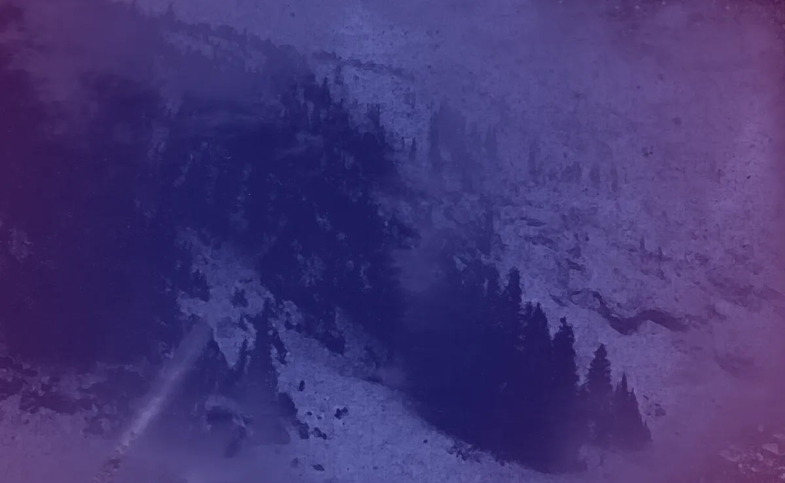
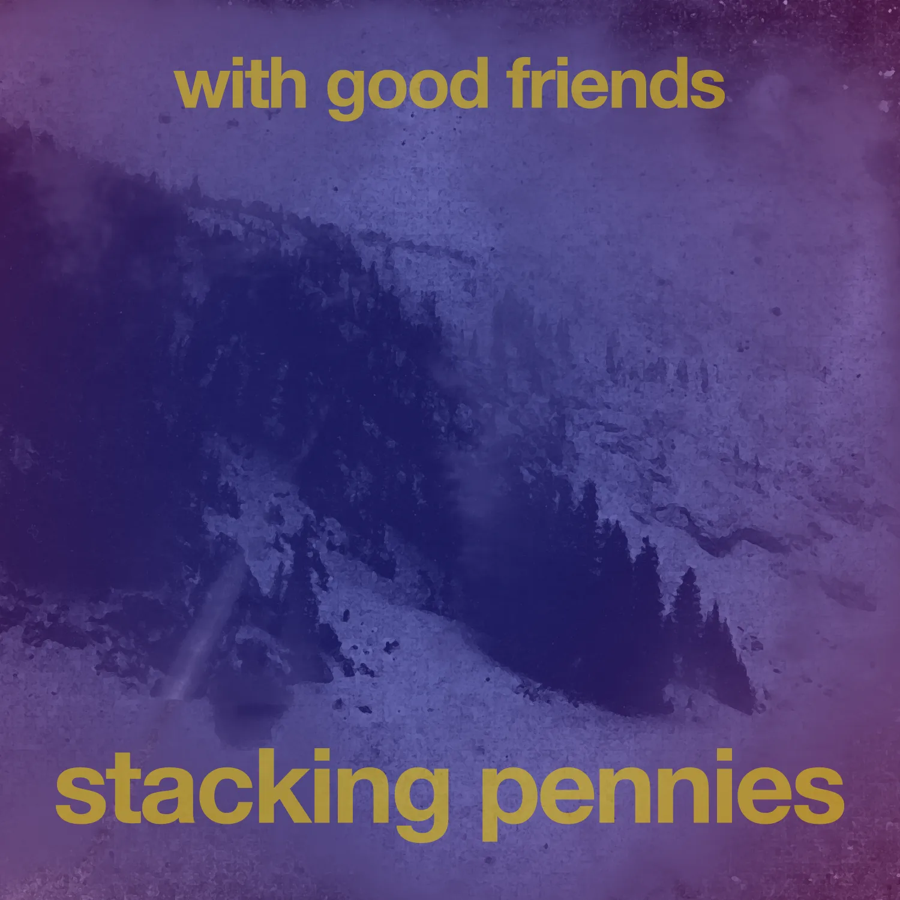
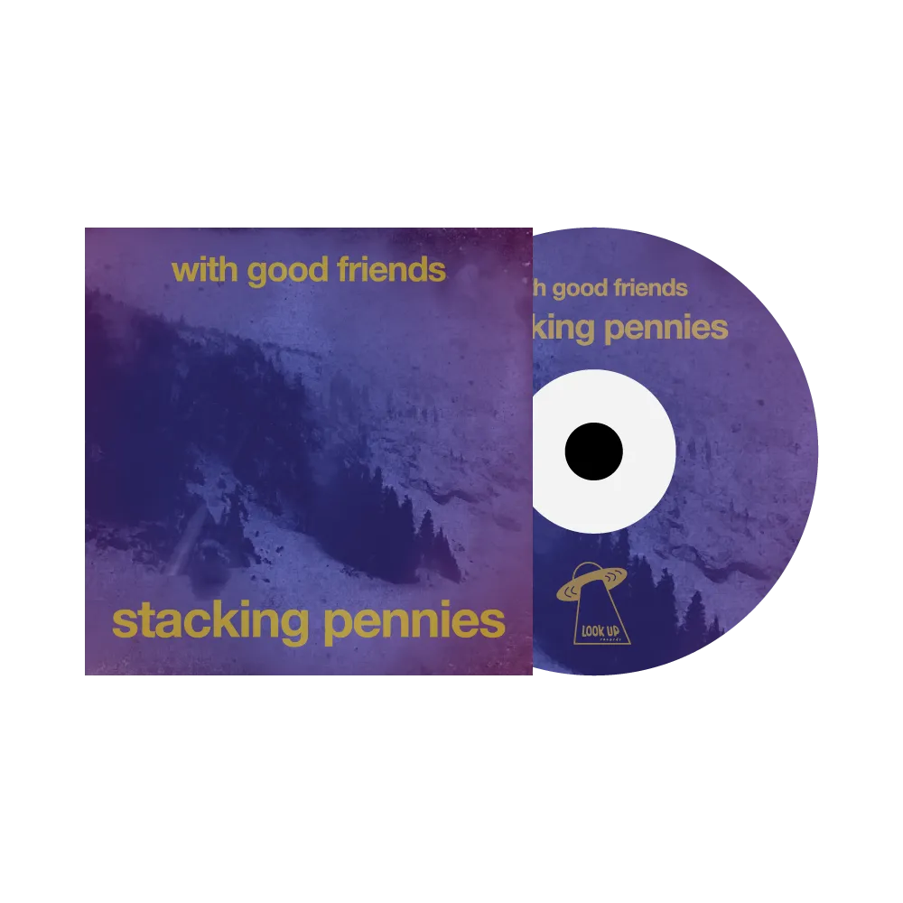
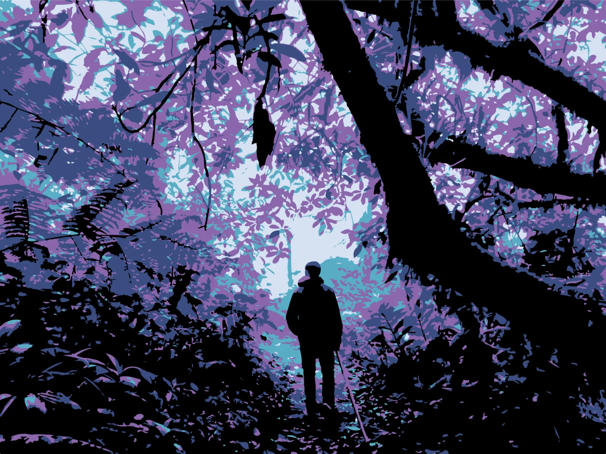

<figure></figure>

Look Up Records released the [stacking pennies](/stacking-pennies) album ‘with good friends,’ on May 7, 2021. The album is a beautiful slowgaze sound that feels like stargazing in the cold breeze. Listen to it on [Bandcamp](https://stackingpennies.bandcamp.com/album/with-good-friends), where you can buy a digital download or limited edition CD.

It’s also on [Spotify](https://open.spotify.com/album/6jUJbMmVMzeWXUH1th8mQv), [Apple Music](https://music.apple.com/us/album/with-good-friends/1558316912), and all other music streaming services.

### About ‘with good friends’

stacking pennies is an anonymous collaboration between quarantined friends, new and old. Springboarding off a lo-fi shoegaze sound, stacking pennies venture into uncharted waters with jazz tonal interpretations, washed-out effects, and a proggy attention to detail. Presented by Look Up Records, stacking pennies' sophomore album "with good friends" feels like a cold breeze under a golden moon.

Stacking pennies' first record, "wild resolve," was self-released in November of 2020, drawing heavily from strong melodic ideas and an early, lo-fi shoegaze timbre. It's the result of lost loved ones, a severe bout with COVID-19, romance, and good old-fashioned fun. The second release, "with good friends," is a collaboration of known and unknown friends and artists.

The sound is experimental but relatable, featuring solid melodies, melting effects, heavy guitars, and spacious lyrical content. "The album really acted as a soapbox to let out whatever everyone needed or wanted to say without judgment or bias," said stacking pennies. Listeners of artists like Slowdive, Mogwai, Bill Evans, Daughters, Gabriel era Genesis, Boris, Weather Report, Pissed Jeans, The Smiths, or Sleep, should find a fondness in stacking pennies. "I think the number one draw to an artist is sincerity. If they sound like no one else, that's what I'm after."

You can see stacking pennies performing in the Denver area and beyond in the not-so-distant future. When stacking pennies isn't making music, they're skateboarding, fly-fishing, playing chess, cranking on motorcycles, listening, and learning. "I love camping and experiencing all things outdoors. There's a big world out there to explore."

<figure><figcaption>Limited edition CD available on <a href="https://stackingpennies.bandcamp.com/album/with-good-friends">Bandcamp</a>!</figcaption></figure>

*\* stacking pennies prefers to be styled as 'stacking pennies,' in lowercase.*

*\* stacking pennies is not on social media. Feel free to tag Look Up if you share it around*

<iframe src="https://www.youtube-nocookie.com/embed/FGJVmEbblKo" title="YouTube embed" loading="lazy" allow="accelerometer; encrypted-media; gyroscope; picture-in-picture; web-share" referrerpolicy="strict-origin-when-cross-origin" allowfullscreen></iframe>

<figure><figcaption>stacking pennies Slowgazy ‘with good friends’ released May 7, 2021.</figcaption></figure>

<iframe src="https://www.youtube-nocookie.com/embed/CGClJVlrBX8" title="YouTube embed" loading="lazy" allow="accelerometer; encrypted-media; gyroscope; picture-in-picture; web-share" referrerpolicy="strict-origin-when-cross-origin" allowfullscreen></iframe>

