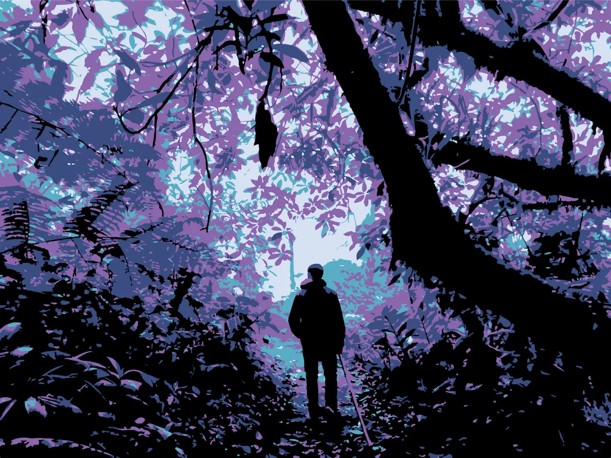

*Joel H shares a track-by-track impression of the latest stacking pennies album, with good friends*

So when I discovered this band and pondered their name, a lot of thoughts came to mind. I recalled the old Happy Days episode where coins were stacked, elbow up, and the motion is made to catch them all in the palm of your hand without dropping a single one. How high can you stack it up and still clutch the motherload without fail? I pondered the value of a penny when I was a child and the contrast between its worth then (a piece of gum on your way out of Kmart) and now — the power play of Penny stocks during the push of virtual financial exchange. Now my thought of these two little words has changed. A stack of pennies appears larger in my mind than it ever has. I define the action as a mammoth task with more heft & stature than my previous memories surmised.

Stacking pennies is an anonymous & artful effort full of possibilities, enabling the listener to name its true worth based on how high you'd like to build it up. Inside the anonymity of this band lies a comradery if you choose to invest the time to enjoy the gifts inside its being. For a fan, it's worth the time & a more than apt venture into an empathetic force that brews forceful creativity with a payout beyond its description. The mystery behind its band membership is a genius move, whether intentional or not. It is a safer & smarter bet to remain an invisible force and exempt from the cancel culture we all acknowledge and fear. "with good friends" is a pure and beautiful effort exempt from pointed criticism. If you like the music and genre, I would suggest that you dig in…If it's not your cup of tea, get outta the way so we can occupy the entire space it created for us.

## 1. revelation

The beginning of the end or the inception of enlightened thought: revelation fills up the water bottles and encourages you to stretch before we start hiking up the mountain. It's a dense and layered tune that makes us aware there will be no shortcuts during this journey. A dream-like picture is painted for us right off the bat. There will be a lot of introspection along the way but rest assured that this party of Donner's will all get out alive. Now we have our map.

## 2. find your way back

(Not a Jefferson Starship cover)

Olive branches are handed out right away with this song. Ups and downs are perfectly timed with proper vocal intonation that deals out a full hand of melancholy Aces. It seems a breakthrough moment occurs in this instance. Things will improve but may have to worsen repeatedly to mark some middle ground, and such is life. It is time to check in and connect.

## 3. pretender

The one valid exemption from criticism in our lives is when another tries to tell us how to feel, think, and act. This is not allowed unless we enable it. In life, we are only limited by the chains we shackle ourselves with. Sounds easy, right? But this idea can be complex when we seek acknowledgment and reinforcement. When moments are good and conversations are healthy — inject yourself into them — if not, extract and expend your energy elsewhere. What a liberating idea to further kindness and stifle negativity. It's is often easier to turn the page and spare the cheek.

## 4. stars in the cold breeze

The gloves come off for seven minutes and forty-three seconds. A muffled carnival Wurlitzer sonnet is instantly carpeting the walls of your ears and mind as a breezy cloud of meditative notes takes over its space. Stacking pennies sets a course for us to head into choppy waters inside a boat entirely constructed of mirrors, forged in rust. It's time to ask ourselves a lot of questions. Grab a paddle, use one end to dig into the water, and aquatically direct your path — the other end is meant to scratch your head and wonder how you got here… and what is the definition of here. A boatload of honest questions are hurled into your mind, and you can't stop the heft of water rushing in until you honestly ponder and discard. Stay wary of suspicious beings with ill intent and protect your legitimate ongoing need to hope. In the end, you are granted a reprieve, and the revelation that it's a crapshoot is designed to drive you mad until you choose enlightenment. Earn the right to rest. Do not lose focus in life. "Call it what it is a bloodbath clown circus."

## 5. vertigo

This song could and most likely does mean a lot of different things. Vertigo and feeling as if we are spinning out of control is a ton of fun when we are young. Growing older can make us yearn for childhood feelings that had no consequences back then. These days when the spiral starts, it can be time to grab a rail and hang on. The guitars are searing on this track, and a rollercoaster inflection mimics life's ups and downs perfectly while forming a pondering touchpoint and resonating in the idea of longing. It is a dizzying effect, and the payoff is notable.

## 6. the warm sun on your smiling face

You are now allowed oxygen, and like a which way book, it's time to choose your own adventure. No words, just contemplative musical freedom to fill in the blanks as words and thoughts braid their way into your mind, now do with it all, what you will. There's a shore and a perfectly placed anchor — dropped as the title challenges you to follow its instructions and reap your reward.

## In conclusion

It would be a haughty and arrogant notion to speak on a band's behalf regarding its intentions. To think that the meaning of all this remotely resembles the effect it had on me or any other listener. The beauty of art, and especially music, is that it can transcend itself. The anonymity effect- on full display. We can take what is given, so what will we do with it. This album hit me as an exercise in heightened therapeutic house cleaning. Calling it an introspective tale of do's and don'ts would not give it the due credit it deserves. Unpack your brain and lay it all out to examine. Best done, "with good friends."

<iframe src="https://www.youtube-nocookie.com/embed/CGClJVlrBX8" title="YouTube embed" loading="lazy" allow="accelerometer; encrypted-media; gyroscope; picture-in-picture; web-share" referrerpolicy="strict-origin-when-cross-origin" allowfullscreen></iframe>

### Listen to with good friends:

<a class="button" href="https://stackingpennies.bandcamp.com/album/with-good-friends">Bandcamp</a> <a class="button" href="https://open.spotify.com/album/6jUJbMmVMzeWXUH1th8mQv">Spotify</a> <a class="button" href="https://music.apple.com/us/album/with-good-friends/6766298148">Apple Music</a>

