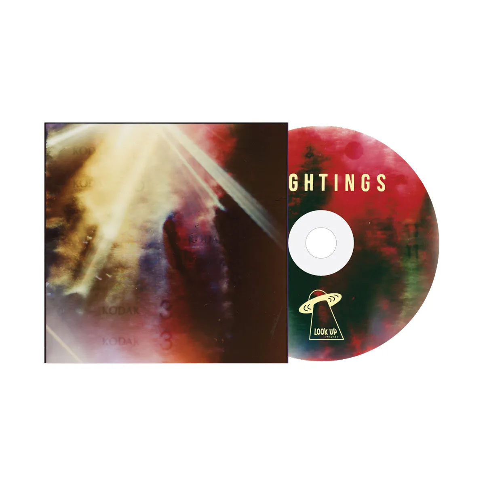
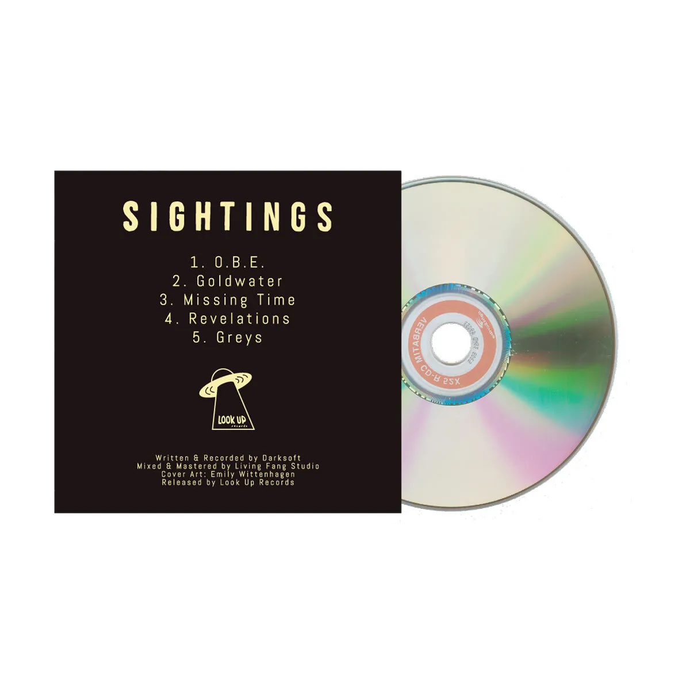
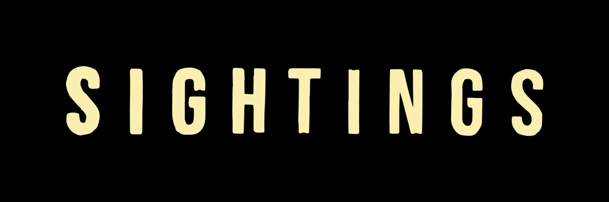

<a class="button" href="/sightings">Sightings artist page</a>

This World UFO Day, Look Up Records presents a brand new project — [Sightings](/sightings). Sightings' lush instrumental tunes combine freeform jazz and dream pop — good background music for scanning the sky for lights.

Sightings’ debut self-titled 5-song EP delivers 15 minutes of warm themes. This slow-wave brings in surfy guitars, zoned-out beats, all overlaid with smooth jazz tones that feel abducted from some mall of the ‘90s.

### Listen

[Spotify](https://open.spotify.com/album/5zjLHlEGpfsMOLODDKoIP2?dl_branch=1&si=5Fj0z_-gQHmXN5Fdk5hCUQ) | [Apple Music](https://music.apple.com/us/artist/sightings/1572499902) | [Bandcamp](https://sightingsmusic.bandcamp.com/album/sightings) | [YouTube](https://www.youtube.com/watch?v=uBUzflBSI8k) | [Soundcloud](https://soundcloud.com/lookuprecords/sets/sightings)

You can listen to the Sightings EP on all major streaming sites. And check out the trippy vid Ryan Brum (@[brumondrum](https://www.instagram.com/brumondrum/)) made for the song ‘Goldwater’ below:

<iframe src="https://www.youtube-nocookie.com/embed/uBUzflBSI8k" title="YouTube embed" loading="lazy" allow="accelerometer; encrypted-media; gyroscope; picture-in-picture; web-share" referrerpolicy="strict-origin-when-cross-origin" allowfullscreen></iframe>

### [Purchase The Sightings EP](https://sightingsmusic.bandcamp.com/album/sightings)

Grab a limited edition Sightings CD on [Bandcamp](https://sightingsmusic.bandcamp.com/album/sightings). Printed by Atomic Disc, it’s made with 100% recyclable materials. Comes wrapped in a crystal clear eco-bag and shipped with a Sightings + Look Up sticker.

Bandcamp purchases also include unlimited streaming of Sightings via the free Bandcamp app, plus high-quality download in MP3, FLAC, and more.

<figure></figure>

<figure></figure>

## About Sightings

The Sightings EP was inspired by a larger batch of demos recorded in the Summer of 2016 throughout a weeklong haze of alone late-night early AM studio recordings. This mini-album was then rediscovered and recut by Darksoft in the Spring of 2021. It was mixed and mastered by Living Fang Audio (stacking pennies), who offered an amazing helping hand.

<figure><figcaption><strong>Sightings</strong> — Look Up Records released Sightings debut EP on July 2, 2021, World UFO Day.</figcaption></figure>
