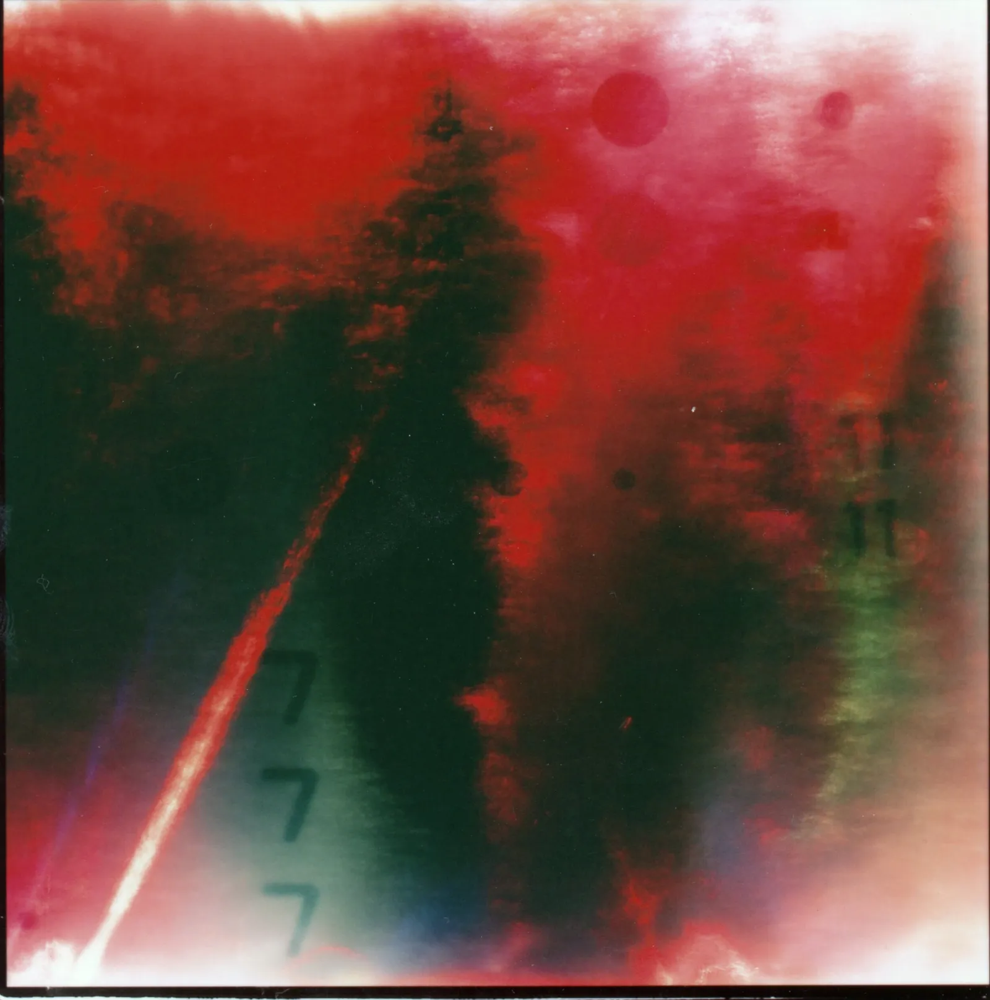
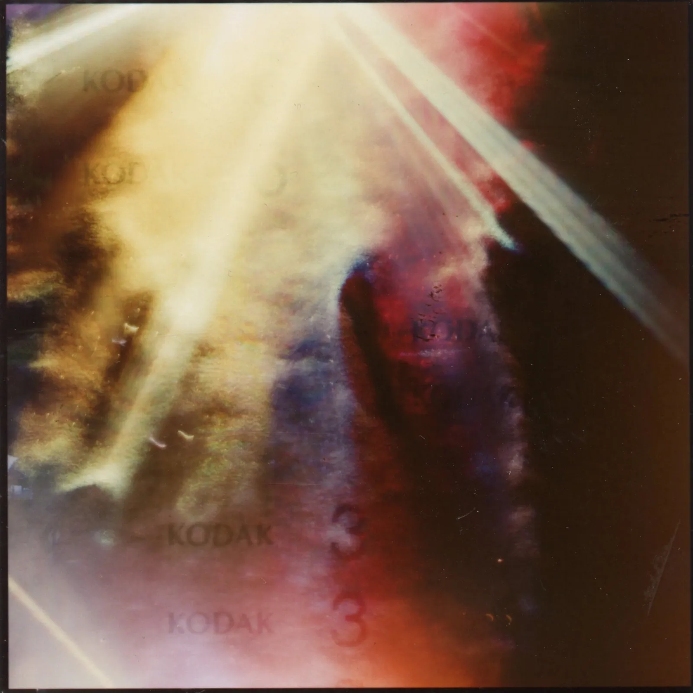
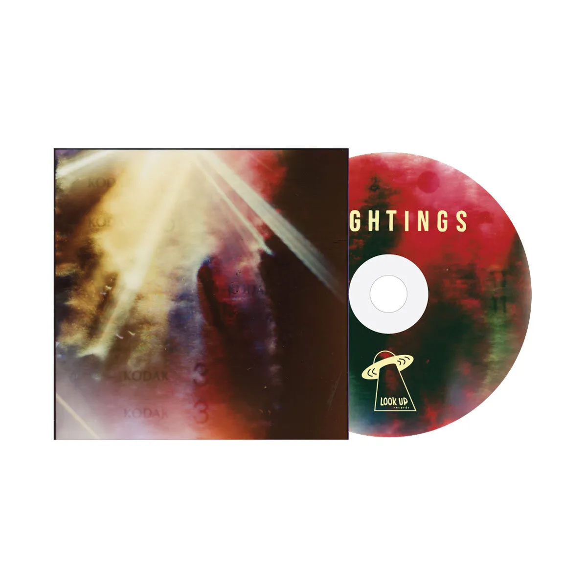
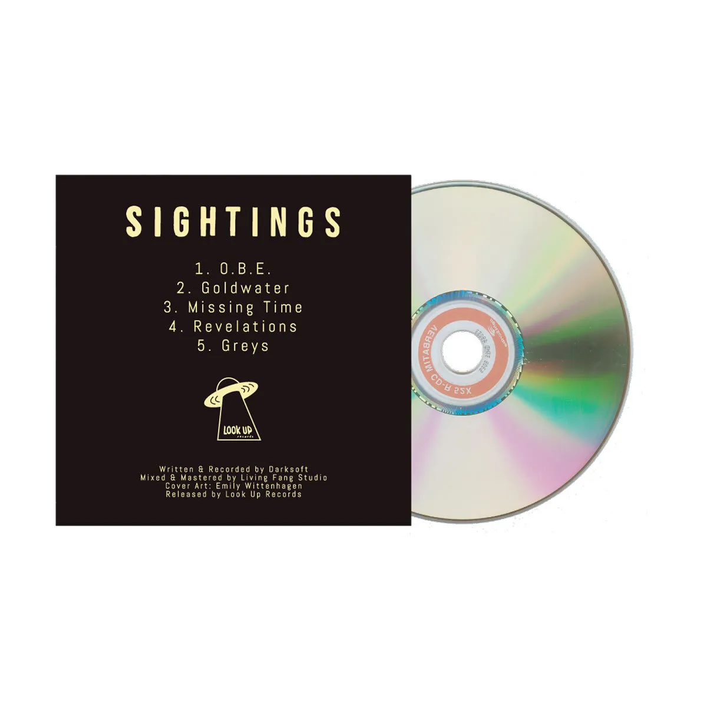

*Timothy O’Brien reviews the latest EP by Sightings*

<figure><figcaption>Sightings EP, now out on Look Up Records.</figcaption></figure>

This year for World UFO Day, [Sightings](/sightings) releases their self-titled EP. With five tracks and twenty minutes of psychedelic ethereal sounds crashing in waves over your ears, this is a project you don’t want to miss listening to.

An amazing EP was recut from a batch of demos by Darksoft from the summer of 2016 — a sonic exploration that blends indie pop and free-form jazz.

The groovy bass lines converge with the melody in several of the tracks including the starting track O.B.E and the track Missing Time. An eclectic array of sound takes you out of this world and into another.

The glistening guitar effects abduct your ears in the track Goldwater and bring them back to rest with the luscious sounds in the track Revelations.

The EP closes out with sweet sounds in the track Greys leaving you with an extraterrestrial sonic experience making you yearn to get out of this world.

### Listen to Sightings:

<a class="button" href="https://sightingsmusic.bandcamp.com/album/sightings">Bandcamp</a> <a class="button" href="https://open.spotify.com/album/5zjLHlEGpfsMOLODDKoIP2?dl_branch=1&si=dunSNuD8RUGV_F9RRg5OPw">Spotify</a> <a class="button" href="https://music.apple.com/us/album/sightings-ep/1572501549">Apple Music</a>

## [Grab a Copy](https://sightingsmusic.bandcamp.com/album/sightings)

<figure></figure>

<figure></figure>

Support Sightings on [Bandcamp](https://sightingsmusic.bandcamp.com/album/sightings) with a digital download or pick up a limited edition Sightings CD. Made with 100% recyclable materials, the CD sleeve comes wrapped in a crystal clear eco-bag. Shipped with Look Up + Sightings stickers.

<iframe src="https://www.youtube-nocookie.com/embed/uBUzflBSI8k" title="YouTube embed" loading="lazy" allow="accelerometer; encrypted-media; gyroscope; picture-in-picture; web-share" referrerpolicy="strict-origin-when-cross-origin" allowfullscreen></iframe>

