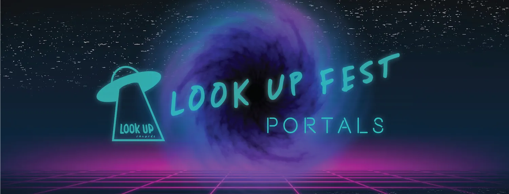

## Look Up Fest returns

Announcing the return of Look Up Fest. We’re holding it on March 12 at Rendezvous in Belltown, Seattle. This year our special little theme is *Portals.*

Like all past Look Up Fests, we’ve opened a call for submissions. If you’d like to play, please submit your band [here](/look-up-fest-portals). Early bird tickets are now for sale on [Eventbrite](https://www.eventbrite.com/e/look-up-fest-portals-tickets-164798730439). And, please [RSVP on Facebook](https://www.facebook.com/events/505414783859576/) to convince the algorithm to get the word out!

Visit the [event page](/look-up-fest-portals) for more information.

### [Submit to play](/look-up-fest-portals)
