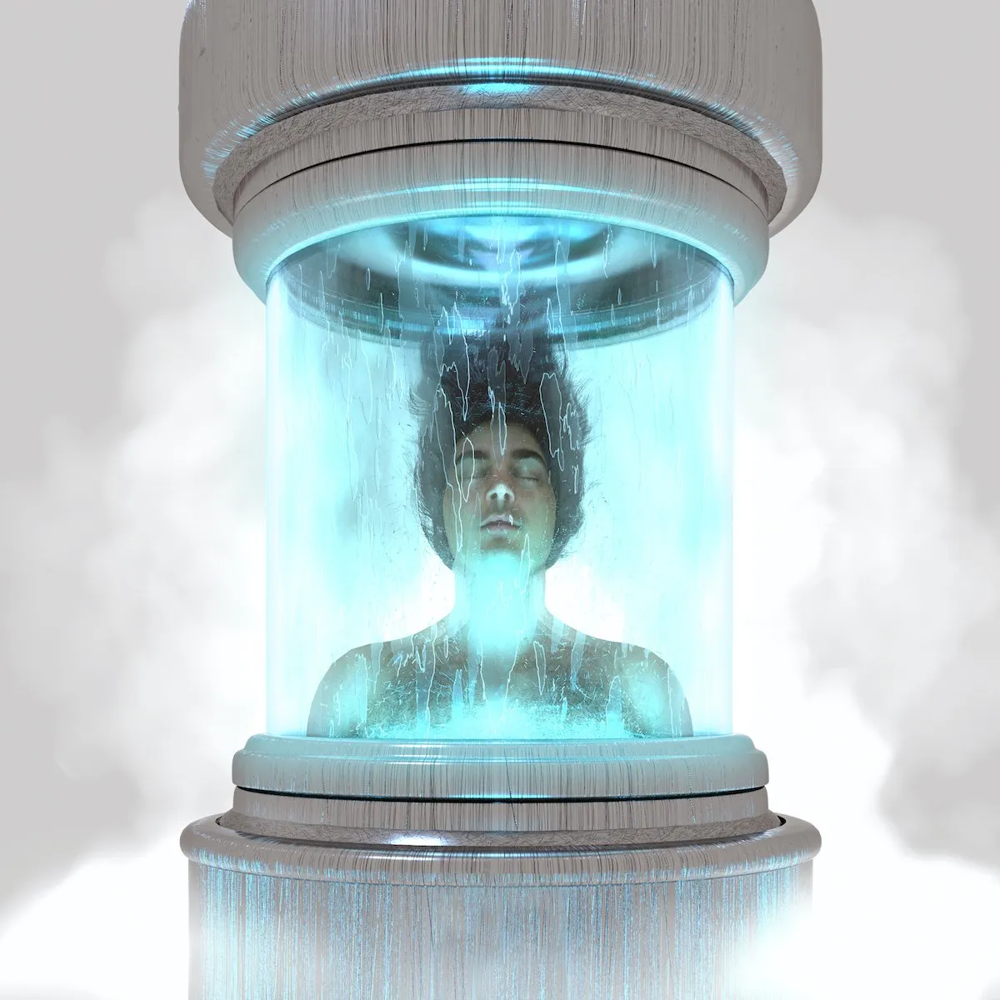
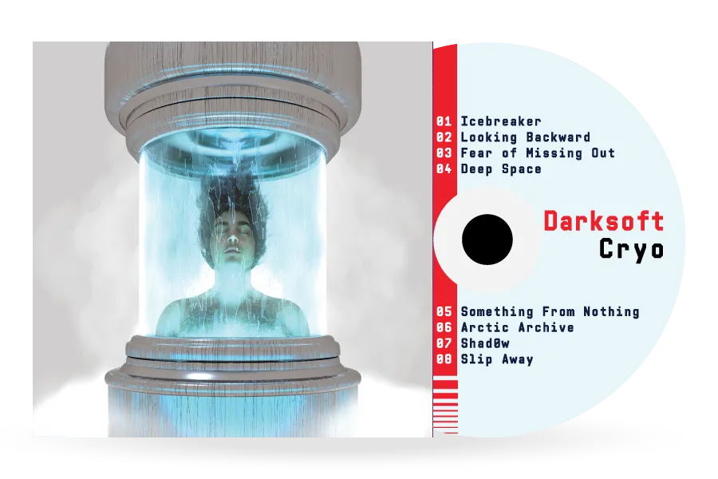
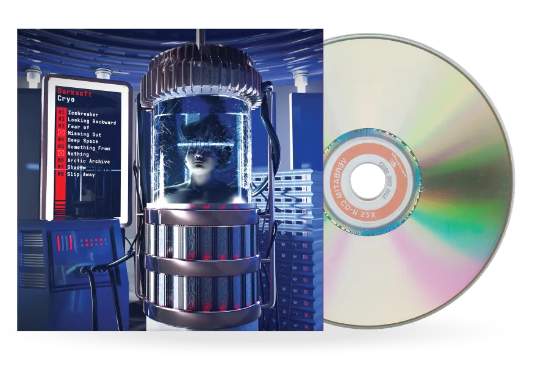

**Darksoft** presents his third full-length album, **Cryo**, a self-produced chill mix of raw nostalgic alternative rock sounds. Cryo was written and recorded by **Darksoft**, mixed by **Zak Van Zeumeren**, and mastered by **Mike Vernon Davis**. It features front artwork by **Owen Blodgett** and back cover art by **Jordan Rundle**. The album is released alongside a music video for **Looking Backward** filmed on Super8mm at Old Orchard Beach in Maine. *All songs are radio-friendly.*

### Listen to Cryo

<a class="button" href="https://darks0ft.bandcamp.com/album/cryo">Bandcamp</a> <a class="button" href="https://open.spotify.com/album/5Y27T3hgkcXG4cCVIqNyZp?si=zcpeeBa4Q7O4H9RwwAcuJg">Spotify</a> <a class="button" href="https://www.youtube.com/playlist?list=OLAK5uy_kiZMH7fQ1Hnmjve1Q5IPzEVCoMTz0Tbik">YouTube</a> <a class="button" href="https://music.apple.com/us/album/cryo/1592734125">Apple Music</a> <a class="button" href="https://darks0ft.bandcamp.com/album/cryo">CD/ Digital download</a>

<figure></figure>

<figure></figure>

### Looking backward Music Video

<iframe src="https://www.youtube-nocookie.com/embed/vCc4XzNZLoY" title="YouTube embed" loading="lazy" allow="accelerometer; encrypted-media; gyroscope; picture-in-picture; web-share" referrerpolicy="strict-origin-when-cross-origin" allowfullscreen></iframe>

1. Icebreaker
2. Looking Backward
3. Fear of Missing Out
4. Deep Space
5. Something From Nothing
6. Arctic Archive
7. Shad0w
8. Slip Away
