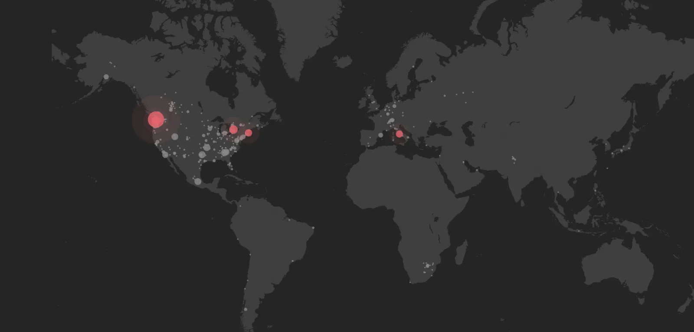
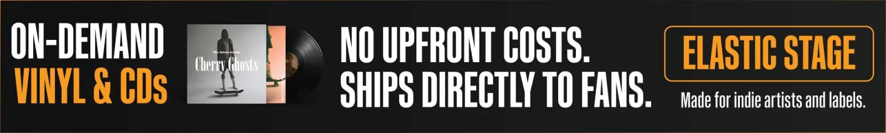

Most musicians are familiar with the **[Spotify for Artists](https://artists.spotify.com/)** program. But did you know other major streaming platforms have an equivalent "for Artists" center too? By signing up with these creator programs, artists and labels could diversify and grow their presence on other streaming platforms.

Below, I'll review all the "for Artists" creator programs throughout the major streaming platforms. Artists can sign up for free on all of them. Once you're approved, you can update your picture and bio and begin monitoring your music performance. Some allow you to pitch new tunes to editorial playlists and unlock other monetization abilities, like selling merchandise or revenue share options.

## 1. [Spotify for Artists](https://artists.spotify.com/)

First up, most musicians are already using **[Spotify for Artists](https://artists.spotify.com/)**. It's a very sleek website where artists can view the statistics of their play counts worldwide, pitch new songs to editors, and update their bios. You can also integrate with Shopify to add merchandise, log in with SongKick to add upcoming shows and post links to artist social media accounts — all beneficial features to grow your fanbase.

Spotify owes a lot of its success and growth to artists. And, with excellent music discovery and a vibrant playlist community, it's a super helpful platform to reach an international audience. But, Spotify has yet to turn a profit and doesn't pay out royalties well compared to [other streaming platforms](https://producerhive.com/music-marketing-tips/streaming-royalties-breakdown/). They've also been slow to respond to [misinformation on the platform](https://www.independent.co.uk/climate-change/news/spotify-joe-rogan-misinformation-jordan-peterson-b2003159.html), although they have begun to [flag content](https://newsroom.spotify.com/2022-01-30/spotifys-platform-rules-and-approach-to-covid-19/) that breaks platform guidelines.

## 2. [Apple Music for Artists](https://artists.apple.com/)

Is anyone old enough to remember purchasing MP3 downloads on iTunes? For decades now, Apple has played a role in digital music distribution. And nowadays, the [Apple Music](https://artists.apple.com/) catalog holds parity with Spotify's catalog.

To join **[Apple Music for Artists](https://artists.apple.com/)**, you must request access and provide some information to prove legitimacy. Then, you can view daily plays, average daily listeners, and song purchases. One cool thing is that since Apple owns Shazam, you can see who is Shazam-ing your stuff. Apple also sends weekly statistics over email.

One thing is their security is a bit cumbersome. You have to have an Apple ID to participate, and you have to verify your device and input a security code upon EVERY login.

<figure><figcaption><a href="https://elasticstage.com/es/referral/3YJ57FIV"><strong>Elastic Stage</strong></a> lets indie artists sell vinyl with no upfront costs, inventory, or shipping. <a href="https://elasticstage.com/es/referral/3YJ57FIV"><strong>We use it and recommend it</strong></a>.</figcaption></figure>

## 3. [Deezer for Creators](https://creators.deezer.com/)

Deezer is one of the [fastest-growing music streaming apps in Mexico](https://newsroom-deezer.com/2020/12/deezer-is-now-the-fastest-growing-music-streaming-app-in-mexico/). In addition to hosting music, it has global and local podcasts. To [claim an artist profile on Deezer](https://web.archive.org/web/20220127111345/https://support.deezer.com/hc/en-gb/articles/360018607978-Claiming-an-artist-profile-on-Deezer), you choose your affiliation and enter the UPC number of your release. The **[Deezer for Creators](https://creators.deezer.com/)** app provides analytics and audience data, but I can't speak much to the experience since my artist request is still under review.

## 4. [Amazon Music For Artists](https://artists.amazonmusic.com/)

Artists who have a problem with Amazon for other reasons can disregard this section. But I should mention that as of 2022, Amazon Music offers the [highest per-stream royalty](https://producerhive.com/music-marketing-tips/streaming-royalties-breakdown/) of all streaming platforms.

After you claim your artist account on **[Amazon Music For Artists](https://artists.amazonmusic.com/)**, you can set your profile picture and background image. Similar to Spotify for Artists, you can track the stations and playlists playing your music and see fine-grained statistics. You'll likely notice there aren't *that* many listeners on this platform yet. Amazon Music for Artists also provides a way to pitch new songs to their editorial team.

## 5. [YouTube for Artists](https://artists.youtube/)

In recent years, YouTube has pivoted toward being more of a legitimate ad-free paid music streaming platform with [YouTube Music](https://www.youtube.com/musicpremium). This is partially thanks to the YouTube Content ID, which now automatically claims rights for music, regardless of who uploaded it. Most digital distributors also automatically send music to YouTube directly.

Musicians likely have an "[Official Artist Channel](https://support.google.com/youtube/answer/7336634?p=manage_oac_subs&visit_id=637791749535410379-3462374165&rd=1)" that, if you're lucky, is merged with whatever YouTube account you had previously. Tracking YouTube Music plays is a similar process to how YouTube creators track views — all accessible through the **[Channel dashboard](https://studio.youtube.com/channel/)**. Here, you can see your channel analytics, like new subscribers, views, watch time, and your top songs.

At the time of writing, YouTube doesn't maintain hand-curated editorial playlists — instead, these suggested playlists are automatically generated.

## 6. [Pandora AMP Playbook](https://www.ampplaybook.com/)

**[Pandora's AMP Playbook](https://www.ampplaybook.com/)** is another new creator tool designed to give you insights into how you perform on Pandora. Pandora says their Insights and Marketing tools could help artists market and engage with fans.

To get started, log in to your Pandora account at [amp.pandora.com](https://amp.pandora.com/). You can submit an [Artist Claim here](https://amp.pandora.com/claim-artist). Or, tastemakers can request a Curator profile [here](https://www.ampplaybook.com/pandora-stories).

## 7. [TIDAL for Artists](https://tidal.com/forartists)

TIDAL has some things going for it. While its user growth has slowed a bit, it's now neck-and-neck with Soundcloud in [terms of revenue](https://www.musicbusinessworldwide.com/tidal-and-soundcloud-now-neck-and-neck-in-revenue-terms-as-jay-z-streaming-platforms-growth-slowed-in-2019/). TIDAL offers a specialty tier with hi-fi audio quality and access to **The Direct Artist Payout program**.

According to TIDAL, "The Direct Artist Payout program is an initiative we're experimenting with to give artists access to a new payment stream thanks to your fans." Your distributor probably already sent you an automated email about signing up for this program. If not, you can contact TIDAL here: [artistspaymentsupport@tidal.com](mailto:artistspaymentsupport@tidal.com).

## 8. Napster Artist Profile Update

Yep, Napster's back — but without the pirates. The Napster brand has been repurposed as a legitimate legal streaming service. So far, Napster for Artists is just a Q&A page. (I'll update this section if they build out an artist center.) As of now, you can't claim an artist page. But if you reach out, customer support will ask for some details to update your profile manually.

## 9. [Soundcloud Artist Resources](https://web.archive.org/web/20220131002130/https://community.soundcloud.com/)

SoundCloud has notoriously been a haven for underground electronic beats and remixes. If you're publishing your music on SoundCloud, you'll automatically have access to analytics on the Insights tab. SoundCloud Premier purportedly allows artists to [monetize their songs](https://web.archive.org/web/20220129035159/https://community.soundcloud.com/monetizing-tracks-video-how-to) if they meet [these specific requirements](https://web.archive.org/web/20220129035159/https://community.soundcloud.com/monetizing-tracks-video-how-to). But, there's no way to submit to SoundCloud Premiere. "If eligible, you'll receive an email or in-product notification to opt-in your tracks."

## Other Ideas

The actions suggested above won't solve issues plaguing the music industry. It probably won't directly help artists get much of an income in music either, unless the streaming platforms become more equitable. But, it could help with your exposure.

"It's hard to take seriously anyone who thinks that quitting Spotify will have any impact on anything. It feels performative and hollow. It doesn't present any viable solution", wrote [Rachel Hurley](https://www.facebook.com/itsashameaboutrachel/posts/2464802046989317). "The ONLY way to raise the monetary amount that musicians make from streaming is to raise streaming prices SIGNIFICANTLY for consumers."

Nate Louis, host of [Raised on Rhythm podcast](https://open.spotify.com/show/1xaXY6qj66DqdI1CU8iq0H?si=e41cd88908334fbc), and drummer for too many bands to mention, encourages artists to stick to their guns and do what they think is right. For those who continue to hype their Spotify presence but are worried about cancel culture attacking, his message is that your true fans know better and will continue to support you if they like what you're doing. "Cancelers are much more caught up in performative activism than they have ever been in listening to music," he said.

Also, instead of viewing Spotify as a moneymaker, Louis encourages artists to consider the marketing advantages it brings. "Artists should really think about the international advertising opportunity that it is," he said. "It's a loss to get out for tour dates."

## Final Thoughts

To be clear, I don't advocate artists remove their catalog from Spotify. And I don't think canceling Spotify will help solve the music industry's inequities or help independent artists.

But hey — there's nothing wrong with diversification. Spotify is still top dog, but its [marketshare is waning](https://techcrunch.com/2022/01/20/spotify-subscription-numbers-up-youtube-music-tidal/). Over time, spreading ourselves out could build a more sustainable music culture wherein one platform doesn't hold all the cards. And as listeners begin to experiment with alternative streaming platforms, artists should pay attention.

Of course, [Bandcamp](https://lookuprecords.bandcamp.com/) is great for getting your stuff out there too. And, if you promote it well, you're likely to make more income selling digital downloads or merch here than you are from all streaming platforms combined. Also, submitting your music to radio stations and registering your music with a PRO like ASCAP or BMI are other ways to get your music heard.

I should add — getting your music *on* the streaming platforms mentioned above is a different story! Your label will likely handle digital distribution and might operate these artist streaming platform backends too. Or, if you're releasing on your own, I recommend using [CD Baby](https://cdbaby.com/) for solo projects and [Distrokid](https://distrokid.com/vip/seven/1059661) if it's a collaborative project.
