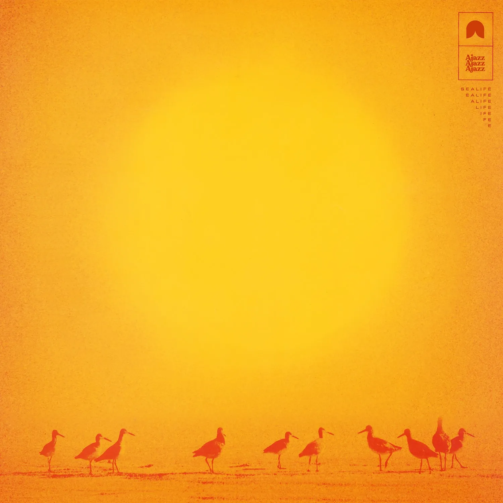
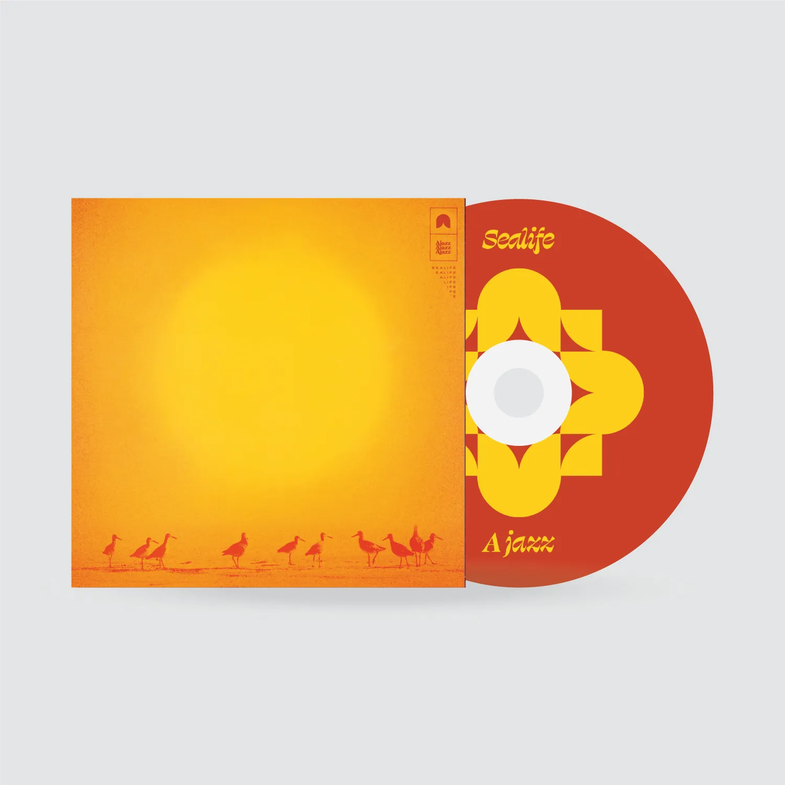
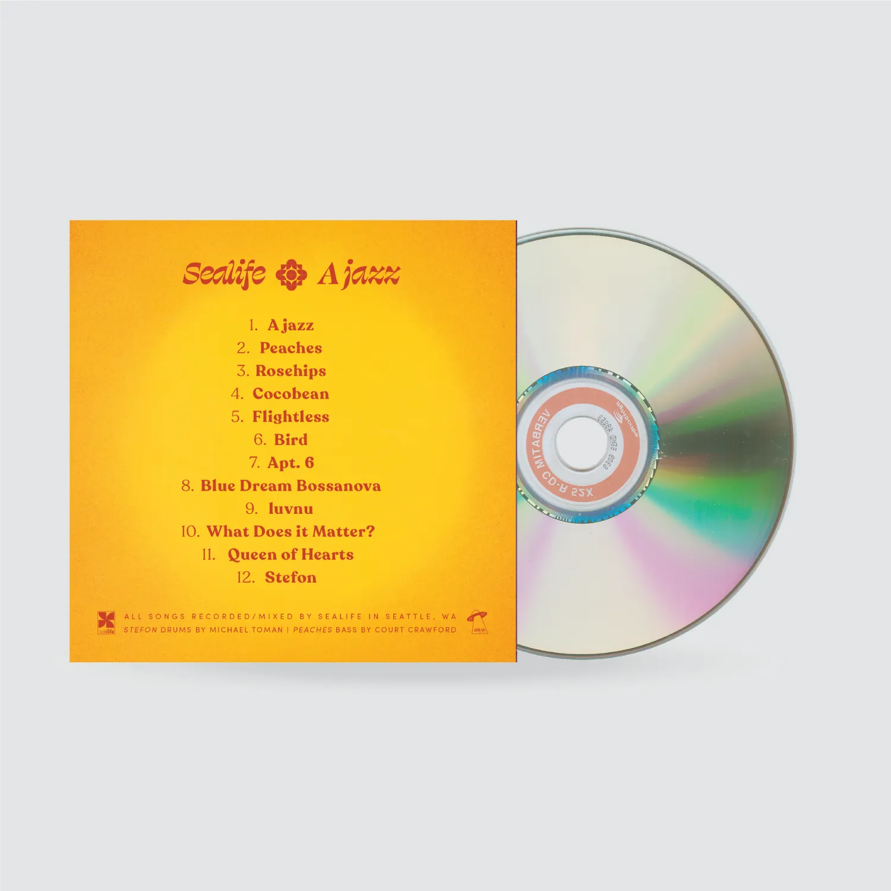
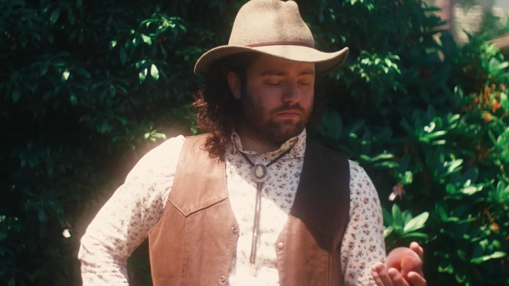

**Look Up** presents the third album by **Sealife**, ***A jazz****,* a sunny blend of eclectic folk-pop tunes.

Sealife describes ***A jazz*** as "an uneducated exploration into jazz." ***A jazz*** is full of saturated tape qualities and playful hoppy beats. These carefree songs might make your head nod from left to right as you sip something funny in a circle of strangers wearing matching outfits.

The album is released alongside a music video for **Peaches** directed by **DreamboatVISTA** aka **Collin Snider**.

<a class="button" href="https://sseeaalliiffee.bandcamp.com/album/a-jazz">Bandcamp</a> <a class="button" href="https://music.youtube.com/playlist?feature=share&list=OLAK5uy_kwjQW0_SzPNtmrkVRUCUHwseD_Dp5E9Uc">YouTube</a> <a class="button" href="https://music.apple.com/us/album/a-jazz/1857286932">Apple Music</a> <a class="button" href="https://open.spotify.com/album/3PWHt6yvueWcZbxwpu4HSp?si=H7u-THRzTluS98-gEDqSWA">Spotify</a> <a class="button" href="https://sseeaalliiffee.bandcamp.com/album/a-jazz">CD/ Digital download</a>

<figure></figure>

<figure></figure>

<iframe src="https://www.youtube-nocookie.com/embed/p5xaWQm17BM" title="YouTube embed" loading="lazy" allow="accelerometer; encrypted-media; gyroscope; picture-in-picture; web-share" referrerpolicy="strict-origin-when-cross-origin" allowfullscreen></iframe>

1 A jazz

2 Peaches

3 Rosehips

4 Cocobean

5 Flightless

6 Bird

7 Apt. 6

8 Blue Dream Bossanova

9 luvnu

10 What Does it Matter?

11 Queen of Hearts

12 Stefon

Bass by Court Crawford on ‘Peaches’

Drums by Michael Toman on ‘Stefon’
