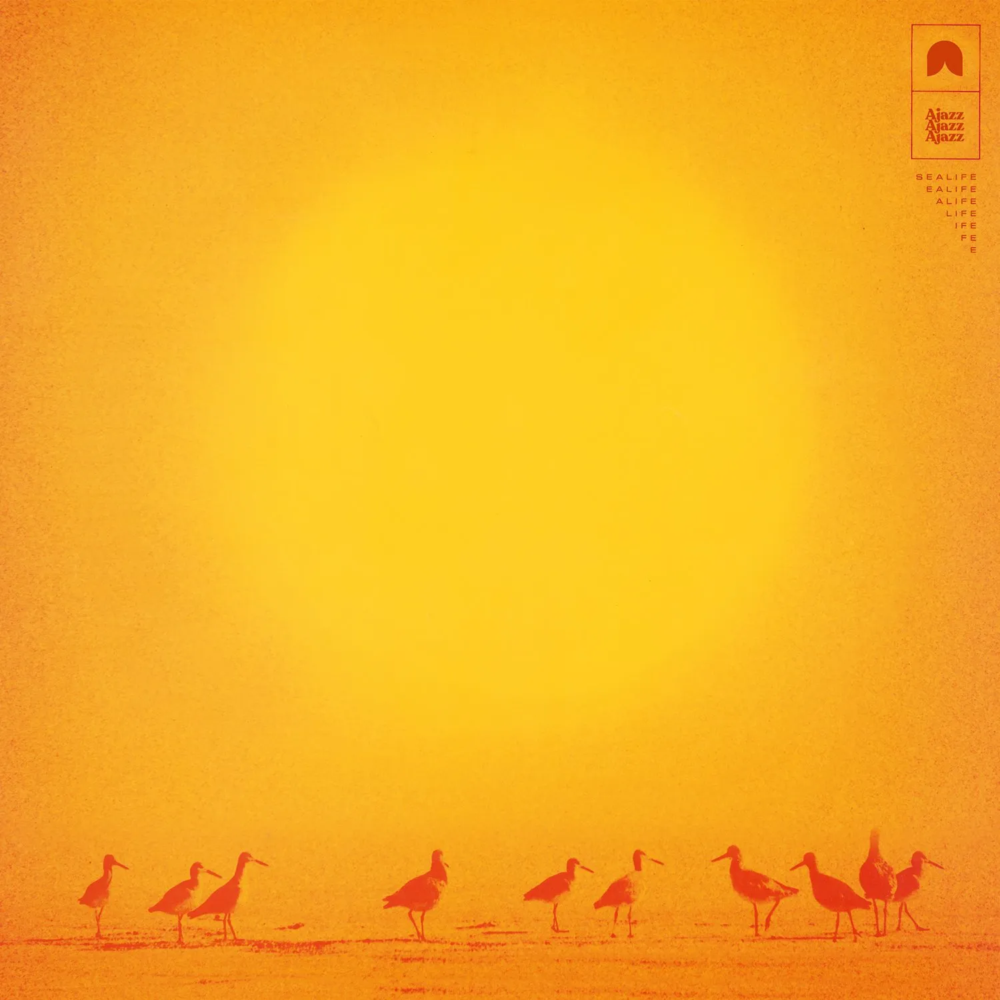

**Sealife** recently debuted their new album, ***A jazz***. Led by **Brennan Gregory Moring**, Sealife delivers a mosh posh of laissez-faire guitar diddles, soulful ballads, expressive bass, and synth-supported folk numbers in this eclectic 12-song full-length album.

***A jazz*** touches on a lot of Sealife sounds we've heard in the past but introduces some new instrumentations for the artist. A lot of it feels like we’ve re-discovered a tape reel of a flower child solo artist from the early 1960s. It's absolutely the Sealife voice with maybe just a tad bit o' A-plus jazziness.

The album's opening song, **A jazz**, feels like you're sipping on a Blue Hawaiian in an art deco boss nova club. It bleeds into **Peaches**, which features a twangy vocals strolling through the orchard of past loves. Sealife released an awesomely creative music video for this one, collaborating with Collin Sinder, aka DreamboatVISTA, on quite a production:

<iframe src="https://www.youtube-nocookie.com/embed/p5xaWQm17BM" title="YouTube embed" loading="lazy" allow="accelerometer; encrypted-media; gyroscope; picture-in-picture; web-share" referrerpolicy="strict-origin-when-cross-origin" allowfullscreen></iframe>

**Roesehips** is another sunny background number with a unique vocal take. **Cocobean** has that classic spring reverb sound with sparse, echoey guitars to make a cool vibe.

**Flightless**, the 5th song on the record, is my favorite track. The synth punchiness is great; it's got some sexy bass movement and a slow R&B funk vibe. The analog synth sounds in a spacey mid-section remind me of John Swihart's lonely score on *Napoleon Dynamite*. This song's also got some stellar harmonies using clever sonic wordplay — "*indulgence and vices, leaving me lifeless*."

*Put a bird on it!***Bird** is a happy love song with birds. It's just happy. It's got that utopian *Of Montreal* flavor. "*Do you want to feel better?*" asks **Apt. 6**, which follows in a similar ilk, with an almost Pee-Wee Herman -esque sort of joy as a saturated tape quality permeates the hoppy beat. The key change midway made me chuckle. Really like that picky bass toward the end of this one.

**Blue Dream Bossanova** sounds a lot like the name. It's bluesy and beachy, with regretful lyrics and a bossa nova beat supported by congas and smooth keyboard sounds. "*I was a fooled right from the start*." The instrumental **luvnu** follows this one, with a reinterpretation of a theme you may recognize... so good.

**What Does it Matter?** speeds things up a tad. It's a pitter-patter of a song that might make your head nod from left to right as you sip something funny in a circle of strangers wearing matching outfits. There's this "ting ting" sound on the drums at 1:22 and 2:32 that is a complete Ringo Starr move. I really like where the organ goes too.

**Queen of Hearts** hits on those mid-century surf music era ballads with doo-wop vocalists singing over a reused chord structure. It has some descending chromatic changes that surprise you a bit, too, all climaxing in some sort of motorcycle accident of sounds. I enjoyed the closing track **Stefon**, too — this piano-based song was sophisticated musically and reminded me of *BadBadNotGood*.

Overall, there's a carefree, intimate quality in *A jazz*. Like early Beatles right before they turn experimental. It's honest and goofy. It's fun to soak in and just as easy to kick on in the background. Kudos to Sealife for using the last year or so to try out some new sounds and produce something 100% unique. I think Look Up fans will like this one.

You can listen to A jazz wherever your ears spend their time these days — YouTube, Spotify, Apple Music, Bandcamp, Deezer, Tidal, and other streaming sites.

In a seperate Q&A with Sealife, we’ll explore their inspiration, background, and production techniques.
