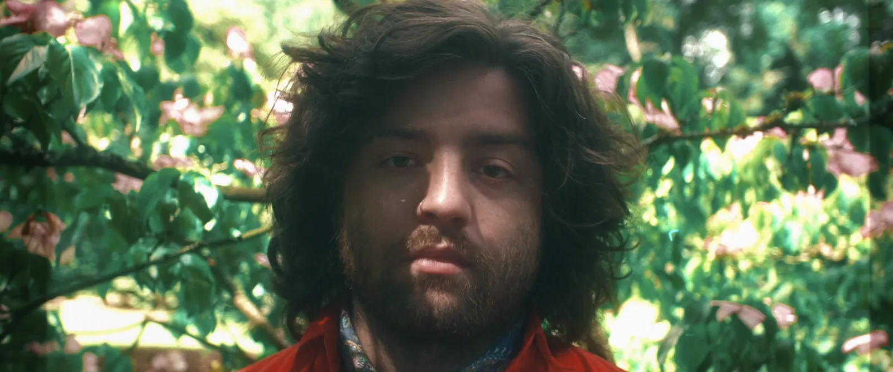

In case you didn't already see, **Sealife** recently put out a sweet 12-song album named **A jazz**. I thought it was p tight. So I sat Sealife down for a questionnaire. 12 songs, 12 questions. Read on for a background on Sealife, his tape recording techniques, musical inspirations, and truths about the known universe...

**1. Sup?**

*Hey buddy*

**2. So what's new about A jazz?**

*A Jazz is an uneducated exploration into jazz. It’s a bit of a change of sound for Sealife, but I was exposed to a lot of jazz as a kid, my mother is a jazz singer and always had it on at the house. I was listening to a lot of Gabor Szabo (check out the album "Dreams") when I started writing this, and I love how dark and mysterious his music is.*

**3. *A jazz* has a very distinct production quality, was it recorded on tape?**

*I usually record digital but I started getting into tape during quarantine. I started with Fostex cassette tape 4 -track, which I made the entirety of "Apt. 6" with. Later I got a 4 track reel-to-reel, which is much thicker tape, which results in a cleaner sound, and I made the entirety of "Queen of Hearts" with. The rest of the songs are a mixture of tape and digital recording, aside from "Stefon" which is all digital, it's the most contemporary jazz piece on the album and I wanted it to be super clean.*

*Stefon was by far the hardest and most complicated song on the album. I brought in Brendan McGovern to play saxophone, and Michael Toman to play drums, which he absolutely nailed. There's a part at the end where the beat changes from 4/4 triplets to 4/4 but it's based on the speed of the triplets, so it goes into some obscure 13/16 time signature or something but you don't really notice it. We had fun making that one.*

**4. What gear did you use to make the album?**

*Lots and lots of stuff. I have a Fender Jaguar that I love, and I recently got a 60's Hagstrom Viking that has a totally different sound than the Fender. I used the Hagstrom a lot for crunchy leads. The reel-to-reel is a Tascam 34, and the tape recorded is a Fostex X-12 that doesn't rewind on its own. I have a Behringer Deepmind 12 and a Roland JX-3P which I mostly use for synths. I can't remember what mic's I used, I like to reinvent the wheel every time I record, which probably accounts for a lot of different production styles on this record. I also used a wooden flute on Peaches, and Court Crawford did an upright bass solo.*

**5. Is it "a jazz" or A jazz as in every song is in the key of A?**

*I find the key of A to be very uplifting and playful. A few songs, including the title track, are in A, but other songs want to be played other ways.*

**6. "Sealife," so whaddya underwater or something?**

*Truth be told it was my rapper name when I was 19. I also went by Lazarus. You can look but you will never find anything from my hip-hop career on the internet. Sorry.*

**7. What do you see when you turn out the lights?**

*I see w my minds eye*

**8. Your Instagram videos are amazing. Wtf?**

*Thanks! All the songs from those videos are recorded on a reel-to-reel tape machine I've been learning how to use. I found a green screen at Goodwill and figured out how to use it. I think I'll turn some of those into full songs soon.*

**9. So do you, like, have a band or something, or are you just one dude?**

*Sealife is just me, I like to collaborate with other artists, but most of all i like the freedom to make any kind of music I want. There's something special about solo artists. How many authors does it take to write a novel?*

**10. Do u play computer games?**

*I got really into slither.io in 2018. It's a flash game where you have to eat other snakes to survive. I could write a thesis on how well it represents capitalism.*

**11. How did you spend your time during the latest global meltdown and what are your plans for the next one?**

*I can think of 1000 things I SHOULDA done with all that free time, but mostly I watched a lot of stand up comedy.*

**12. Do you realize we're floating in space?**

*And I'm glued to my seat*

<iframe src="https://www.youtube-nocookie.com/embed/VDaqHnl3MLI" title="YouTube embed" loading="lazy" allow="accelerometer; encrypted-media; gyroscope; picture-in-picture; web-share" referrerpolicy="strict-origin-when-cross-origin" allowfullscreen></iframe>

Check out this video for a more in-depth tutorial on how Sealife records to a tape cassette.
