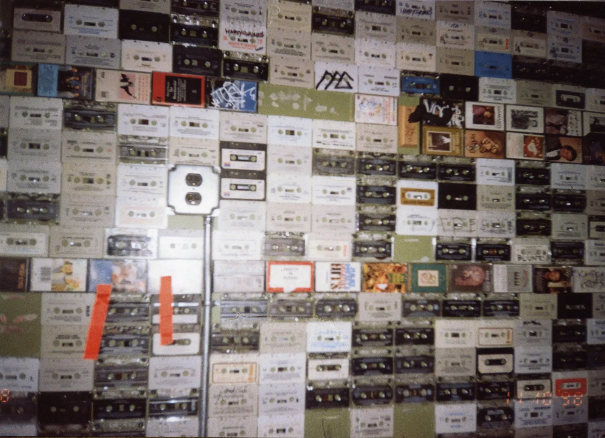
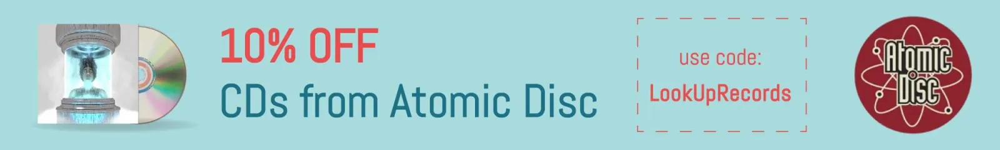

How do you start your own record label? Well, whether you plan to release indie rock, hip hop, funk, or sonic drones from the surface of Mars, you're going to run into some of the same requirements. And, with so much of the music industry going online these days, most music marketing tools have easy-to-use websites to get up and running quickly.

Below, we'll cover ten essential tools you'll need to start your own online record label. The list spans our favorite distribution, registration, printing, mastering, marketing, and social promotion services. Since we use all these sites and services at Look Up Records, we've included our referral links below to help you get the best exclusive deals and discounts. Even if you're self-releasing an album or single, these are all sites music marketers can't really live without.

## 1. [DistroKid](https://distrokid.com/vip/seven/1059661)

*Digital Music Distribution*

Working with a distributor is the easiest way to get your music on streaming platforms like Spotify and Apple Music. At Look Up Records, we use [**DistroKid**](https://distrokid.com/vip/seven/1059661) for digital music distribution. DistroKid makes uploading your music to stores extremely easy. It collects streaming royalties and digital purchases from these music marketplaces and makes splitting payments between collaborators, or a label and its artists, very seamless. DistroKid can also generate ISRC codes for each track if you don't already have them.

**[Get 7% off using our referral link](https://distrokid.com/vip/seven/1059661)**.

## 2. [Atomic Disc](https://www.atomicdisc.com?bg_ref=is13kGgPQR)

*CD & Vinyl Printing & Mastering*

Although streaming is mainstream, physical media isn't dead. In fact, in 2021 [vinyl sales rose](https://qz.com/2111339/vinyl-outsold-cds-in-the-us-for-the-first-time-since-the-1980s/) by 51% to $41.7 million. Fans are still into tapes, CDs, and vinyl — it's a cool memento and a unique way to support a release. But, purchasing all the equipment and supplies to print these yourself would be a huge upfront cost.

We use [**Atomic Disc**](https://www.atomicdisc.com?bg_ref=is13kGgPQR) for physical media duplication, and we recommend them! Whether you're printing CDs or vinyl, Atomic Disc provides quality duplication and print services for both media types. Adding on mastering can be especially useful if you're doing [vinyl](https://www.atomicdisc.com/products/vinyl-records-in-jackets?bg_ref=is13kGgPQR), as this requires a different master than digital listening. Use [**this link to get a 10% discount**](https://www.atomicdisc.com?bg_ref=is13kGgPQR) that can be applied to all CD packages, stickers, posters, graphic design, and mastering services from Atomic Disc.

<figure><figcaption>Get 10% off CD or merch orders with <a href="https://www.atomicdisc.com/?bg_ref=is13kGgPQR"><strong>AtomicDisc</strong></a> using our code <a href="https://www.atomicdisc.com/?bg_ref=is13kGgPQR"><strong>LookUpRecords</strong></a>.</figcaption></figure>

## 3. [Sticker Mule](https://www.stickermule.com/unlock?ref_id=5969511701&utm_medium=link&utm_source=invite)

*Stickers, Stickers, &… Surprisingly Good Hot Sauce?*

What good is a band without stickers? Giving stickers away for free at shows or slipping them into the packaging when you ship out orders can be a cool, inexpensive way to get your brand out there and build a following. Plus, let's be honest, you're going to need a bunch of stickers to line the wall of every dive bar you play on your way up the venue ladder.

For stickers, we use [**Sticker Mule**](https://www.stickermule.com/unlock?ref_id=5969511701&utm_medium=link&utm_source=invite). It's affordable and good quality. Plus, you save per quantity when you buy in bulk. We like how you can order die-cut stickers around any sort of design. Plus, if your order is over $100, you get sent a free Mule Sauce, their surprisingly good sweet hot sauce with a kick. Talk about clever merch.

**[Get $10 in-store credit when you spend $10 or more](https://www.stickermule.com/unlock?ref_id=5969511701&utm_medium=link&utm_source=invite)**

## 4. [Bottomless](https://www.bottomless.com/referral/f66e1ft9)

*☕ Fresh Pots!*

Coffee. Not only does a drummer like [Dave Grohl](https://youtu.be/fhdCslFcKFU) need his fresh pots, but label owners do too. Coffee is an essential daily factor at Look Up HQ, so much so that we found a way to find a limitless supply of it…

[**Bottomless**](https://www.bottomless.com/referral/f66e1ft9) is this Seattle-based startup that automates your coffee bean delivery. They send you a connected scale for you to place your coffee bean bag on. And, when your coffee gets lower, Bottomless automatically mails you a new bag, so you never run out.

**[Use our referral link to get your first bag for only $1](https://www.bottomless.com/referral/f66e1ft9)**. That deal also comes with a 30-day free trial.

## 5. [SubmitHub](https://www.submithub.com/apply?from=look-up-records)

*PR, Blogs, & Playlists*

Playlists are how the majority of users consume their music these days. And, getting placed onto these playlists has become a bit competitive. [**SubmitHub**](https://www.submithub.com/apply?from=look-up-records) is a helpful way to break through the noise to get your music on playlists relevant to your genre. It's a platform that connects artists with tastemakers, such as Spotify and SoundCloud playlisters, bloggers, DJs, and social media influencers. You purchase credits and then use these credits to pitch a single song to specific presences.

And, if you're a blogger interesting in reviewing music on SubmitHub, you can [use our invite link to apply](https://www.submithub.com/apply?from=look-up-records). (Reviewing music is actually how we first started building out the interest around the label). Another helpful site to submit your music for review is [IndieMono](https://indiemono.com/music-submit/).

## 6. [Bandcamp](https://lookuprecords.bandcamp.com/)

*Merch Sales & Music Discovery*

[**Bandcamp**](https://lookuprecords.bandcamp.com/) is an easy and free way to immediately distribute your music online for all to hear. It's also one way to quickly set up an eCommerce page where you can sell merchandise around your releases. Bandcamp also offers a label account that can combine artist accounts into a unified login and dashboard for a subscription fee. If you're getting a lot of orders, you may want to consider automating shipping payments and label generation with Shipstation, since they offer an [integration with Bandcamp](https://help.shipstation.com/hc/en-us/articles/360025855232-).

## 7. [Buffer](https://buffer.com/)

*Social Media Planning*

Growing a presence on social media websites like Instagram, Twitter, Facebook, or TikTok helps people know about your release. It's also useful for building a community, networking with artists, and getting fans excited about [upcoming shows](/look-up-fest). But, maintaining your presence on many platforms simultaneously is a pain — especially if you're trying to post at a regular cadence.

Using a social media scheduler like [**Buffer**](https://buffer.com/) can help automate many of the tedious tasks associated with social media. You can use it to plan posts in advance to schedule a campaign. Other than Buffer, there are plenty of [social media tools](https://www.socialchamp.io/comparison/buffer-alternatives/) out there that do something similar, such as Coschedule, Loomly, Publer.io, and others.

## 8. [Mailchimp](https://mailchimp.com/)

*Email Newsletter*

Another way to market your music is through a gold ol' fashioned email newsletter. But, as your newsletter grows into the hundreds and thousands, it doesn't make sense to send emails out one by one using an app like Gmail. [**Mailchimp**](https://mailchimp.com/) is a service that automates sending emails to large numbers of subscribers. And it's free to get started with too. Just make sure they've agreed to receive email from you! No one likes a spammer.

## 9. [Spotify For Artists](https://artists.spotify.com/)

*Claim Your Artist Profiles*

[**Spotify for Artists**](https://artists.spotify.com/) is a site where you can claim your Spotify artist profile, update your bio, pitch upcoming releases to Spotify editorial, and see the impact of your music with detailed analytics. It's like a "behind-the-scenes" view of how your music is performing. But, Spotify isn't the only music streaming platform with a "for Artists" site. In [this post](/blog/claim-your-artist-profile-9-for-artists-streaming-platform-sites), we explain how to claim your artist profile on nine streaming services.

## 10. [ASCAP](https://www.ascap.com/)

*Performance Rights Organization*

To make sure you're receiving all the royalties you're owed, make sure to register your songs with a Performance Rights Organization (PRO) such as [**ASCAP**](https://www.ascap.com/), BMI, SEASAC, or SOCAN. Look Up has a publisher account with ASCAP, and many of our artists have an artist account with ASCAP too. A group like this is responsible for collecting the royalties you are legally owed when your song is publicly broadcast or performed. For example, if radio stations are spinning your music, some of their broadcast dues go toward paying the creators.

If you hold the publishing rights to the songs you are promoting, create a publisher account to claim your 50% of royalties. The other 50% of this split goes to artists. After registering your release with a PRO, [**SoundExchange**](https://www.soundexchange.com/) is another important digital performance rights organization to register your music with.

## Final Thoughts

Above, we've outlined a toolkit to start releasing, promoting, and selling your music online. This list is not exhaustive — you can think of it as a 101 introduction to the essential tools you'll need to start an online record label. These deals and discounts are just as helpful if you're self-releasing a single album too.

Of course, this list assumes that you have a name and label already worked out! And some other holes in the process are hosting a website (we use Squarespace). Promoting music to radio stations can be accomplished using something like [MusicSubmit.com](https://www.musicsubmit.com/). You'll probably also want to keep an eye out for mixers, masters, visual artists, designers, and photographers who share a similar vision.

But the most important thing will be sharing quality sounds and being honest with your community. Online methods are one way to go about this, but getting physical is even better. Connecting with in-person events and working with venues and booking agents, and stocking releases with record stores will be another way to take your label from a dream into more of a reality.
