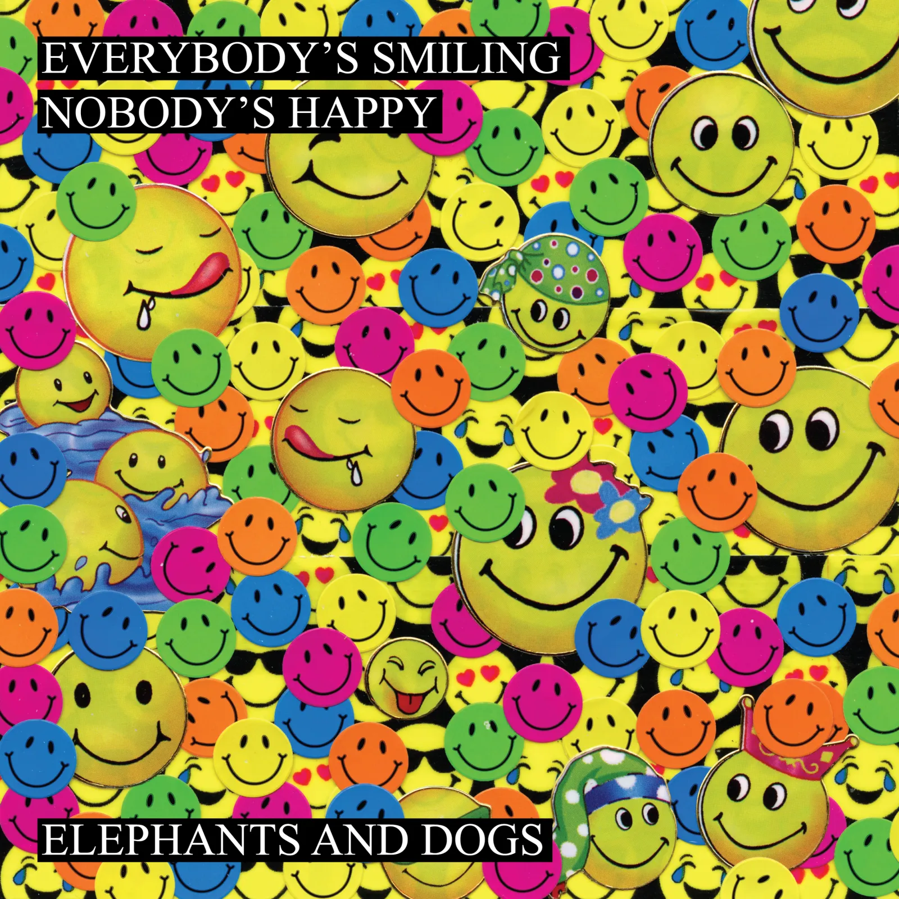
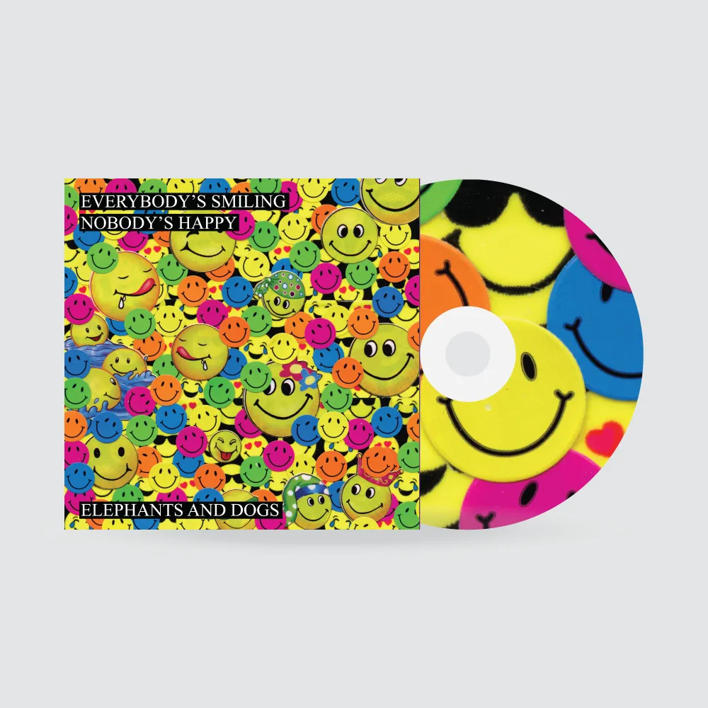
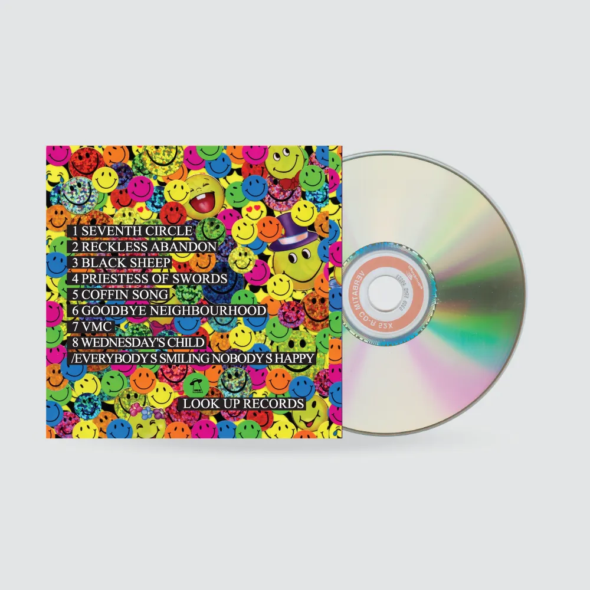

<figure></figure>

Look Up presents the first full-length album by **Elephants and Dogs**, ***Everybody’s Smiling Nobody’s Happy***. **Elephants and Dogs** deliver eight catchy melancholic dream pop tunes, with saturated guitars, whistful vocals, and chill synthy arrangements.

***Everybody’s Smiling Nobody’s Happy*** was written by **Joseph Narducci**, mixed by Zak Van Zeeumeren, and mastered by Mike Vernon Davis. It's released alongside a music video for **Black Sheep** directed by Frazier De Mesa.

**Elephants and Dogs**, named after the mnemonic for memorizing guitar strings (EAD), is a project led by Joe Narducci from Toronto.

*All songs are radio-friendly.*

<a class="button" href="https://elephantsanddogs.bandcamp.com/album/everybodys-smiling-nobodys-happy">Bandcamp</a> <a class="button" href="https://youtu.be/Qcjc_4v9H_g">YouTube</a> <a class="button" href="https://music.apple.com/us/artist/elephants-and-dogs/1551639893">Apple Music</a> <a class="button" href="https://open.spotify.com/artist/1Txs9MqxrFGGQpS4j5iFdu?si=54d24c6ce9504453">Spotify</a> <a class="button" href="https://elephantsanddogs.bandcamp.com/album/everybodys-smiling-nobodys-happy">CD/ Digital download</a>

<figure></figure>

<figure></figure>

<iframe src="https://www.youtube-nocookie.com/embed/pvS4nAZ9rsQ" title="Elephants and Dogs - Black Sheep (Official Video)" loading="lazy" allow="accelerometer; encrypted-media; gyroscope; picture-in-picture; web-share" referrerpolicy="strict-origin-when-cross-origin" allowfullscreen></iframe>

1 Seventh Circle

2 Reckless Abandon

3 Black Sheep

4 Priestess Of Swords

5 Coffin Song

6 Goodbye Neighbourhood

7 VMC

8 Wednesday's Child/Everybody's Smiling Nobody's Happy

Written by Joseph Carmen Narducci

Mixed by Zak Van Zeeumeren

Mastered by Mike Vernon Davis

Music video by Frazier De Mesa
