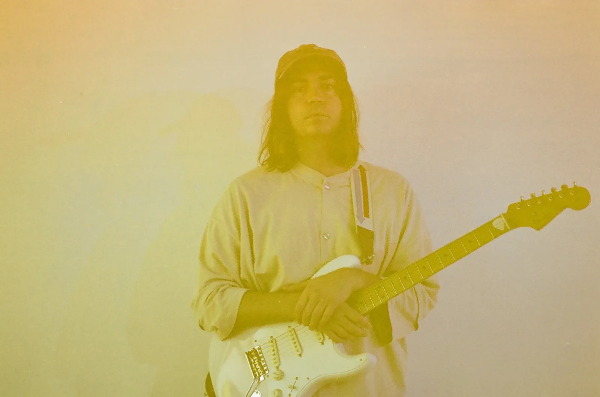
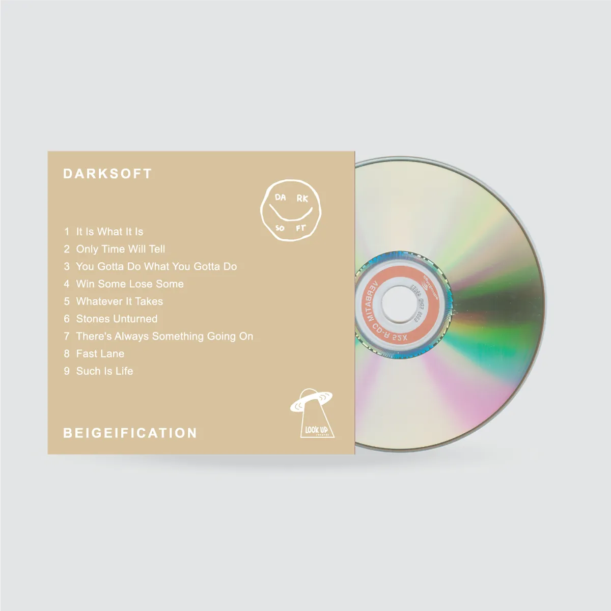
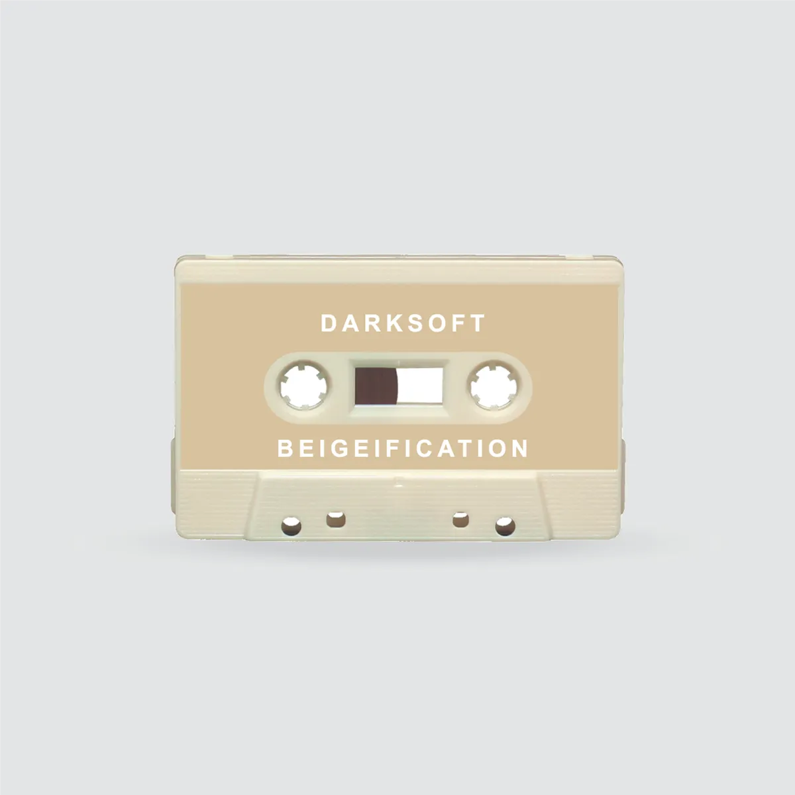

<figure><figcaption>Look Up Records releases Beigeification on 1/13/23.</figcaption></figure>

**Darksoft** presents a new album, **Beigeification**, a postmodern dose of beigey moods and pastel cliches to match the disillusionment of our age. The 9-song album combines elements of dream pop, shoegaze, and alternative rock, with soothing velvety vocals.

The album is mixed by **Brian Fisher** (Hibou, Éclo, Eastern Souvenirs), and mastered by **Stefan Mac** (Cold War Kids, No Vacation, Sea Lemon). **Beigeification** is released alongside three music videos. All songs are radio-friendly.

Beigeification is released digitally on **Friday, January 13th 2023** by **Look Up Records**, with tapes printed by Olympia-based **2060 Records**.

If you are a radio DJ wanting downloads, please contact [**Pirate! Promotions**](https://piratepirate.com/darksoft-4/).

### Listen to Beigeification

<a class="button" href="https://darks0ft.bandcamp.com/album/beigeification">Bandcamp</a> <a class="button" href="https://open.spotify.com/album/4FpAHBtHbstQSRVM19txhE?si=KP8S97MwR-q4PUP4kHNqag">Spotify</a> <a class="button" href="https://www.youtube.com/channel/UCYGODf2pvnV88yuoNnDFWfw">YouTube</a> <a class="button" href="https://music.apple.com/us/artist/1438263529">Apple Music</a> <a class="button" href="https://darks0ft.bandcamp.com/album/beigeification">CD / TAPE / Digital download</a>

<figure></figure>

<figure></figure>

<iframe src="https://www.youtube-nocookie.com/embed/mJ4VmLzdeCA" title="YouTube embed" loading="lazy" allow="accelerometer; encrypted-media; gyroscope; picture-in-picture; web-share" referrerpolicy="strict-origin-when-cross-origin" allowfullscreen></iframe>

<iframe src="https://www.youtube-nocookie.com/embed/GPUPpEbHBK4" title="Darksoft - It Is What It Is  (Official Music Video)" loading="lazy" allow="accelerometer; encrypted-media; gyroscope; picture-in-picture; web-share" referrerpolicy="strict-origin-when-cross-origin" allowfullscreen></iframe>

<iframe src="https://www.youtube-nocookie.com/embed/U5NQMLpZvjA" title="Darksoft - You Gotta Do What You Gotta Do (Official Music Video)" loading="lazy" allow="accelerometer; encrypted-media; gyroscope; picture-in-picture; web-share" referrerpolicy="strict-origin-when-cross-origin" allowfullscreen></iframe>

1 It Is What It Is

2 Only Time Will Tell

3 You Gotta Do What You Gotta Do

4 Win Some Lose Some

5 Whatever It Takes

6 Stones Unturned

7 There's Always Something Going On

8 Fast Lane

9 Such Is Life

## Artist Statement

> For lyrics on Beigeification, I'm using a lot of "thought-terminating cliches." These overused phrases have the effect of ending a conversation, because they are vague, universal truths. What's also interesting is that grammatically they say absolutely nothing, but they carry a lot of weight in context. Example cliche phrases: "it is what it is," "you gotta do what you gotta do," "win some lose some," "only time will tell," "to each their own."
>
> This theme has been fun to play with, and I think fits the general attitude after watching the world over the past few years. To stay sane and functional as a digital being, you sort of have to accept that an endless barrage of bad news will always be at your fingertips, and then focus on what matters to you. I don't want to encourage inaction, but when so much negativity piles up, it's like, "whaddya gonna do?"
>
> Also, remember when everything got beigeified? Perhaps your parents painted the walls beige to increase the "resell value" of their home (even if they weren't selling it). Or think of Carmela Soprano's Etruscan-themed living room, or how beige was used for conformity reasons on workplace PCs for most of the 20th century.
>
> I want these songs on Beigeification to carry nothing too heavy, say something without saying anything, and sit in the background of everyday life, like how sand fits around your toes at the beach, passive like the color beige, and worn-out like these idioms.”
>
> - Darksoft
