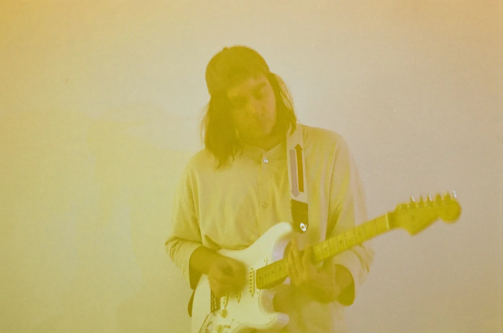

<figure><figcaption>Timothy O’Brien reviews the latest Darksoft album, Beigeification (2023).</figcaption></figure>

**Darksoft**'s latest album **Beigeification** (2023) is a masterful blend of ethereal dream pop and textured shoegaze. The result is an album that feels both familiar and fresh, simultaneously modern and timelessly vintage. The combination of the reverb-drenched guitars and lulling vocals creates a lush sonic landscape perfect for getting lost in.

Led by the two singles, **It Is What It Is** (November 2022) and **Only Time Will Tell** (December 2022), **Beigeification** adds a little over half an hour to the now-growing discography that **Darksoft** has graced us with. This collection has become a masterclass in sonic exploration, and **Beigeificaiton** is the pinnacle of the journey **Darksoft** has taken through dream-pop stylings.

The album opens with the first single, **It Is What It Is**, warming the mix with pulsing guitar riffs and a groovy drum sequence. What follows is eight more tracks of blissed-out guitar work and a manifestation of lush harmonies and melodic nostalgia-soaked lyrics. **Win Some Lose Some**, **There's Always Something Going On**, and **Fast Lane** are tracks that bring an upbeat intertwining sound of the lush genre to pack the album with moments that remind why **Darksoft** personifies the dream pop genre in each project.

**Beigeification** is full of impressively effortless guitarwork, weaving riffs, and melodies that are impossible not to get lost in. Floating in the stunningly gorgeous sonic landscape, it's evident that **Darksoft** has crafted the ultimate velvety beige album. This is a project to stream on repeat for a lazy Saturday to relax and let the mind wander.

**Darksoft**'s albums have eagerly dived into the nuances of shoegaze and dream pop, with **Beigeification** adding to the perfectly spoken starry-eyed universe that **Darksoft** has shared with us all.
