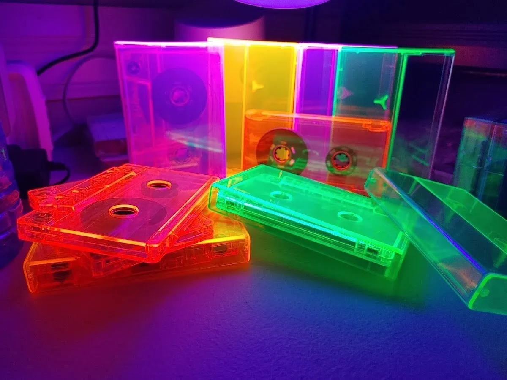
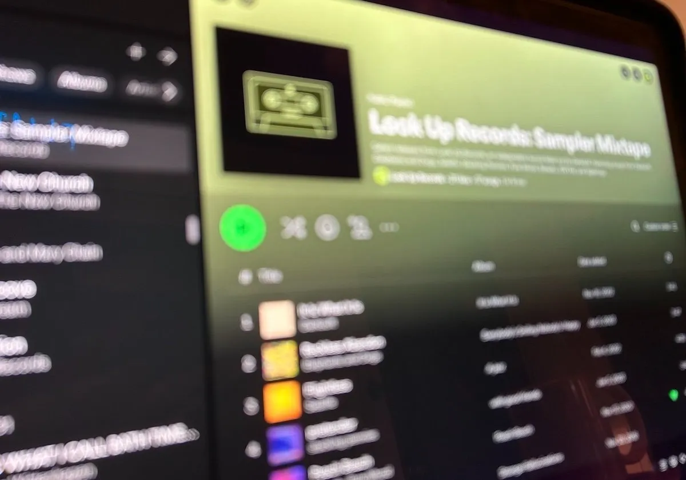
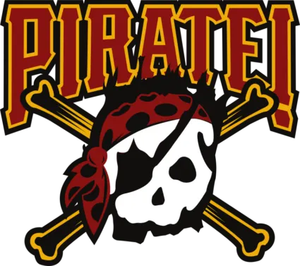
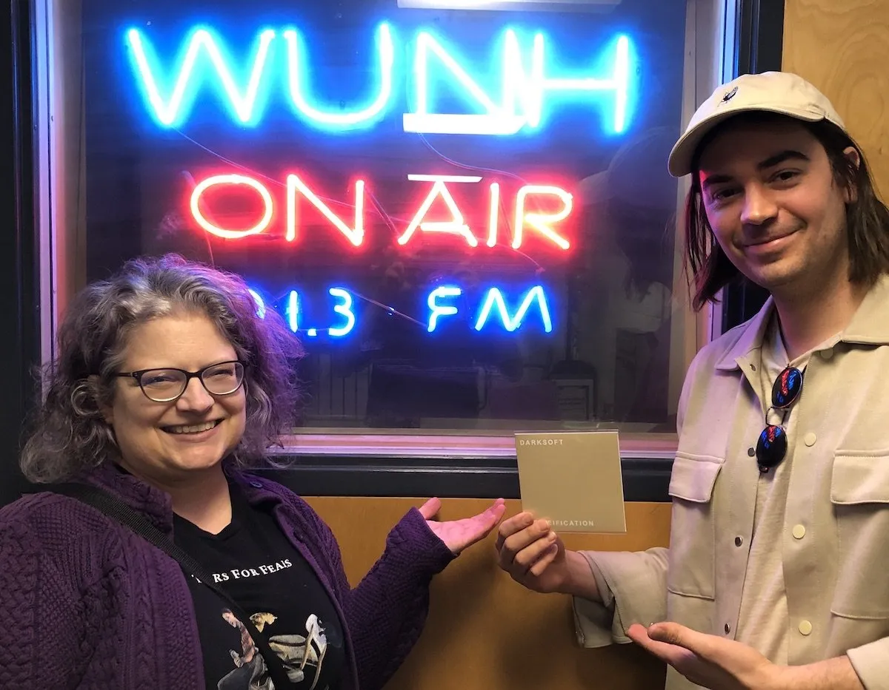
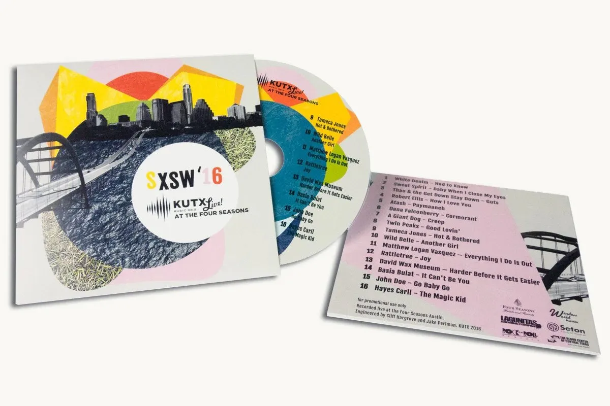
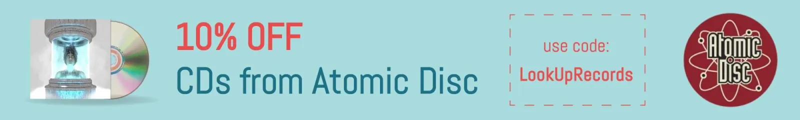
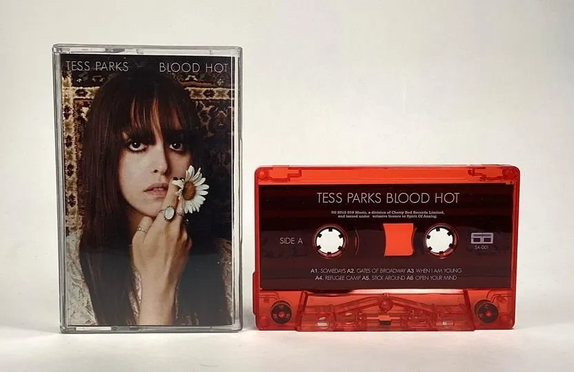
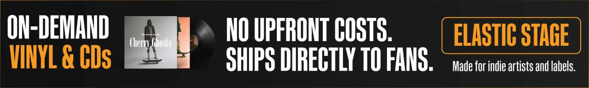
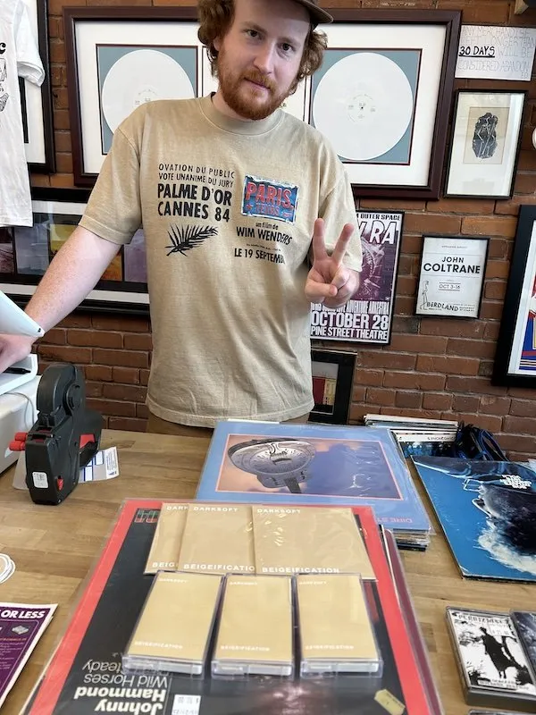

<figure><figcaption>Image credit: Get Tapes Here.</figcaption></figure>

So. You've recorded an awesome music album, and now you're ready to show the world. Well, the best way to reach a global audience is by putting your record online. But how do you get your music on streaming platforms like Spotify, Apple Music, Bandcamp, YouTube Music, or Tidal? And, even if your songs are on those platforms, how do you get people to actually listen to them?

Below, we'll discuss some of the best platforms and services to help you self-release your album. We'll walk you through the digital side of things, including using a digital distributor, licensing your music with royalty collectors, and pitching your music to playlist curators. We'll also look at some great options for printing and selling physical copies of your album, like CDs, vinyl, cassette tapes, as well as other merchandise options and strategies to help promote your release.

## 1. Use a Digital Distributor

There are many [music distributors](https://soundcamps.com/blog/best-music-distribution-services/) out there that can automate the process of adding your album to all digital music platforms. Here's a brief overview of my experience using CD Baby and DistroKid.

### CD Baby

<figure></figure>

I recommend using [CD Baby Pro](https://cdbaby.com/), especially if you are releasing music on your own and hold all the rights to the production. It just costs a one-time fee per release, and they put your music on all [popular digital platforms](https://cdbaby.com/music-distribution/digital-distribution-partners/) and register you as a songwriter with a performing rights organization (PRO) like [ASCAP](https://www.ascap.com/) or [BMI](https://www.bmi.com/) if you aren't already registered.

CD Baby collects all the income from streaming, digital purchases, and other royalties and then automatically transfers you what you're owed once you hit a specific price point (which you can set yourself).

### Other Options

DistroKid is another option for simple digital distribution. However, I no longer reccomend them to to their unjust union busting [which affected my friends](https://nabetcwa.org/local17/news/nabet-cwa-members-distrokid-fight-layoffs-and-seek-first-contract), as well as their costly subscription tiers, sneaky add-on fees, terrible customer support, and inflexibility when triaging issues in the platform. They no longer feel built for artists.

## 2. Pitch Your Release to Playlist Curators

Hopefully, the algorithm will hear about your release, and — poof! — you have one hundred thousand monthly listeners. However, this is super rare. You'll most likely have more luck pitching a song or two from your album to established playlist curators, with the hopes they will add your release to their playlists.

When you do this, it's a good idea to target your music to playlist curators focused explicitly on the style or genre you're producing in. Before reaching out to them, take the time to actually listen to their playlists to make sure they're a good fit. Otherwise, you risk wasting people's time.

Sometimes, Spotify playlist tastemakers leave their contact information in the playlist description field to contact them directly. Other playlist curators accept pitches through third-party platforms, like [SubmitHub](https://www.submithub.com/apply?from=look-up-records) or [IndieMono](https://indiemono.com/music-submit/).

Using SubmitHub, you purchase credits, which you then use to pitch to playlists, bloggers, or influencers, which you can filter by many factors, like genre, response rate, following, and more. It's a good idea to do this in the weeks *before* your release so you have the best impact on the day of the release.

<figure><figcaption>Playlists are an indispensable aspect of releasing music online and building a following. Check out <a href="https://open.spotify.com/playlist/49RDluP18DORLrsmO2V1nn?si=eb375d0589134758">our playlist of songs</a> from Look Up artists!</figcaption></figure>

## 3. Share Your Release With Radio DJs

Breaking into large, national commercial radio stations is tough. But community and college radio is a growing field with incredible, authentic station managers and DJs who might be very interested in playing your stuff! So, mail a CD or send an email to your local station.

But, if you want to go bigger, you could try for a more national campaign. Hundreds of stations in North America report to the [NACC charts](https://naccchart.com/), which track what releases are added to stations each week and who's playing what. It's the most sought-after chart for indie artists, and exposure here can put your release in the spotlight.

<figure><figcaption><a href="mailto:steve@piratepirate.com?body=Hey%20Steve%2C%20I%20heard%20about%20Pirate!%20on%20the%20Look%20Up%20blog%20and%20am%20curious%20to%20know%20more%20about%20your%20services.%20Thank%20you!&amp;cc=bill%40look-up-records.com&amp;subject=Reaching%20out%20about%20radio%20promo%2C%20referred%20by%20Look%20Up">Get in touch with Pirate!</a> to get your release to college &amp; community radio stations.</figcaption></figure>

The problem is that competition is high, so your music is likely to get lost in a station manager's inbox. Plus, the DJs come and go all the time since they're usually student-run volunteers. So, finding who to send stuff to and tracking down their contact details is really time-intensive.

For college and community radio promotion, I ***highly recommend*** working with people with deep experience in this area and who have relationships with music programmers.

I personally have worked with **Pirate!**, a radio promotion & marketing agency, to promote Darksoft album releases and was blown away by the results. (With their help, my album Beigeification (2023) was #1 most added at NACC and reached #9 on the Top 200 chart). So, send them a note, and please please be sure to **mention Look Up when you do**!!

[**Contact Steve Theo (steve at piratepirate dot com) from Pirate! to learn more.**](mailto:steve@piratepirate.com?subject=Reaching%20out%20about%20radio%20promo%2C%20referred%20by%20Look%20Up&body=Hi%20Steve%2C%20I%20heard%20about%20Pirate!%20on%20the%20Look%20Up%20blog%20and%20am%20curious%20to%20know%20more%20about%20your%20services.%20Thank%20you!&cc=bill%40look-up-records.com)Say Look Up sent ya, and they’ll treat you well.

<figure><figcaption>I’ve met a lot of cool people through college radio! For more information, check out the <a href="https://web.archive.org/web/20230313133644/https://soundcloud.com/darks0ft/interview-with-wunh-913fm">on-air interview I did with WUNH 91.3FM</a>.</figcaption></figure>

## 4. Create Physical Copies of Your Album

Digital is great, but it's nothing like the real thing. Having a physical copy of your release is a nice keepsake to feel like you've really created something special. It's also helpful to have physical copies of your album to sell at shows or online. Here are some production options to self-release your album on CD, tape, and vinyl.

### CDs

Compact Discs are still a great way to share your music. Because many of us still have CD players in our old cars. And it's cool to have a digital copy of an album in near-lossless 44,100 Hz audio quality.

[Atomic Disc](https://www.atomicdisc.com?bg_ref=is13kGgPQR) is a great, affordable option for physical CD duplication and printing. They offer a variety of options, from [sleeves](https://www.atomicdisc.com/products/jackets?bg_ref=is13kGgPQR) to [standard wallets](https://www.atomicdisc.com/products/wallets?bg_ref=is13kGgPQR), to their [Wallet Lites™](https://www.atomicdisc.com/products/wallet-lite?bg_ref=is13kGgPQR), and [bulk CDs](https://www.atomicdisc.com/products/bulk?bg_ref=is13kGgPQR).

<figure><figcaption>I’m a fan of the <a href="https://www.atomicdisc.com/products/jackets?bg_ref=is13kGgPQR">CD sleeves from Atomic Disc</a>. They're super affordable, look great, and are good quality.</figcaption></figure>

<figure><figcaption>Get 10% off CD or merch orders with <a href="https://www.atomicdisc.com/?bg_ref=is13kGgPQR"><strong>AtomicDisc</strong></a> using our code <a href="https://www.atomicdisc.com/?bg_ref=is13kGgPQR"><strong>LookUpRecords</strong></a>.</figcaption></figure>

Make sure the duplicator you use has the correct metadata so the CD will show the player the right information! And if you're considering ordering CDs, use [this link to get a 10% discount](https://www.duplication.com/) that can be applied to all CD packages from Atomic Disc.

### Cassette Tapes

Tapes are another rad 80s merchandise making a comeback. (And I've found that tapes sell really well at live shows and on tours). These little rectangles sound cool and are relatively affordable to produce. And it's now possible to order tapes online.

One example of an online tape production service is [Get Tapes Here](https://web.archive.org/web/20231211125432/https://www.gettapeshere.com/), which is a good option for indie artists as it has no minimum purchase requirement and a quick turnaround. They also have these amazing-looking fluorescent glowing cassette tape cases (as featured above). Another affordable option is [Duplication.CA](https://www.duplication.com/).

<figure><figcaption>Get Tapes Here offers good options for indie artists hoping to order tapes.</figcaption></figure>

### Vinyl

Printing to vinyl is the most costly option for physical albums, but it is the most legendary of the bunch. Nothing quite compares to the pleasantly warm and scratchy sound of vinyl records. They also make your merch table look pretty legit!

However, the upfront cost for ordering vinyl in bulk is very hard to stomach. That's why I'm really excited about **[Elastic Stage](https://elasticstage.com/es/referral/3YJ57FIV)**. It's a print-on-demand option for printing vinyl. And, it's completely drop-ship — meaning you don't have to physically hold or fulfull any orders yourself.

If you do want to order bulk amounts, Atomic Disc is another option for indie artists on a budget. Their [Atomic Groove Package](https://elasticstage.com/es/referral/3YJ57FIV) is a popular option for low-volume orders of 100 or 200 quantities. They also ship for free in the US and have transparent turnaround estimates. (Vinyl production can be a lengthy process).

<figure></figure>

## 5. Create an Online Store

Creating an online shop for your album is another way to release your music. The most popular option for artists and labels is [Bandcamp](https://darks0ft.bandcamp.com/). With Bandcamp, you can upload your MP3 or WAV files and sell your release as digital downloads. You can also sell physical merchandise, like CDs, tapes, vinyl, shirts, or stickers, through this storefront, making it a great one-stop shop to showcase your album release in its full glory.

## 6. Stock Your Release In Local Record Stores

<figure><figcaption>In my 2023 west coast tour, I dropped off some copies of <a href="/blog/review-of-darksoft-album-beigeificatio-2023"><strong>Beigeification</strong></a> at PreAtomic Records in Corvallis! Awesome shop and cool owner.</figcaption></figure>

Stocking in local record stores is another fun, on-the-ground way to release your music. Most record store owners are a joy to work with, and they operate on consignment, meaning they'll hold your release on their shelves and send you a check or Venmo split once someone buys your album. Do some digging on Google Maps, or whatever business discovery app you prefer, and see what independent stores are in your area! Better yet, if you're going on tour, see what shops are along your route and pop in to drop off a copy or two.

## 7. Register The Album Properly

To make sure your album is receiving royalties correctly, you'll have to register your ISRC codes with the right organizations that track these sorts of things. Choose a performance rights organization (PRO) such as [ASCAP](https://www.ascap.com/), BMI, SEASAC, or SOCAN. These groups help collect and disperse the royalties you are legally owed when your song is publicly broadcast or performed, which could make sense if your stuff ends up on the radio. (It's possible that your digital distributor or publisher may already be doing this for you).

Don't ask me why or how it works, but 50% of the royalties go to a publisher account, and the other 50% go to an artist account. If you hold the publishing rights to the songs you are promoting, just create both types of accounts to get your entire cut. There might be a one-time nominal fee required to start your account. After registering your release with a PRO, [SoundExchange](https://www.soundexchange.com/) and [the MLC](https://www.themlc.com/) are other important organizations to register your music with.

If you don't want to do all this manually, some groups help register your music. One is [AllTrack](https://www.alltrack.com/), an all-service PRO that can register your music with MLC, Soundexchange, and collect mechanical and neighboring rights for independent artists.

## 8. Have A Release Party

Okay. Now that all the business is out of the way, it's time to celebrate, right? Throwing some sort of release party, either a listening party, live show, or tour, can get your fans excited about your album and make your release day more meaningful.

Nowadays, there are so many ways to hold an event. You could go 100% online on social media platforms, play for Twitch streamers, or dance with avatars in some meta-VR landscape.

But personally, I prefer getting in person. Organizing a listening party at a bar, or an album release show at a local venue you like, supported by friends in other bands, are terrific ways to bring in the community. To take it to the next level, organizing a small [regional tour](/blog/darksoft-announces-2023-west-coast-tour-dates) can solidify your commitment to sparkle motion.

<figure><figcaption>Imho, live shows make it all worth it. Photo taken at our show at Look Up Fest by DreamboatVISTA.</figcaption></figure>

## Final Thoughts on Self-Releasing Your Album

Obviously, there are many other things to consider when releasing an album. Something we haven't touched much on here is the production side of things — you may think your tunes are ready for the big times, but looping in other engineers for mixing and [mastering](https://www.atomicdisc.com/products/mastering?bg_ref=is13kGgPQR) first can be a big help to get another ear.

Also, there's plenty else to be said on the promotional side of the equation — sharing the album release with publicists, podcasters, bloggers, and local music aficionados is another way to make a successful release. There is also an art to booking shows and designing cool fliers that get people out.

Here are other things that are on my checklist for self-releasing:

- [Claim your artist profiles](/blog/claim-your-artist-profile-9-for-artists-streaming-platform-sites) on popular streaming services to help build your presence there.
- Keep action items organized in a spreadsheet.
- Create a PR folder with a One Sheet, direct downloads, album artwork, artist photo(s), and links.
- Use your email newsletter if you have it.
- Announce things on social media.
- Schedule a release campaign (one single, one single, then album).
- Film music videos to have more content to share.

Of course, an album is an album, and regardless of how it's released, it means something to you and your close network. However you want to go about "releasing" it is up to you. There are many ways to skin a cat, but even more ways to get music out there into the world. Best of luck with your release!
