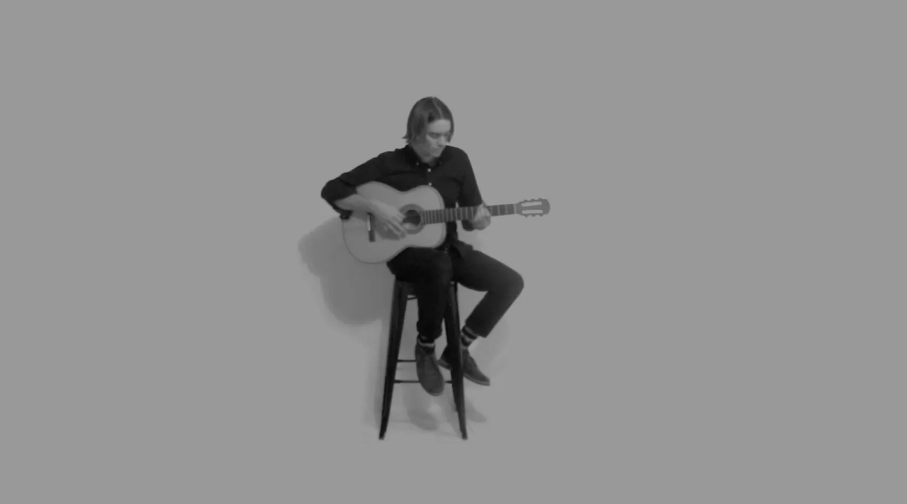
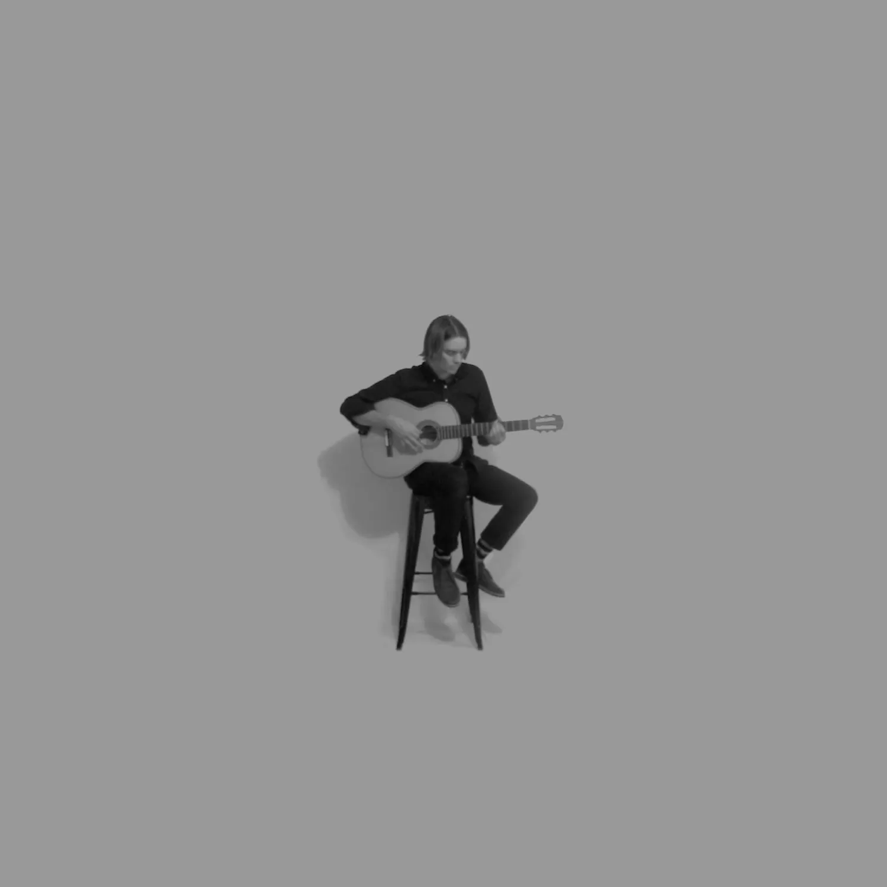
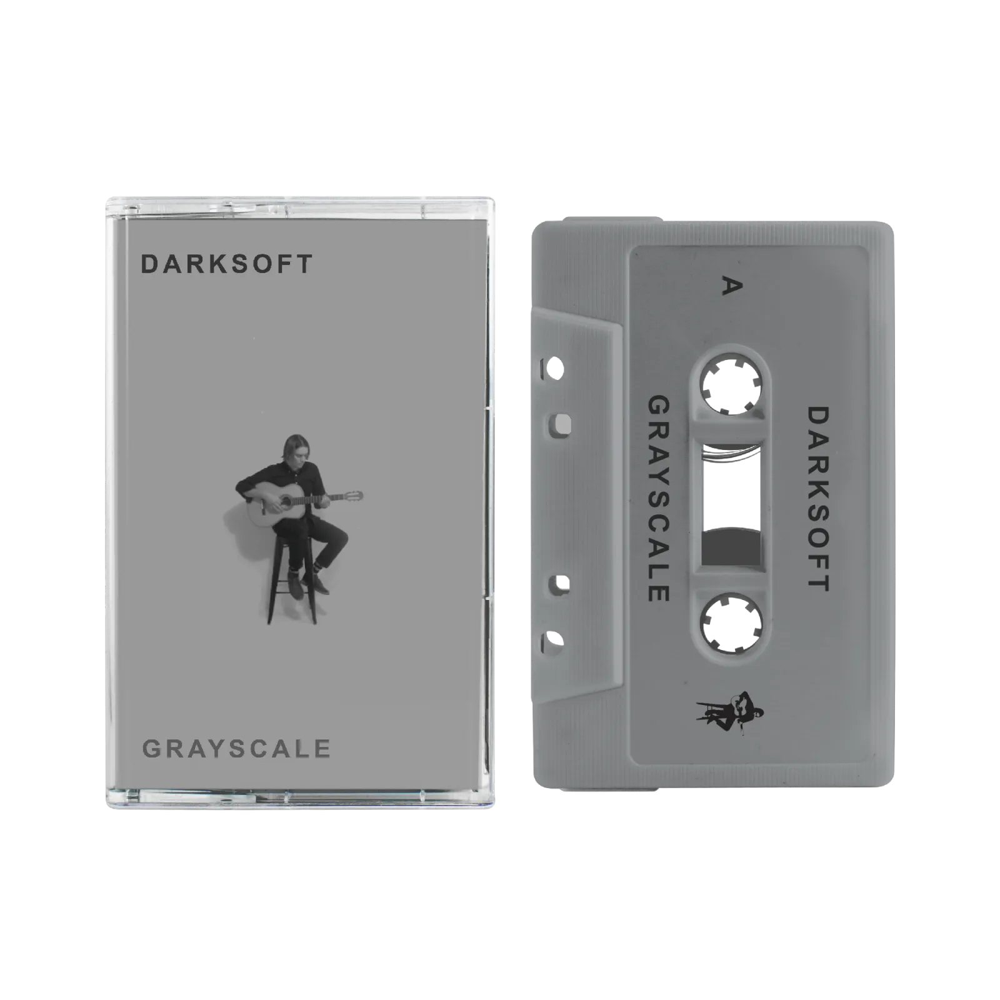

<figure><figcaption>Spirit Goth records releases Grayscale on 12/1/23</figcaption></figure>

**Darksoft** presents a new album, [**Grayscale**](https://sg63.fanlink.to/darksoft-grayscale), ten-song album that follows Darksoft’s [**Beigeification**](/blog/darksoft-releases-new-album-beigeification) (2023). The album was released by [**Spirit Goth records**](https://spiritgoth.com) on Friday, December 1st, 2023. All songs were written and recorded by Darksoft in his home studio.

The album is mixed by [**Brian Fisher**](mailto:brianknolen@gmail.com?subject=Saw%20you%20mixed%20Darksoft's%20album&body=Hi%20Brian%2C%20I'm%20curious%20to%20learn%20more%20about%20your%20mixing%20services%20and%20I%20heard%20about%20you%20on%20the%20Look%20Up%20site.&&bcc=bill%40look-up-records.com) (Hibou, Éclo, Eastern Souvenirs), and mastered by **Stefan Mac** (Cold War Kids, No Vacation, Sea Lemon). **Beigeification** is released alongside music videos for **Yesteryear** and **Less Is More**.

The catalog number is **SG63**. A limited number of cassette tapes will be available on the [Spirit Goth webstore](https://spiritgoth.com/collections/tape). Grayscale will be the featured tape for December, for Spirit Goth’s [**Cassette Club**](https://www.cassetteclub.co), a monthly tape subscription.

If you are a radio DJ wanting downloads, please contact [**Pirate! Promotions**](https://piratepirate.com/darksoft-5/).

### Listen to Grayscale

<a class="button" href="https://darks0ft.bandcamp.com/album/grayscale">Bandcamp</a> <a class="button" href="https://open.spotify.com/album/3jNJF3swIimEIi25q4Ggtt?si=fQa1waPCRtWUzgpPunxuXw">Spotify</a> <a class="button" href="https://www.youtube.com/watch?ab_channel=SPIRITGOTH&v=zQHnN3LsIoU">YouTube</a> <a class="button" href="https://music.apple.com/us/album/grayscale/1716573535">Apple Music</a> <a class="button" href="https://darks0ft.bandcamp.com/album/grayscale">Digital download</a>

<figure></figure>

<iframe src="https://www.youtube-nocookie.com/embed/OTPsk0ktfio" title="Darksoft - Less Is More (Official Video)" loading="lazy" allow="accelerometer; encrypted-media; gyroscope; picture-in-picture; web-share" referrerpolicy="strict-origin-when-cross-origin" allowfullscreen></iframe>

<iframe src="https://www.youtube-nocookie.com/embed/gXELvmbaMgI" title="Darksoft - Yesteryear (Official Video)" loading="lazy" allow="accelerometer; encrypted-media; gyroscope; picture-in-picture; web-share" referrerpolicy="strict-origin-when-cross-origin" allowfullscreen></iframe>

1 Yesteryear

2 Less Is More

3 So It Goes

4 Only Human

5 Whatever Happens

6 Bubblegum

7 All Your Little Cares

8 Staycation

9 You Never Know

## Artist Statement

> The theme of this album is a gray area…
>
> The world is becoming less colorful. It’s a trend we’ve seen over the last 20 years across clothing, everyday objects, cars, and public spaces. This one research study that analyzed thousands of objects over time found that things are literally becoming more gray. Blandness is in, and a ‘less is more’ philosophy is popular. How is it that “nothing became everything we wanted,” as wrote ​​Kyle Chayka for the New York Times? Even McDonald's looks sterile and boring now. We stay indoors and paint interiors black and white and look at pretty colors when we want to buy something on our phones. So it goes, so it goes.
>
> Of course, these generalizations don't apply to everything, but it's something I can't help but notice. In our saturated and confusing post-digital lives, I think it’s easy to see an allure in fading into emotionless sameness and minimalism. Throughout Grayscale, I question these ideas in some songs (see “Bubblegum,” “Only Human”) and embrace them in others (see “Less Is More,” “So It Goes,” "Whatever Happens"). But the album isn’t 100% about all that. There are references to the sun, fully automated luxury communism, life in the PNW, and other ideas. Like I said, it's a gray area.
>
> I see Grayscale as a direct follow-up to Beigeification, which was released in January 2023. Sonically, I’m aiming for a similar sound and an overall neutral tone. But I also pulled on other musical influences in Grayscale and tried out slightly different arrangements.
>
> Lyrically, similar to my last album, I’m using a handful of cliches and idioms that evoke a passive acceptance of whatever’s happening in your life. I hope people can throw this on in the background, and not dwell on anything too much but enjoy the moment, keep it going, and end up feeling refreshed. And, to seek out their own brand of individualism and creativity. Because, you never know what other colors are around the bend... maybe it’ll be a neat turquoise or a bold carmine.”
>
> - Darksoft
