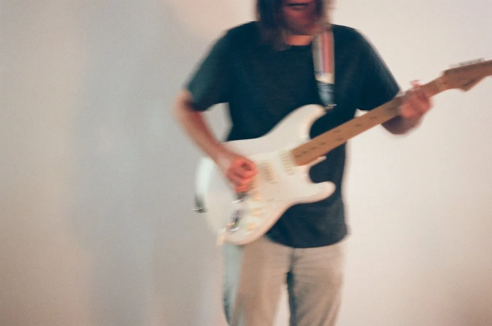

Recording electric guitar direct-in (DI) used to get a bad rep. But, with the breakthroughs in desktop interfaces and plugins, you can pretty much achieve any sort of sound you want with DI. And, I'd actually argue you can get better results than the traditional method of mic-ing a live performance through a guitar amplifier.

I prefer the DI sound because I love getting a clean, pure input. Plenty of micro-genres, like dream pop, [bedroom pop](/blog/darksoft-releases-new-single-it-is-what-it-is), darkwave, new wave, slacker rock, and some trap or hip-hop, even benefit from a DI sound. If you're going for anything with an '80s bent or are planning to add compression, reverb, and delays over a clean input, DI can sound awesome.

Recording clean also sets you up well for reamping. “Reamping is a great way to add your own unique effect chain and amp tone to a clean DI signal,” adds audio engineer [**Brian Fisher**](mailto:brianknolen@gmail.com?subject=Heard%20about%20you%20on%20the%20Look%20Up%20blog!&body=Hi%20Brian%2C%20I%20heard%20about%20your%20mixing%20work%20from%20Darksoft%20on%20the%20Look%20Up%20blog.%20I'm%20curious%20to%20learn%20more%20about%20your%20services.&cc=bill%40look-up-records.com), who is a freelance mixing engineer and Channel Marketing & Operations Manager for [**Lewitt**](https://www.lewitt-audio.com). “With the performance already captured, you can focus on tone and dialing in the best results to enhance the guitar part,” he says.

But, even though recording DI is easier than the traditional studio method, there is still an art to getting it right. It's more than just plugging in. For one, recording DI can expose imperfections in your playing moreso than when amplified. There are also some nuances to the home recording process and some hardware that you'll need to get the best sound.

Below, I'll outline some of my secret techniques for recording guitar DI for desktop music production. I've picked up these tips over the literally thousands of hours I've spent recording guitar DI in my home studio, using various setups of guitars, computers, laptops, audio interfaces, and DAWs, over the last 15 years or so. These are the techniques I use when producing [**Darksoft**](https://www.darksoft.band).

Below, I won't focus on what plugins or effects I'm using. Instead, I'll focus on the outboard gear, playing styles, guitar tech, and tonality improvements to help you get a superb DI input. I'll also assume you have a desktop computer or laptop and the space to record.

I learned all this stuff on my own through trial and error. Also, I typically play on an [**Eric Johnson series Fender Stratocaster**](https://www.amazon.com/Fender-Johnson-Stratocaster-Maple-Fretboard/dp/B000GAOZVE/ref=sr_1_1?_encoding=UTF8&%3Bkeywords=Eric%20Johnson%20series%20Fender%20Stratocaster&%3Bqid=1701796083&%3Bsprefix=eric%20johnson%20series%20fender%20stratocaster%252Caps%252C423&%3Bsr=8-1&%3Bufe=app_do%253Aamzn1.fos.17f26c18-b61b-4ce9-8a28-de351f41cffb&camp=1789&creative=9325&crid=22BYM532RU3WD&linkCode=ur2&linkId=2ab653ccd8e8d1ea12589e744742ce49&tag=lookuprecords-20), so some of my perspective is crafted through using that instrument a lot in recent years.

## Use A High-Quality USB Desktop Interface

<figure><a href="https://www.amazon.com/Universal-Audio-Apollo-Twin-Heritage/dp/B08NYK33B5/ref=sr_1_2_sspa?_encoding=UTF8&camp=1789&creative=9325&crid=3N8AFY087I9WO&keywords=Apollo%20Twin%20USB&linkCode=ur2&linkId=0395baf0e382ac92fa89a527170e483b&psc=1&qid=1701796257&s=musical-instruments&sp_csd=d2lkZ2V0TmFtZT1zcF9hdGY&sprefix=apollo%20twin%20usb%252Cmi%252C150&sr=1-2-spons&tag=lookuprecords-20">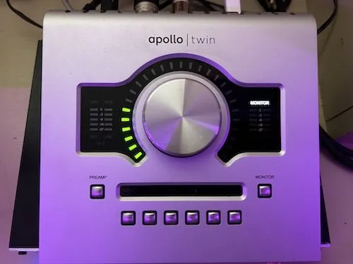</a><figcaption>I’ve used an <a href="https://www.amazon.com/Universal-Audio-Apollo-Twin-Heritage/dp/B08NYK33B5/ref=sr_1_2_sspa?_encoding=UTF8&amp;camp=1789&amp;creative=9325&amp;crid=3N8AFY087I9WO&amp;keywords=Apollo%20Twin%20USB&amp;linkCode=ur2&amp;linkId=0395baf0e382ac92fa89a527170e483b&amp;psc=1&amp;qid=1701796257&amp;s=musical-instruments&amp;sp_csd=d2lkZ2V0TmFtZT1zcF9hdGY&amp;sprefix=apollo%20twin%20usb%252Cmi%252C150&amp;sr=1-2-spons&amp;tag=lookuprecords-20">Apollo Twin USB</a> interface on all Darksoft recordings.</figcaption></figure>

If you intend to record DI for the long haul, investing in a high-quality USB interface will be well worth it. And there are many viable options for desktop interfaces from M-Audio, PreSonus, Scarlett, or other manufacturers.

Personally, I use an [**Apollo Twin USB**](https://www.amazon.com/Universal-Audio-Apollo-Twin-Heritage/dp/B08NYK33B5/ref=sr_1_2_sspa?_encoding=UTF8&camp=1789&creative=9325&crid=3N8AFY087I9WO&keywords=Apollo%20Twin%20USB&linkCode=ur2&linkId=0395baf0e382ac92fa89a527170e483b&psc=1&qid=1701796257&s=musical-instruments&sp_csd=d2lkZ2V0TmFtZT1zcF9hdGY&sprefix=apollo%20twin%20usb%252Cmi%252C150&sr=1-2-spons&tag=lookuprecords-20). UAD produces hardware with some of the highest fidelity audio conversions on the market, and the latency is extremely low. I love using it as a preamp for my guitar. It's also versatile for multi-tracking bass, vocals, percussion, or synth.

<figure><figcaption><a href="https://elasticstage.com/es/referral/3YJ57FIV"><strong>Elastic Stage</strong></a> lets indie artists sell vinyl with no upfront costs, inventory, or shipping. <a href="https://elasticstage.com/es/referral/3YJ57FIV"><strong>We use it and recommend it</strong></a>.</figcaption></figure>

## Find The Right Digital Audio Workstation (DAW)

<figure>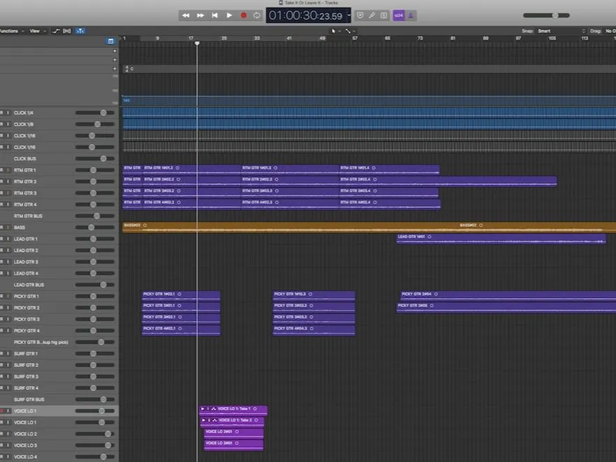<figcaption>Logic Pro X is my DAW of choice. The key commands are a second language to me!</figcaption></figure>

Use a digital audio workstation (DAW) that makes sense for you. Many DAWs are on the market, and they all do very similar things. I think ProTools is a bit overkill. I use [**Logic Pro**](https://apps.apple.com/us/app/logic-pro/id634148309?itscg=30200&itsct=apps_box_link&mt=12). But I've seen others successfully use Garageband, Audacity, or other DAWs.

If you are just starting out or only focused on getting dry inputs, any of these DAWs could work. The next level is to understand the intricacies of your DAW to be super productive, like its key commands, plugins, project templates, and more, which deserves another blog post.

## Get One High Quality, Gold-Plated Cord

<figure><a href="https://www.amazon.com/Mogami-GOLD-INSTRUMENT-03-Instrument-Connectors/dp/B0002E291C/ref=sr_1_2?_encoding=UTF8&camp=1789&creative=9325&crid=TH15YPRBOZ00&keywords=3ft%20Mogami%20Gold%201%252F4%2522%20cable&linkCode=ur2&linkId=ef522f04e7353176b77a8c8e060711e8&qid=1701796706&sprefix=3ft%20mogami%20gold%201%252F4%20cable%252Caps%252C159&sr=8-2&tag=lookuprecords-20&ufe=app_do%253Aamzn1.fos.17d9e15d-4e43-4581-b373-0e5c1a776d5d">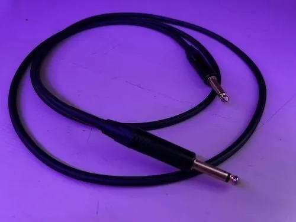</a><figcaption>Invest in at least one top-of-the-line 1/4” cable.</figcaption></figure>

You want the highest fidelity possible. But cables are expensive. Heck, when you add all this equipment up, it's not cheap. One way to reduce cost is to reduce the length of the high-end cable you use for recording. I recommend purchasing one short, high-quality, top-of-the-line 1/4" cable with gold-plated plugs that you only use for recording.

For example, I use a [**3ft Mogami Gold 1/4" cable**](https://www.amazon.com/Mogami-GOLD-INSTRUMENT-03-Instrument-Connectors/dp/B0002E291C/ref=sr_1_2?_encoding=UTF8&camp=1789&creative=9325&crid=TH15YPRBOZ00&keywords=3ft%20Mogami%20Gold%201%252F4%2522%20cable&linkCode=ur2&linkId=ef522f04e7353176b77a8c8e060711e8&qid=1701796706&sprefix=3ft%20mogami%20gold%201%252F4%20cable%252Caps%252C159&sr=8-2&tag=lookuprecords-20&ufe=app_do%253Aamzn1.fos.17d9e15d-4e43-4581-b373-0e5c1a776d5d). But there are plenty of other more boutique options that other producers stand by.

<figure><figcaption>Get 10% off CD or merch orders with <a href="https://www.atomicdisc.com?bg_ref=is13kGgPQR">AtomicDisc</a> using our code <a href="https://www.atomicdisc.com?bg_ref=is13kGgPQR"><strong>LookUpRecords</strong></a>.</figcaption></figure>

## Turn Off The Effects

<figure>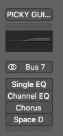<figcaption>Bye bye for now, effects. See you soon.</figcaption></figure>

Okay, I know the urge to apply many plugins right away to create a wall of sound, with drives, delays, flanger, reverb, amp simulation, compression, you name it. But when you record DI, I recommend starting without any effects to focus first on getting a clean input. Disable any plugins within your digital audio workstation (DAW), and plug directly into your interface without pedals.

Doing this will help you hear how the guitar actually sounds naturally. This can help expose unintentional sounds in your playing, like accidental jangly twangs, fingering missteps, or tuning problems. (Doing this has helped me improve as a guitarist). And listening to clean playback makes doubling parts a lot easier. Also, turning off your in-the-box plugins will reduce the monitoring latency as you perform.

## Listen With Studio-Grade Headphones

<figure><a href="https://www.amazon.com/Audio-Technica-ATH-M50x-Professional-Monitor-Headphones/dp/B00HVLUR86/ref=sr_1_1_sspa?_encoding=UTF8&camp=1789&creative=9325&crid=1R51WAZB4JB34&keywords=ath-m30x%252Bby%252Baudio-technica%252Bheadphones&linkCode=ur2&linkId=bc1af5d350f613fe3ef9c28798588971&qid=1701796876&sp_csd=d2lkZ2V0TmFtZT1zcF9hdGY&sprefix=ath-m30x%252Bby%252Bausio-technica%252Bheadphones%252Caps%252C229&sr=8-1-spons&tag=lookuprecords-20&th=1">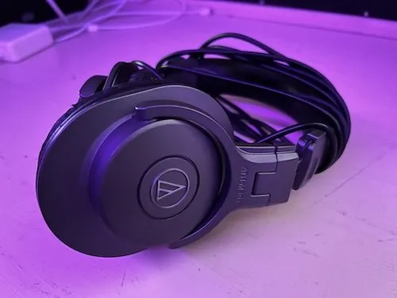</a><figcaption>Any of the <a href="https://www.amazon.com/Audio-Technica-ATH-M50x-Professional-Monitor-Headphones/dp/B00HVLUR86/ref=sr_1_1_sspa?_encoding=UTF8&amp;camp=1789&amp;creative=9325&amp;crid=1R51WAZB4JB34&amp;keywords=ath-m30x%252Bby%252Baudio-technica%252Bheadphones&amp;linkCode=ur2&amp;linkId=bc1af5d350f613fe3ef9c28798588971&amp;qid=1701796876&amp;sp_csd=d2lkZ2V0TmFtZT1zcF9hdGY&amp;sprefix=ath-m30x%252Bby%252Bausio-technica%252Bheadphones%252Caps%252C229&amp;sr=8-1-spons&amp;tag=lookuprecords-20&amp;th=1"><strong>ATH headphones by Audio-Technica</strong></a> will do you well.</figcaption></figure>

On that last note, you need to produce using high-quality audio monitoring. Because what's the point of improving your input sound if you can't hear the nuances? AirPods just aren't going to cut it, plus you can't always use them depending on your setup. Especially if you are in an apartment where sound is an issue, I recommend picking up studio headphones with a standard 1/4" jack.

For example, I use the [**ATH-M30x by Audio-Technica headphones**](https://www.amazon.com/Audio-Technica-ATH-M50x-Professional-Monitor-Headphones/dp/B00HVLUR86/ref=sr_1_1_sspa?_encoding=UTF8&camp=1789&creative=9325&crid=1R51WAZB4JB34&keywords=ath-m30x%252Bby%252Baudio-technica%252Bheadphones&linkCode=ur2&linkId=bc1af5d350f613fe3ef9c28798588971&qid=1701796876&sp_csd=d2lkZ2V0TmFtZT1zcF9hdGY&sprefix=ath-m30x%252Bby%252Bausio-technica%252Bheadphones%252Caps%252C229&sr=8-1-spons&tag=lookuprecords-20&th=1) and stand by any model in that series.

## Dial In The Right Input Volume

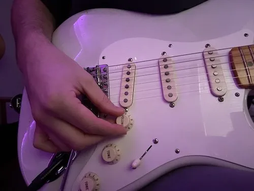

When you focus on DI guitar recording, you want to ensure your instrument produces the best signal possible. Part of this is dialing in the right volume for recording. The input volume should have a low shelf to not produce digital clipping, especially during accents or loud moments in the song. So, test out those moments. I like to leave my guitar volume knob at seven and then adjust the sensitivity of my USB interface's preamp from there.

## Experiment With Guitar Tonality

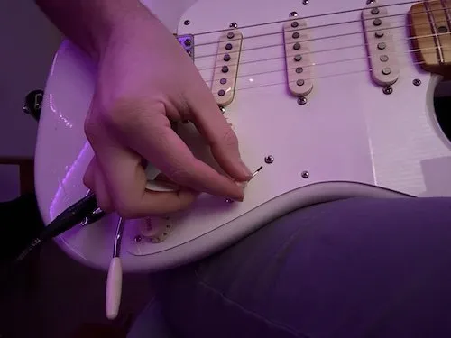

The same guitar can produce a wide range of tones and timbres. For example, my Fender has five distinct pickup settings, each with a slightly different EQ. I typically use a lower-sounding pickup setting for parts that I want to sit in the mid-range of the final mix, like rhythm guitar, and then a higher-sounding pickup setting for lead parts, which I want to sit more on top of the mix. I throw some picky parts somewhere in the middle.

This way, different guitar parts aren't fighting in the sonic plane and making things muddy. The tone knobs are another way to adjust your sound. Regardless, when you find a particular sound that fits, make a note in the track in the DAW so you can recreate the sound easily.

## Use A *Softer* Pick

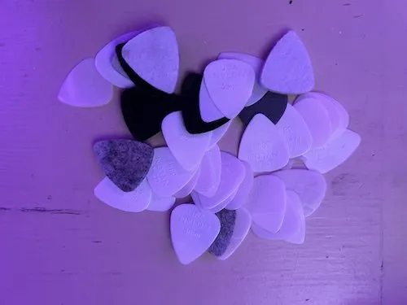

Honestly, I think a softer pick sounds best for DI guitar. I usually use a [**.46mm Dunlop pick**](https://www.amazon.com/Dunlop-44P-46-Nylon-Standard-Players/dp/B0002D0CGM/ref=sr_1_1_pp?_encoding=UTF8&camp=1789&creative=9325&crid=3AB7ENUAZ4VEK&keywords=dunlop%2046mm%20pick&linkCode=ur2&linkId=b31cb70a1c201e9d5d1177db2c617e9b&qid=1701797038&sprefix=.46mm%20Dunlop%20pick%252Caps%252C350&sr=8-1&tag=lookuprecords-20) for rhythm guitar and leads. I have used as soft as a [**.38mm**](https://www.amazon.com/Dunlop-44P-46-Nylon-Standard-Players/dp/B0002D0CGC/ref=sr_1_1_pp?_encoding=UTF8&camp=1789&creative=9325&crid=3AB7ENUAZ4VEK&keywords=dunlop%252B46mm%252Bpick&linkCode=ur2&linkId=be60fbc29d07eb0e11515d1758165864&qid=1701797038&sprefix=.46mm%252BDunlop%252Bpick%252Caps%252C350&sr=8-1&tag=lookuprecords-20&th=1) at times, especially when accenting single chord strums for surfy sounds. I like the soft pick because it produces a smoother full-body sound, and there is less of a chance of the strings hitting the neck and making a clang.

I also do a lot of upward picking, and the softer pick makes that easier, in my experience. Also, if you're a guitarist recording electric bass and uncomfortable with fingering, try out [**felt picks**](https://www.amazon.com/gp/product/B06XDMJWCP/ref=ppx_yo_dt_b_asin_title_o00_s00?_encoding=UTF8&camp=1789&creative=9325&ie=UTF8&linkCode=ur2&linkId=bb79c2e481ec61cf6ac7e7d57f97ab6f&psc=1&tag=lookuprecords-20)! I was recently turned onto them, and now they're my go-to for recording bass.

## Choose A Sweet Picking Spot

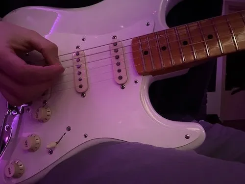

Another way to experiment with different tones is to change \*where\* you pick. And when recording clean DI, the difference becomes more apparent. For example, if you're picking very close to the bridge, it'll produce a tinny sound with an accentuated high-end. Picking farther away from the bridge, on the other hand, will make a more full-bodied mid-range sound. I've used various picking locations for both palm-muting and open-playing styles. There's no "right" way to do this, and it all accounts for taste. Whatever you do, make a note in your project file.

## Track Section By Section

<figure>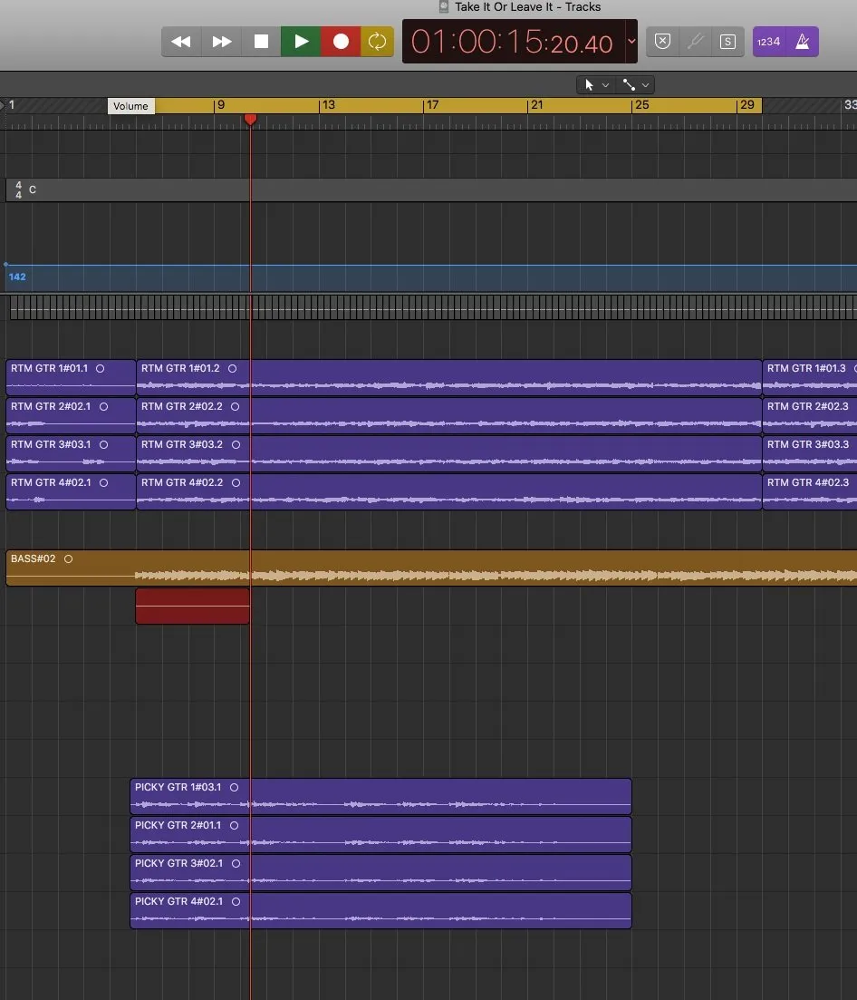<figcaption>I’m only human, okay!?</figcaption></figure>

It can be challenging to get the perfect part down in one sitting. So, don't be afraid to do track bit-by-bit throughout the song or go back and re-record over mistakes with corrections. I often chunk it out from section to section. This type of production is a bit easier when you're recording DI since there is less set-up time before hitting "record," and you can hop around to "punch in" very quickly.

However, the key is to have parts \*sound\* like they're coming from the same take. This requires adding your crossfades! And it means recording at the same volume with the same picking style, intensity, and tonality. (As mentioned above, note this in your project file!)

## Consider Layering and Panning

This is more of a production tip, but I recommend seeing what you can do with layering and panning. I'm obsessed with layering parts in my productions. I often record four of the same tracks per guitar part and hard-pan them, two on each side, for a "wide mono" sound. It can create a truly immersive effect. When layering guitar takes, begin with a scratch take to model and then replicate it in the other tracks as closely as humanly possible.

## *Wait, What's That Buzz?*

Electronic stuff is weird. Even simple setups are sensitive to random feedback and noise. I swear, I've used my setup on one day, and it's been totally fine. And then, the next day, the same rig produces a strange buzz. Or, I'll move my phone one inch and get a random hiss. When this happens, I first check for grounding issues. Then, I remove unnecessary things draining power or producing radiation from the room, like phones, charging cables, batteries, or Bluetooth-enabled devices.

But the electronic weirdness may still haunt you. Sometimes, it’s static build up and I have to ground myself. Other times, when I can't find the source of the issue, I just remove my shirt and press the metal coils on the backside of my guitar to my skin to take away the buzz. (I'm not a professional engineer per se, just a pragmatic one.)

## Reamp Stems For A Natural Amp Sound

Okay. Let's assume you're at the point where you have chosen an excellent input sound and recorded all your parts and layers. Now comes the fun time — mixing and effects! You can do a lot with the native plugins within your DAW. Outside of that, UAD offers some great preamps and plugins. But, if you're not satisfied going all-in on digital effects, another option is to re-amp your stems.

According to mixing engineer Brian Fisher, the reamping process is fairly simple and has two basic steps.

“First, you need to send the DI track out from your DAW and into your guitar amp. Second, you need to set up a microphone to record your amp. To accomplish step one, you should use a dedicated reamp box in order to get the best results. This converts a line level balanced signal from your audio interface to an unbalanced Hi-Z signal, which is what your guitar amp was designed to receive. Once you have the signal sent to your pedalboard and/or amp, you can continue as you normally would when recording electric guitar with the added benefit of having your performance already captured so you can just focus on dialing in your tone.”

Brian adds a couple of additional tips:

1. Mute your studio monitors during this process so you don't accidentally create a feedback loop.

2. There will be added latency during the analog to digital and digital to analog process, so you will need to compensate for that either manually (by sliding the audio to line up with the DI tracks) or by using your DAW's built in latency compensation (Logic's I/O plugin is a great tool for this).

*By the way, audio engineer* ***Brian Fisher*** *does this re-amping technique very well. (Listen to his work on my album* [***Grayscale***](https://open.spotify.com/album/3jNJF3swIimEIi25q4Ggtt?si=NbdBuckvSs2F-i3g5NfIkA)*). I highly recommend him as a mixer if you are looking for help with your project.* [***Send him an email here***](mailto:brianknolen@gmail.com?subject=I%20heard%20about%20you%20on%20the%20Look%20Up%20blog!&body=Hi%20Brian%2C%20I%20heard%20about%20your%20mixing%20work%20from%20Darksoft%20on%20the%20Look%20Up%20blog.%20I'm%20curious%20to%20learn%20more%20about%20your%20services.&cc=bill%40look-up-records.com)*, mention Look Up sent you, and he'll treat you well.*

Brian Fisher reamps a guitar part for my song ‘So It Goes,’ off Grayscale (2023).

## Final Thoughts: Pretend It's A Studio

<figure>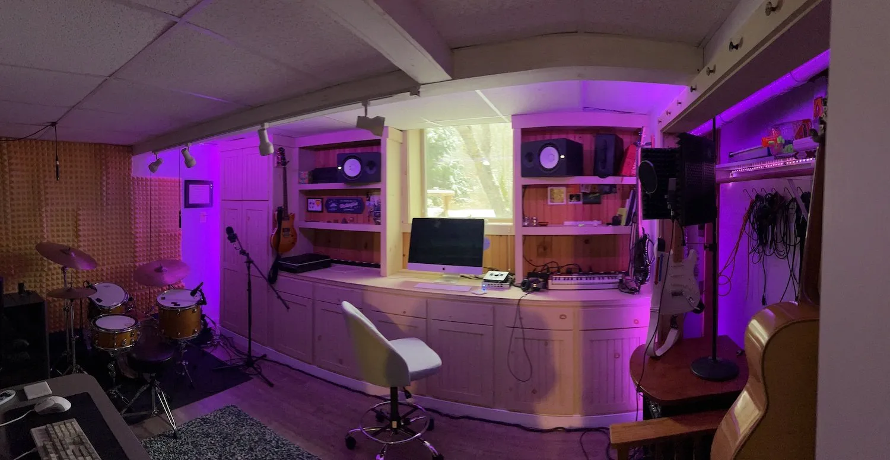<figcaption>The Darksoft lab!</figcaption></figure>

I love recording electric guitar DI because it encourages you to focus on the songwriting and your parts first instead of getting lost in what effects or plugins you want to use. Of course, DI is not great for every scenario — sometimes, you may want that distorted, drivey amp fuzz that only a nasty [**RAT distortion pedal**](https://www.amazon.com/Pro-Co-RAT2-Distortion-Pedal/dp/B0002MSQVQ/ref=sr_1_1?_encoding=UTF8&camp=1789&creative=9325&crid=1I9YTE0IGQVQ2&keywords=RAT%20pedal&linkCode=ur2&linkId=d52e14d1b5effe89246d0f88ca2155a5&qid=1701797705&s=musical-instruments&sprefix=rat%20pedal%25252Cmi%25252C248&sr=1-1&tag=lookuprecords-20&ufe=app_do%25253Aamzn1.fos.17d9e15d-4e43-4581-b373-0e5c1a776d5d) and amp can deliver.

But when you want to start with a clean sound as a foundation, DI is a great option. What's more, unlike the traditional method of mic'-ing a guitar amplifier in a recording studio, DI is a cost-effective, lightweight alternative. And did I mention it's silent if your headphones are in? Here come the 3AM sessions...

I'm still learning, and this to-do list has evolved over time. Music is subjective, but these "best practices" have worked for me. Here are a few other quick recommendations:

- **Set up your guitar now and then**: I recommend seeing a professional every other year to set up your guitar to ensure the intonation and sustain are good and to fix anything that may be wrong electronically.
- **Tune, tune, tune**: Tune after each take. It's annoying to do, but it'll be worth it in the end.
- **Record to a click**: Logic's click sucks and is too quiet. Make your own using samples. I use a woodblock sample from my [**Alesis SR-19 drum machine**](https://www.amazon.com/Alesis-Studio-Grade-Standalone-Performance-MID-305BK/dp/B08SRGXR4M/ref=sr_1_1?_encoding=UTF8&camp=1789&creative=9325&crid=3C1NL7ABFSQ66&keywords=Alesis%20SR-19%20drum%20machine&linkCode=ur2&linkId=8d63eba27c02ebf1e24d33a8aafe8999&qid=1701798770&s=musical-instruments&sprefix=alesis%20sr-19%20drum%20machine%252Cmi%252C138&sr=1-1&tag=lookuprecords-20).
- **Change your strings**: If the guitar starts to sound dead with less sustain, changing your strings is an easy fix. But, when you do so, play them a bit *before* recording. I don't use any fancy strings — the [**Earnie Ball Power Slinky 11-48 pack**](https://www.amazon.com/Ernie-Ball-Slinky-Electric-Strings/dp/B00J8RWSL0/ref=sr_1_4?_encoding=UTF8&camp=1789&creative=9325&crid=1CCKF7YU3CDPF&keywords=ernie%20ball%20power%20slinky%2011%20pack&linkCode=ur2&linkId=54a556d5fb4a54fe27b5d5ece19353fc&qid=1701798824&s=musical-instruments&sprefix=earnie%20ball%20power%20slinky%2011%20pack%252Cmi%252C167&sr=1-4&tag=lookuprecords-20) suits me fine.
- **Use project templates**: As a general thumb for any recording project, it's good to reuse DAW templates that have all your presets ready to go. Then, you can get started quickly when you have a new idea.
- **Your reference monitors matter**: Besides headphones, studio monitors are integral to hearing the overall sound. I recommend the [**8-inch Yamaha HS8 Studio Monitors**](https://www.amazon.com/Yamaha-8-Inch-Powered-Studio-Monitor/dp/B08BGC6DRY/ref=sr_1_2?_encoding=UTF8&camp=1789&creative=9325&crid=3KZ3N5JPHNV31&keywords=8-inch%20Yamaha%20HS8%20Studio%20Monitors&linkCode=ur2&linkId=10c7be5b7cff3ac23392399a16cfe1f6&qid=1701798895&s=musical-instruments&sprefix=8-inch%20yamaha%20hs8%20studio%20monitors%252Cmi%252C201&sr=1-2&tag=lookuprecords-20&ufe=app_do%253Aamzn1.fos.2b70bf2b-6730-4ccf-ab97-eb60747b8daf) for a well-balanced audio spectrum.
- **Have a stable setup**: If you can afford it, have a permanent recording setup. As in, dedicate a place for recording and use a desktop computer that doesn't move. This will ensure things are less prone to errors from day to day.

I really like Fran Lebowitz's Netflix series "Pretend it's a City," and I'll echo that by saying, "pretend it's a studio." It's not your bedroom — it's your *studio*.

The beauty of home recording is that you have all the time in the world. Sure, it requires some upfront investment into gear, but it's well worth it for lifers. You're not on the clock like in a professional recording studio, and you can enter the creative process whenever it works for you.

The downside of this freedom is that you could devalue your work or feel unmotivated to finish a project. You may end up settling for less. So, to take it seriously, keep a clean workstation and pretend it's a studio. The end result might surprise you and your listeners.
