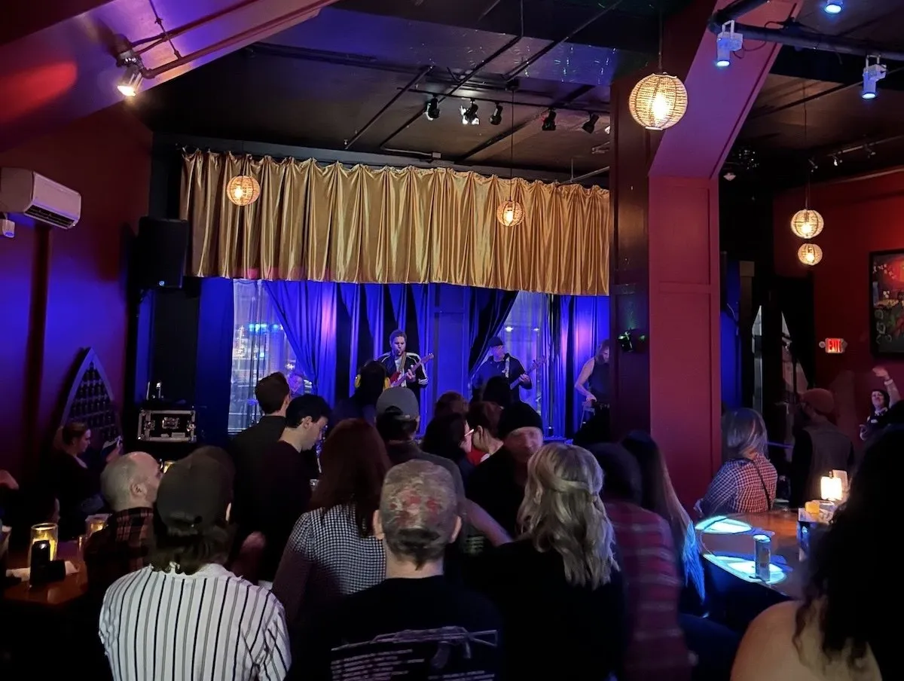
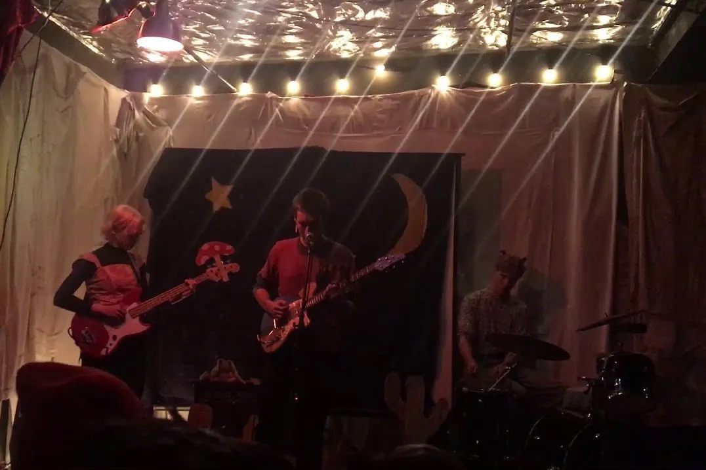
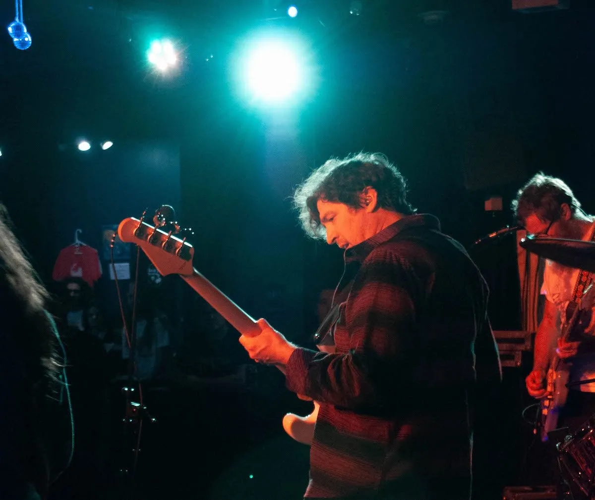
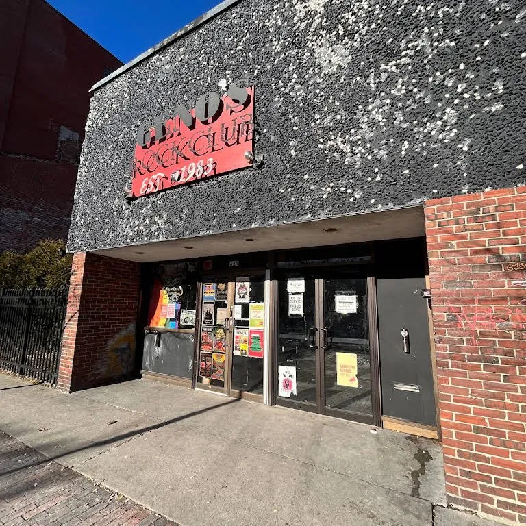
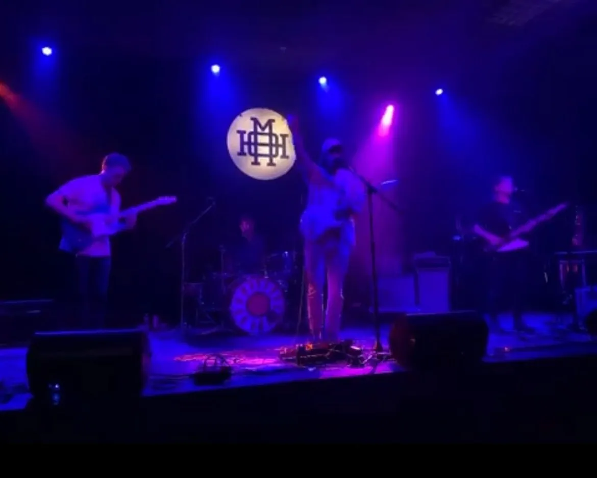
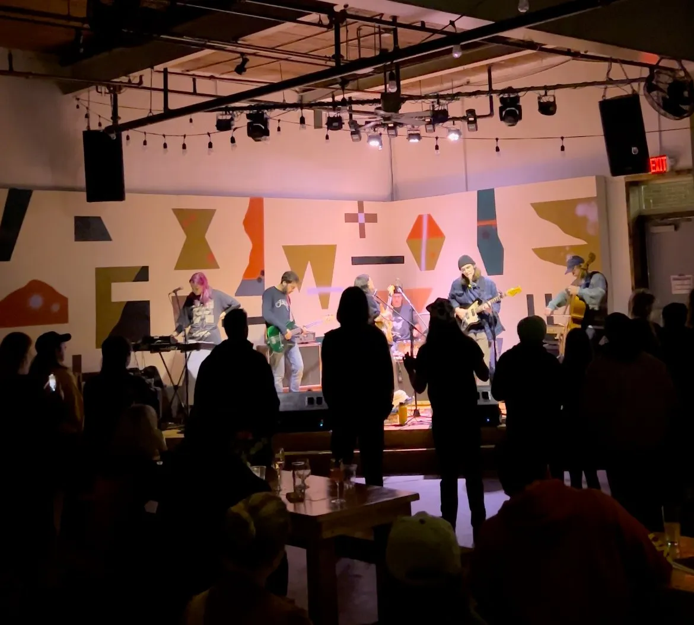
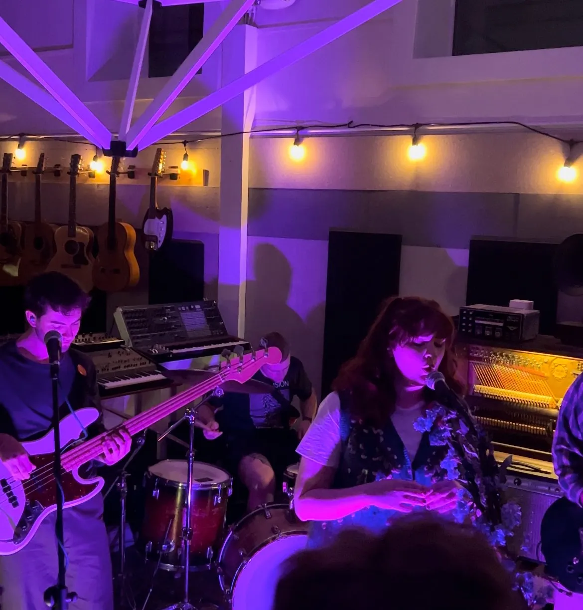
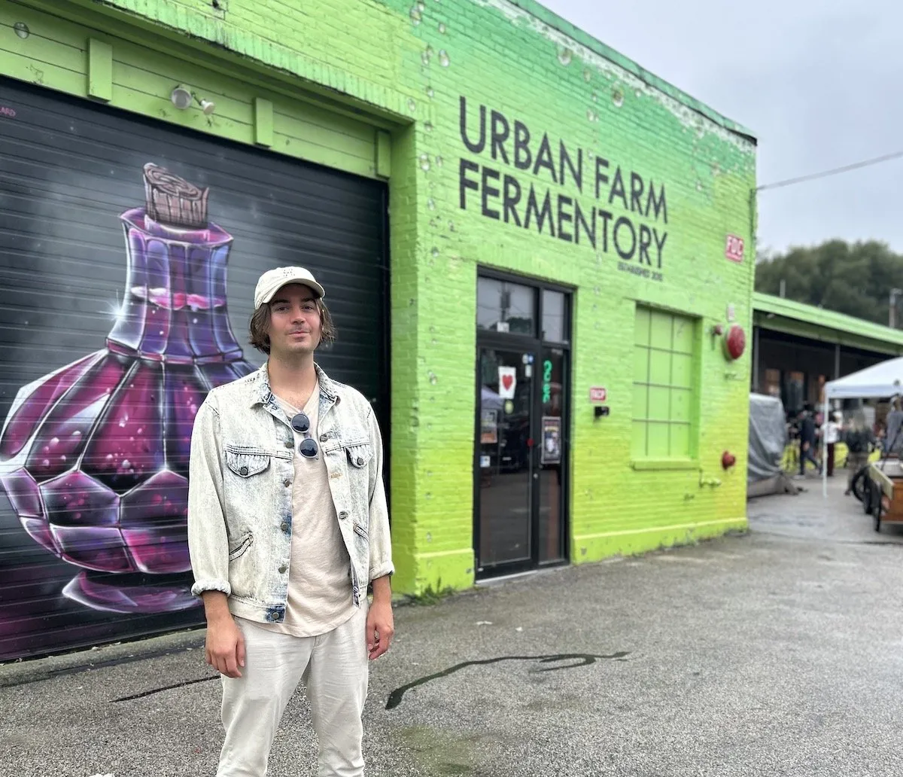
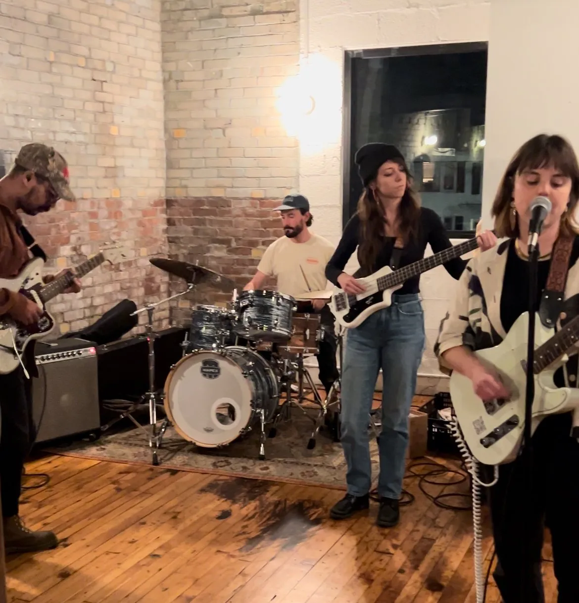
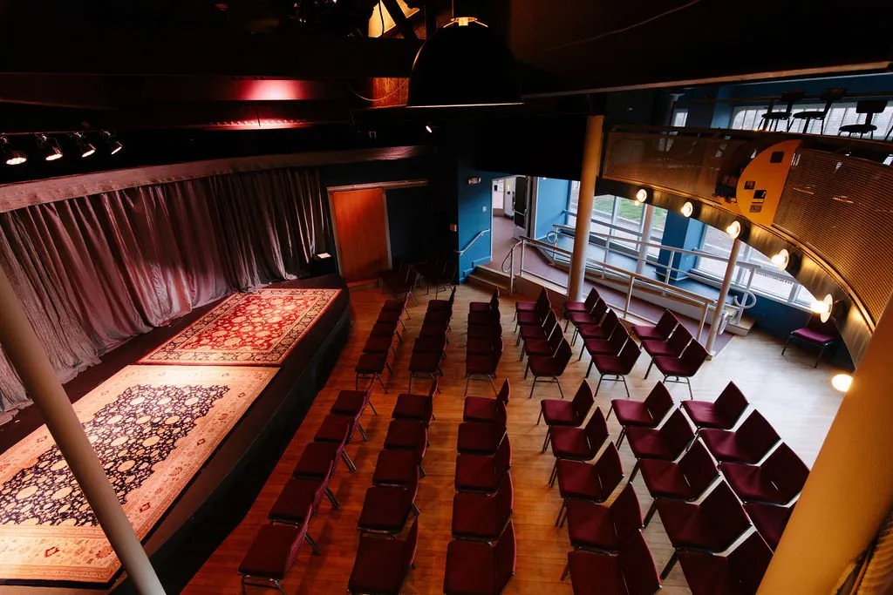

**Portland**, **Maine**, is mostly known for lobsters and lighthouses. But it also has an active **local music scene**, making it an excellent stop for your next **east coast tour**. Below, I'll review some of the **small-to-medium music venues** in the city that are ideal for do-it-yourself (DIY) booking.

I'll walk you through nearly all the **underground stages** that Portland offers, along with ways to contact the bookers. All the music stages below are roughly in the **50-200** attendee capacity range, and most cater to a 21+ crowd, unless otherwise mentioned. I’ve played at a handful of them.

## [BPM](https://web.archive.org/web/20240215211014/https://www.blueportlandmaine.com/)

<figure><figcaption>Greasy Grass plays live at Blue.</figcaption></figure>

Established in 2005, [BPM](https://web.archive.org/web/20240215211014/https://www.blueportlandmaine.com/) (Blue Portland Maine) is an intimate nightclub right in the heart of downtown, on Congress St. This venue is great if you are trying to pack a small room. Blue is open to all genres and routinely hosts jazz, rock, salsa, and singer-songwriters for open mic nights. The venue is under new(ish) management, and they are very friendly and easy to work with. They don't seem to book too far out. The stage has a simple PA with monitors and an overall good sound. There is usually a TV in the back playing Airplane! on VHS. *And don’t call me Shirley.*

Booking: [booking@blueportlandmaine.com](mailto:booking@blueportlandmaine.com?)

* * *

## The Apohadion Theater

<figure><figcaption>Yellowfront plays live at The Apohadion Theater.</figcaption></figure>

[The Apohadion](https://web.archive.org/web/20231129073923/https://apohadiontheater.com/) is a DIY art space that hosts an eclectic array of events. This alternative stage welcomes everything from indie music bills to film screenings. So if you are in an experimental lo-fi noise band or debuting your electric citar act, this might be your place to call home (If you can pronounce the name of the venue — *Apo-what?*). I recommend approaching this venue with other artists interested in joining your bill.

Booking: [info@apohadiontheater.com](mailto:info@apohadiontheater.com?subject=Booking%20for%20%5BBAND%20NAME%5D%20tour%20-%20Apohadion%20Theater%20-%20Portland%2C%20ME%20-%20%5BDATE%5D&body=Hey%20there%2C%20%0A%0AI'm%20booking%20a%20tour%20from%20my%20band%20and%20we're%20hoping%20to%20get%20a%20date%20in%20Portland%20Maine%20on%20%5BDATE%5D.%20Could%20you%20give%20us%20a%20hold%3F%0A%0AYou%20can%20listen%20to%20our%20recordings%20%5BHERE%5D%20and%20%5BHERE%5D.%20I%20think%20we%20could%20pull%20about%20%5B%23%5D%20people.%0A%0AWe%20have%20some%20local%20bands%20interested%20in%20playing%20this%20night%2C%20including%20%5BBAND%20%231%5D%20and%20%5BBAND%20%232%5D.%20%0A%0AHere's%20our%20band%20bio%20with%20more%20information%3A%20%5BINSERT%20BAND%20BIO%5D%0A%0ASome%20folks%20have%20said%20our%20music%20is%20like%20%22%5BINSERT%20PRESS%20QUOTE%20HERE%5D.%22%20%0A%0AAnd%20here's%20some%20social%20links%3A%20%5BINSERT%20LINKS%5D%0A%0ALet%20me%20know%20if%20you%20are%20interested!%0A%0A(FYI%2C%20I%20heard%20about%20Blue%20from%20reading%20Darksoft's%20post%20on%20the%20Look%20Up%20blog...)%20%20)

* * *

<figure><figcaption><a href="https://elasticstage.com/es/referral/3YJ57FIV"><strong>Elastic Stage</strong></a> lets indie artists sell vinyl with no upfront costs, inventory, or shipping. <a href="https://elasticstage.com/es/referral/3YJ57FIV"><strong>We use it and recommend it</strong></a>.</figcaption></figure>

## SPACE

<figure><figcaption>Make space for SPACE, it’s a safe place.</figcaption></figure>

[SPACE](https://space538.org) is a non-profit arts space in a good location, right in downtown Portland on Congress St. The venue hosts arts exhibitions and events. I've seen SPACE host various styles of music, from folk to experimental orchestral sounds, indie rock, singer-songwriter, punk/metal, and more. It seems to welcome smaller acts and also attract some touring artists with larger draws. It has an elevated stage and decent sound system.

Information: [info@space538.org](mailto:info@space538.org?&subject=Booking%20request&body=Hey%20there%2C%20%0A%0AI'm%20booking%20a%20tour%20from%20my%20band%20and%20we're%20hoping%20to%20get%20a%20date%20in%20Portland%20Maine%20on%20%5BDATE%5D.%20Could%20you%20give%20us%20a%20hold%3F%0A%0AYou%20can%20listen%20to%20our%20recordings%20%5BHERE%5D%20and%20%5BHERE%5D.%20I%20think%20we%20could%20pull%20about%20%5B%23%5D%20people.%0A%0AWe%20have%20some%20local%20bands%20interested%20in%20playing%20this%20night%2C%20including%20%5BBAND%20%231%5D%20and%20%5BBAND%20%232%5D.%20%0A%0AHere's%20our%20band%20bio%20with%20more%20information%3A%20%5BINSERT%20BAND%20BIO%5D%0A%0ASome%20folks%20have%20said%20our%20music%20is%20like%20%22%5BINSERT%20PRESS%20QUOTE%20HERE%5D.%22%20%0A%0AAnd%20here's%20some%20social%20links%3A%20%5BINSERT%20LINKS%5D%0A%0ALet%20me%20know%20if%20you%20are%20interested!%0A%0A(FYI%2C%20I%20heard%20about%20Blue%20from%20reading%20Darksoft's%20post%20on%20the%20Look%20Up%20blog...)%20%20)

* * *

## Sun Tiki

<figure><figcaption>Crystal Canyon melts faces at Sun Tiki. Photo by Brett Davis Jr.</figcaption></figure>

[Sun Tiki Studios](https://www.suntikistudios.com) was my first introduction to Portland’s independent music scene. It's an intimate all-ages live music venue that can pack a crowd. The acoustics of the stage are really dialed in here. The venue has a knack for booking locals and traveling alternative rock bands. Sun Tiki is unique in this list because it also offers rehearsal studios. One downside is the location is not on a main strip. If you end up playing here, head down Forest Ave to [The Great Lost Bear](http://greatlostbear.com/glbmobile.html) for a bite after soundcheck.

*Fun fact: the venue got its name and branding from the tanning parlor 'Sun Tiki Tanning' that once occupied the spot.*

Booking: [booking@suntikistudios.com](mailto:booking@suntikistudios.com?body=Hey%20there%2C%20%0A%0AI'm%20booking%20a%20tour%20from%20my%20band%20and%20we're%20hoping%20to%20get%20a%20date%20in%20Portland%20Maine%20on%20%5BDATE%5D.%20Could%20you%20give%20us%20a%20hold%3F%0A%0AYou%20can%20listen%20to%20our%20recordings%20%5BHERE%5D%20and%20%5BHERE%5D.%20I%20think%20we%20could%20pull%20about%20%5B%23%5D%20people.%0A%0AWe%20have%20some%20local%20bands%20interested%20in%20playing%20this%20night%2C%20including%20%5BBAND%20%231%5D%20and%20%5BBAND%20%232%5D.%20%0A%0AHere's%20our%20band%20bio%20with%20more%20information%3A%20%5BINSERT%20BAND%20BIO%5D%0A%0ASome%20folks%20have%20said%20our%20music%20is%20like%20%22%5BINSERT%20PRESS%20QUOTE%20HERE%5D.%22%20%0A%0AAnd%20here's%20some%20social%20links%3A%20%5BINSERT%20LINKS%5D%0A%0ALet%20me%20know%20if%20you%20are%20interested!%0A%0A(FYI%2C%20I%20heard%20about%20Blue%20from%20reading%20Darksoft's%20post%20on%20the%20Look%20Up%20blog...)%20%20&subject=Booking%20Sun%20Tiki)

* * *

<figure><figcaption>Get 10% off CD or merch orders with <a href="https://www.atomicdisc.com/?bg_ref=is13kGgPQR"><strong>AtomicDisc</strong></a> using our code <a href="https://www.atomicdisc.com/?bg_ref=is13kGgPQR"><strong>LookUpRecords</strong></a>.</figcaption></figure>

* * *

## GEno's Rock Club

Geno's Rock Club is an absolute staple in Portland, Maine. The current venue can trace its roots to a different spot within the city, which began operating in the early '80s. Geno's is on the harder side, so if you are playing punk or metal, this is a spot for you. That's the reputation, at least. This is another venue in the heart of downtown, on Congress St. *I've heard that if a pebble from the Geno's sign falls on the head of a smoker on the sidewalk, it blesses them with eternal good luck.*

Contact: (207) 747-5594

* * *

<a class="button" href="/blog/how-to-self-release-your-album">Also Read: How to Self-Release Your Album</a>

* * *

## Portland House of Music & Events (PHOME)

<figure><figcaption>Darksoft plays live at Portland House of Music &amp; Events (PHOME)</figcaption></figure>

[Portland House of Music & Events](https://www.portlandhouseofmusic.com) (PHOME), pronounced "P-home," is a medium-sized room ideal for regional to national touring bands in various genres. They also book a *lot* of tribute bands. The capacity is larger than the other venues listed in this roundup, so make sure it's a good fit before reaching out. They also seem to book farther in advance. The raised stage and sound system is awesome, the crew is solid, and the venue has a green room upstairs for performers. It's also situated near **Old Port** on a side street that's relatively easy to load in during the early hours. *I want to play here again!*

Booking: [booking@portlandhouseofmusic.com](mailto:booking@portlandhouseofmusic.com?subject=Booking%20PHOME&body=Hey%20there%2C%20%0A%0AI'm%20booking%20a%20tour%20from%20my%20band%20and%20we're%20hoping%20to%20get%20a%20date%20in%20Portland%20Maine%20on%20%5BDATE%5D.%20Could%20you%20give%20us%20a%20hold%3F%0A%0AYou%20can%20listen%20to%20our%20recordings%20%5BHERE%5D%20and%20%5BHERE%5D.%20I%20think%20we%20could%20pull%20about%20%5B%23%5D%20people.%0A%0AWe%20have%20some%20local%20bands%20interested%20in%20playing%20this%20night%2C%20including%20%5BBAND%20%231%5D%20and%20%5BBAND%20%232%5D.%20%0A%0AHere's%20our%20band%20bio%20with%20more%20information%3A%20%5BINSERT%20BAND%20BIO%5D%0A%0ASome%20folks%20have%20said%20our%20music%20is%20like%20%22%5BINSERT%20PRESS%20QUOTE%20HERE%5D.%22%20%0A%0AAnd%20here's%20some%20social%20links%3A%20%5BINSERT%20LINKS%5D%0A%0ALet%20me%20know%20if%20you%20are%20interested!%0A%0A(FYI%2C%20I%20heard%20about%20Blue%20from%20reading%20Darksoft's%20post%20on%20the%20Look%20Up%20blog...)%20%20)

* * *

## Oxbow

<figure><figcaption>Sequela tears it up at Oxbow.</figcaption></figure>

If the venues aren't getting back to you, why not try a brewery? [Oxbow Blending & Bottling in Portland](https://oxbowbeer.com/location/portland/) hosts everything from electronic DJ nights, parties, bands and events in between. Lately, Oxbow has been investing in its stage and is behaving more like your standard ticketed venue with live concerts. This spot is located on Washington Ave on the East End, which is a hip strip with a posh sub shop, a distillery, a good bagel place, and other yum yums.

[Contact Form](https://oxbowbeer.com/contact/)

1 (207) 350-0025

* * *

## Prism Analog

<figure><figcaption>Sullen Eyes plays live at Prism Analog.</figcaption></figure>

[Prism Analog](https://web.archive.org/web/20240827100927/https://prismanalog.org/) is a non-profit vintage recording studio located downtown on Preble St. The studio sometimes opens its doors for intimate showcases in the live room. It’s a tight squeeze, but beautifully designed with a cool retro decor. There are some sound limitations here, and it may be hard to book as it's not a regularly active venue. But it's worth a shot. I could see chill dream pop or jangle pop bands making sense in this space. Did I mention they have a [van for rent](https://web.archive.org/web/20260304115902/https://prismanalog.org/van)?

[Contact Form](https://web.archive.org/web/20250713114334/https://prismanalog.org/contact)

* * *

## Urban Farm Fermentory

<figure><figcaption>Darksoft at Urban Farm Fermentory.</figcaption></figure>

[Urban Farm Fermentory](https://web.archive.org/web/20240118201318/https://www.fermentory.com/) is another brewery that occasionally hosts bands. It's located in the brewery district called East Bayside. In addition to pouring some quality ciders, they put on music [events](https://web.archive.org/web/20240118201312/https://www.fermentory.com/calendar) featuring jazz, alternative, indie, metal and other styles. I once played a solo set on their loading dock for a group of bikers at a motorcycle and bicycle award show, so anything goes, I suppose. *The dream of the 90s is alive in Portland.*

Booking: [events@fermentory.com](mailto:events@fermentory.com?body=Hey%20there%2C%20%0A%0AI'm%20booking%20a%20tour%20from%20my%20band%20and%20we're%20hoping%20to%20get%20a%20date%20in%20Portland%20Maine%20on%20%5BDATE%5D.%20Could%20you%20give%20us%20a%20hold%3F%0A%0AYou%20can%20listen%20to%20our%20recordings%20%5BHERE%5D%20and%20%5BHERE%5D.%20I%20think%20we%20could%20pull%20about%20%5B%23%5D%20people.%0A%0AWe%20have%20some%20local%20bands%20interested%20in%20playing%20this%20night%2C%20including%20%5BBAND%20%231%5D%20and%20%5BBAND%20%232%5D.%20%0A%0AHere's%20our%20band%20bio%20with%20more%20information%3A%20%5BINSERT%20BAND%20BIO%5D%0A%0ASome%20folks%20have%20said%20our%20music%20is%20like%20%22%5BINSERT%20PRESS%20QUOTE%20HERE%5D.%22%20%0A%0AAnd%20here's%20some%20social%20links%3A%20%5BINSERT%20LINKS%5D%0A%0ALet%20me%20know%20if%20you%20are%20interested!%0A%0A(FYI%2C%20I%20heard%20about%20Blue%20from%20reading%20Darksoft's%20post%20on%20the%20Look%20Up%20blog...)%20%20&subject=Booking%20at%20Fermentory%20)

* * *

## THE CAVERN at Free Street

[Free Street](https://freestreetportland.com) has a bar on top and a stage in the basement called The Cavern. It’s called Free Street because it’s on a street called Free St, ya silly goose. This place is sort of all over the place. They hold raves, comedy nights, burlesque, metal, open mics, and the occasional rock and roll bills. Never played here so I can’t vouch for what the experience is like.

Contact: [Freestreetme@gmail.com](mailto:Freestreetme@gmail.com?subject=Booking%20at%20Free%20Street&body=Hey%20there%2C%20%0A%0AI'm%20booking%20a%20tour%20from%20my%20band%20and%20we're%20hoping%20to%20get%20a%20date%20in%20Portland%20Maine%20on%20%5BDATE%5D.%20Could%20you%20give%20us%20a%20hold%3F%0A%0AYou%20can%20listen%20to%20our%20recordings%20%5BHERE%5D%20and%20%5BHERE%5D.%20I%20think%20we%20could%20pull%20about%20%5B%23%5D%20people.%0A%0AWe%20have%20some%20local%20bands%20interested%20in%20playing%20this%20night%2C%20including%20%5BBAND%20%231%5D%20and%20%5BBAND%20%232%5D.%20%0A%0AHere's%20our%20band%20bio%20with%20more%20information%3A%20%5BINSERT%20BAND%20BIO%5D%0A%0ASome%20folks%20have%20said%20our%20music%20is%20like%20%22%5BINSERT%20PRESS%20QUOTE%20HERE%5D.%22%20%0A%0AAnd%20here's%20some%20social%20links%3A%20%5BINSERT%20LINKS%5D%0A%0ALet%20me%20know%20if%20you%20are%20interested!%0A%0A(FYI%2C%20I%20heard%20about%20Blue%20from%20reading%20Darksoft's%20post%20on%20the%20Look%20Up%20blog...)%20%20)

* * *

## Sacred Profane

<figure><figcaption>Little Oso plays a dreamy set at Sacred Profane</figcaption></figure>

Located just a half-hour south of Portland proper, in Biddeford, [Sacred Profane Brewery](https://sacredprofane.com) has emerged as Southern Maine's locus for hardcore. That said, it’s not the only genre they do. There isn't a stage per se — it's essentially a rectangular multi-purpose room upstairs with a PA and you play on the floor. Cool spot though.

Sacred Profane brews two fantastic Czech-style beers, a light and a dark ale, and the kitchen has some tasty bites to boot. This place is no grungey dive — it has a well-manicured atmosphere. If your vibe is screamo meets hanging air plants, Sacred Profane might be your perfect locale.

*Hot tip: if you're playing here, check out* [*Color Sound Oblivion*](https://www.colorsoundoblivion.com)*, a record shop next door for goth, industrial, post-punk, experimental, noise, and electronic records.*

Booking: [Sacovalleyunited@gmail.com](mailto:Sacovalleyunited@gmail.com?subject=Booking%20at%20Sacred%20Profane&body=Hey%20there%2C%20%0A%0AI'm%20booking%20a%20tour%20from%20my%20band%20and%20we're%20hoping%20to%20get%20a%20date%20in%20Portland%20Maine%20on%20%5BDATE%5D.%20Could%20you%20give%20us%20a%20hold%3F%0A%0AYou%20can%20listen%20to%20our%20recordings%20%5BHERE%5D%20and%20%5BHERE%5D.%20I%20think%20we%20could%20pull%20about%20%5B%23%5D%20people.%0A%0AWe%20have%20some%20local%20bands%20interested%20in%20playing%20this%20night%2C%20including%20%5BBAND%20%231%5D%20and%20%5BBAND%20%232%5D.%20%0A%0AHere's%20our%20band%20bio%20with%20more%20information%3A%20%5BINSERT%20BAND%20BIO%5D%0A%0ASome%20folks%20have%20said%20our%20music%20is%20like%20%22%5BINSERT%20PRESS%20QUOTE%20HERE%5D.%22%20%0A%0AAnd%20here's%20some%20social%20links%3A%20%5BINSERT%20LINKS%5D%0A%0ALet%20me%20know%20if%20you%20are%20interested!%0A%0A(FYI%2C%20I%20heard%20about%20Blue%20from%20reading%20Darksoft's%20post%20on%20the%20Look%20Up%20blog...)%20%20)

* * *

## One Longfellow Square

<figure><figcaption>What a warm listening room it is.</figcaption></figure>

Another intimate option in Portland, Maine, is [One Long Fellow Square](https://onelongfellowsquare.com) (OLS), which calls itself a warm “listening room” that books acoustic acts, like country, bluegrass, jazz, blues, and folk. The concerts are typically seated events. They tend to book five months in advance.

[Booking Form](https://onelongfellowsquare.com/about-one-longfellow-square/booking-information/)

* * *

## Other Venues And Ideas

[Flask Lounge](https://flasklounge.com/) hosts DJs and sometimes smaller acts. If you manage a larger group and have your sights on bigger capacity venues in Portland, check out [Aura](https://auramaine.com), [State Theatre](https://statetheatreportland.com), or [Thompson's Point](https://www.thompsonspoint.com/). In addition to the venues mentioned above, [Saco Valley Unvied](https://www.instagram.com/svu_207/) (SVU) is another good contact if you want help with local booking.

Regardless of where you book, typical booking logic applies. When requesting hold dates, I recommend not overstating your pull, suggesting bands to play with, and including streaming links to music, press notes, estimated draw, artists you've played with, and social links.

* * *

## Local Bands To Hit Up

Here are some Portland-area local bands I have seen live or played shows with. They may or may not be active: [Field Studies](https://www.instagram.com/field_studies_music/), **Sequela**, [**Darksoft**](https://darksoft.band), **Snake Lips**, **Little Oso**, **Sullen Eyes**, **FonFonRu**, **Crystal Canyon**, **All False**, **Dead Gowns**, **Greasy Grass**, **Matriarch**, **Red Eft**, and **Gum Parker**.

* * *

## Final Thoughts on Portland Maine Music Spots

I love Portland, Maine. There's hardly any traffic and parking is usually easy, even on weekends. It feels **safe**. The people are **cool**, and attendees are **supportive** of live music. It's just under a two-hour drive from Boston. With the influx of newcomers, the city is growing, but it still feels **undiscovered** and authentic. In short, Portland, Maine, is a **hidden gem**.

In my experience, the larger US cities like Los Angeles, San Francisco, [Seattle](/blog/15-small-capacity-venues-in-seattle-for-touring-bands), or New York City are just too saturated with competing events to be worth it for smaller touring indie bands. So, depending on where you're at, you may have better luck with smaller cities and towns, like Portland, where there are actually people interested in going to your show.

Oh, also, while you're in Portland, Maine, and have time to kill, I recommend visiting [Strange Maine](https://wgme.com/news/local/inside-the-strange-maine-store-where-vhs-tapes-still-reign-supreme-movies-dvd-home-video-video-cassettes-blu-ray-discs-entertainment-videotapes-portland) for VHS, records and random used chockees. Go to Arcadia for pinball and skee-ball. LFK is my favorite bar for a drink and french fries. For food with vegetarian options, check out [El Rayo Taqueria](https://elrayotaqueria.com). Drop an album off at Bull Moose. And visit Weekend Vintage for vintage clothes. And last but not least, keep an eye on the Time and Temperature building... you don't want to be late for your set time, now do you?
