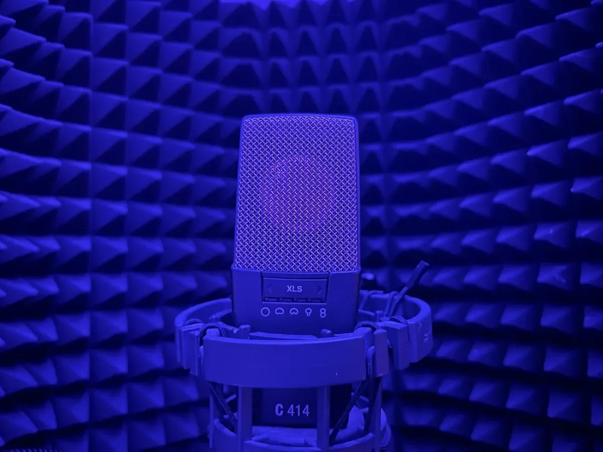
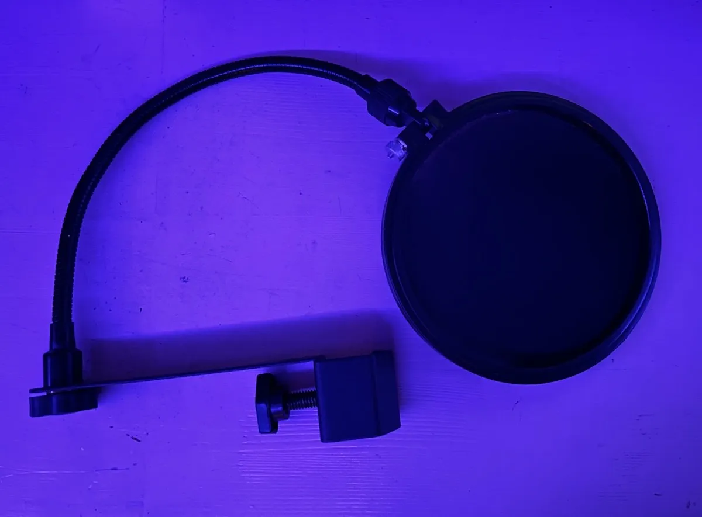
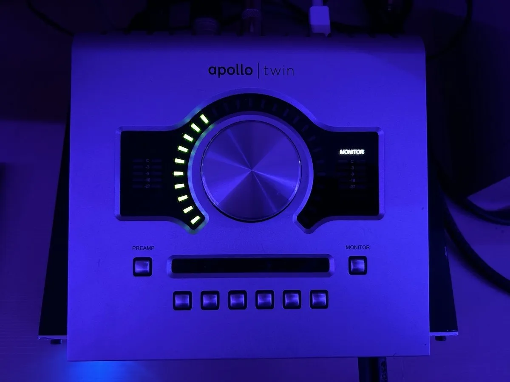
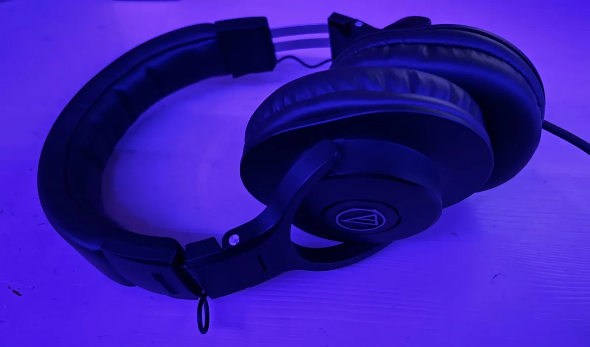
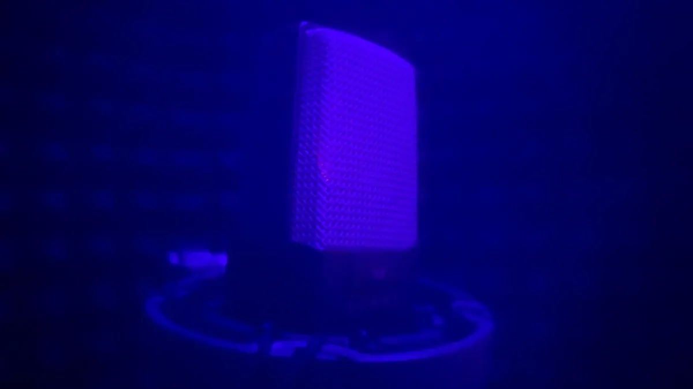

Vocals can make or break a song. This is partially because they can be tricky to record. But thankfully, there are tips you can follow for recording vocals that can make anyone, regardless of their singing experience, sound pretty darn good. And you don't need an expensive studio to get a solid vocal take, either.

Below, I'll outline my engineering techniques for recording vocals at home. These are all the things I do for vocals when I'm producing [**Darksoft**](https://www.darksoft.band). I'll go through the hardware I use and explain some recording techniques for getting a great, clean vocal sound. In this post, I'll focus more on the recording side of things, not so much on mixing or singing techniques.

## 1. Get A Decent Condenser Microphone

Compared to dynamic mics, condensers are more sensitive and a better fit for recording vocals in a studio setting. I recommend using a decent condenser microphone to pick up a balanced full EQ spectrum. For example, I use an [**AKG C414 XLS**](https://www.amazon.com/AKG-Pro-Audio-Instrument-Multipattern/dp/B003GUV1FE/?_encoding=UTF8&camp=1789&creative=9325&linkCode=ur2&linkId=bbd8455efe81534785b881571dccfe81&tag=lookuprecords-20) when recording vocals. This mic produces a natural vocal take with a little more focus on the high-end, creating a velvety sound.

The [**AKG C414 XLS**](https://www.amazon.com/AKG-Pro-Audio-Instrument-Multipattern/dp/B003GUV1FE/?_encoding=UTF8&camp=1789&creative=9325&linkCode=ur2&linkId=bbd8455efe81534785b881571dccfe81&tag=lookuprecords-20) is also versatile — it is a multipattern condenser with various polar patterns. I've used it for recording acoustic guitar, percussion, as a shoulder mic for live drums, and other scenarios.

## 2. Use A Pop Filter

<figure></figure>

A [**pop filter**](https://www.amazon.com/Professional-Microphone-Stabilizing-Recordings-Broadcasting/dp/B01N21H9WY/?_encoding=UTF8&camp=1789&creative=9325&linkCode=ur2&linkId=e8e06c46e72e4effd6860a7c6e55a8b7&tag=lookuprecords-20) helps reduce the unsavory-sounding "pops" produced from syllables like Ps and Bs. I definitely recommend using one to decrease the attack for some of these more brutal noises. Grab a pop filter with a gooseneck with a screw that you can affix to a sturdy microphone stand. I typically place the pop filter an inch or two from the microphone.

## 3. Get an Isolation Shield

If you're recording at home, the chances are you don't have a well-treated room to record vocals in. One way around this is to use an [**isolation shield**](https://www.amazon.com/gp/search?camp=1789&creative=9325&ie=UTF8&index=mi&keywords=isolation%20shield&linkCode=ur2&linkId=8e4bd87e3646d32c2b4de8f060e915d5&tag=lookuprecords-20) with a dense form to absorb the sound waves produced by your voice. This will eliminate some reflective echoes from harder surfaces in the room. This makes it easier to record vocals in any sort of space. For example, I use an [**Aokeo AO-605 isolation shield**](https://www.amazon.com/Aokeo-Professional-Microphone-microphone-equipment%25EF%25BC%2588AO-403%25EF%25BC%2589/dp/B07BCKL4RS/?_encoding=UTF8&camp=1789&creative=9325&linkCode=ur2&linkId=00e9622abf10a61a7d5cd000a806d122&tag=lookuprecords-20).

That said, it’s a good idea to pay attention to the surfaces right behind the vocalist. “While a shield helps absorb some of the vocal energy reflecting out in the room, it won't completely stop it — especially if you are a loud singer,” said audio engineer [**Brian Fisher**](mailto:brianknolen@gmail.com?subject=Heard%20about%20you%20on%20the%20Look%20Up%20blog!&body=Hi%20Brian%2C%20I%20heard%20about%20your%20mixing%20work%20from%20Darksoft%20on%20the%20Look%20Up%20blog.%20I'm%20curious%20to%20learn%20more%20about%20your%20services.&cc=bill%40look-up-records.com), who is a freelance mixing engineer and Channel Marketing & Operations Manager for Lewitt. He goes on to add:

“To mitigate this, make sure the vocalist is further away from any walls or windows, and if you are getting too much room ambiance, put up a heavy blanket on a mic stand behind the vocalist to act as an acoustic baffle. It can also help to have a rug underneath the vocalist if you have hardwood floors. If you sing softly and close to the mic, the room ambiance won't be an issue, but if you really belt it, then you might need to take these extra measures.”

## 4. Reduce Background Noise

Whenever you record acoustic sounds, as opposed to direct-in DI, it's a good idea to reduce ambient sounds if possible. This could be electrical whirrs from fans, external hard drives, heaters, or other devices. Condenser microphones are more sensitive and can pick up these sounds, so reduce background noise however you can. (If you have the energy, time, and budget to treat an isolation room, the next step would be building sound diffusion or absorption panels.)

## 5. Use a High-Quality Interface

<figure></figure>

Getting a high-fidelity audio signal for vocals really hinges on a quality USB interface. I use an [**Apollo Twin USB Interface by Universal Audio**](https://www.amazon.com/gp/search?camp=1789&creative=9325&ie=UTF8&index=mi&keywords=Apollo%20Twin%20USB%20Interface&linkCode=ur2&linkId=874af8d3fddb1427c8f0bdd729472002&tag=lookuprecords-20) for recording vocals. The Apollo series has some of the highest-fidelity audio conversions on the market with very low latencies. This desktop USB interface is also versatile for recording guitar or bass DI, or for percussion or synth.

<a class="button" href="/blog/how-to-self-release-your-album">Also Read: How to Self-Release Your Album</a>

## 6. Listen With Studio-Quality Headphones

<figure></figure>

What's the point in getting a crystal clear vocal take if you can't listen to it accurately? I recommend grabbing some studio-quality headphones with a standard 1/4" jack. For example, I use the [**ATH-M30x by Audio-Technica headphones**](https://www.amazon.com/Audio-Technica-ATH-M30x-Professional-Monitor-Headphones/dp/B00HVLUQW8/?_encoding=UTF8&camp=1789&creative=9325&linkCode=ur2&linkId=f62d2a70d6585724ee028b34578cd5a7&tag=lookuprecords-20). Any model in that series would probably do well, too. Also, if you are working with another person in your recording process, getting a 1/4" splitter is an easy, cheap way to have you both listen to the same audio output while one of you is performing.

## 7. Dial In The Right Input Level

On the input volume, you want the audio to be present enough but with enough headroom to avoid clipping in the louder moments of the song. So, before recording, I always test out those louder sections. It's also a good practice to have the input be active enough to pick up the voice well without having to strain your voice. I like going for a more subtle, natural delivery, but do what's right for your project.

## 8. Don't Let The Track Bleed Too Much

When recording vocals, I love getting into the vibe of the song. Usually, this means listening to the backing tracks sort of loudly. But, this can have the unintended consequence of the audio escaping your headphones and being picked up by the mic. A little bit of this is fine and is usually drowned out in the mix. But, sometimes, very present sounds can pierce through. So, I often turn down or mute the drums (especially the hi-hat) when recording vocals.

## 9. Layers, Layers, Layers

Nirvana did it. John Lennon did it. Most pop songs do it. Vocal doubling can create an awesome effect. It's an easy way to make your home recordings feel more polished. I recommend starting with a vocal scratch track, then recording over it until you find a delivery you're confident with, and then mocking that one in subsequent takes. I typically record four layers for each vocal part .

Having multiple takes of the same vocal performance also gives whoever's mixing it much more capabilities. They could create a wide pan or mute/unmute tracks for dynamic contrast from section to section. The thing with layering, however, is that you really need to know when to start and end phrases, and how to line up your consonants. Otherwise, if the layers don't match up, it ends up sounding too cluttered.

## 10. Chunk It Out

When multi-tracking, I think it's best to record the vocals throughout the entire song in at least one take to help discover nuances and get a natural delivery down. But if you really want to focus on improving your tuning and the delivery of particular lines, it doesn't hurt to record vocals section by section. For example, this could mean honing in on the first verse and creating all the layers before moving on to the next section. I did this a lot more starting out. It allowed me to focus on my intonation and finding my own voice.

<a class="button" href="/blog/tips-for-recording-electric-guitar-di-at-home">Also: Tips For Recording DI Guitar At Home</a>

## 11. Perform One Fist Away

One fist or about four inches away is a good minimum distance for vocals. I often pull back from the microphone a bit more for louder sections to create a consistent volume throughout the entire take.

If you plan on doubling or quadrupling your takes, adjusting your distance from the microphone slightly for some of them is a good idea too. “This gives you less proximity effect which helps reduce bass buildup when layering vocals,” says Brian.

## 12. Have A Stationary Setup

Having a permanent recording setup is the best. This means having a dedicated desktop computer for recording, with an interface, microphone, and soundproofing all set up in a permanent location. With everything in place, you can hop in and start laying down vocals effortlessly. And since there's less setup required, things are less prone to errors. Of course, this may not be possible for all home recording projects. But if you have the space, I recommend setting aside a bit of it.

## 13. Remove Breaths

Sometimes, breaths add more of a human quality that I feel is part of the intentional delivery, especially if they are in tempo. Other times, I prefer the sound of a crystal clear vocal performance with the breaths removed. When I remove breaths, I like to do so manually. Sure, you could gate your vocal tracks with a plugin, but I prefer to go in like a surgeon to clip things up. In addition to breaths, I'll remove unintentional mouth noises or reduce the dB of random accents. Doing this work ensures that, when you mix your project or when you hand stems over to a mixer, there are never any sounds that you do not intend to make it into the final product.

## 14. Put Your Faders In

Don't forget fades. Fades are the gradual change in audio volume that you insert at the start and end of a track to make it fade in and out smoothly. Without fades, you'll hear a lot of digital blips and clips. Especially if you're doing a lot of vocal editing, you'll want to ensure all changes are smoothed out.

So, ensure all audio tracks in your digital audio workstation have fades without cutting out anything that needs to be there. I also use crossfades a lot if I need to blend two takes. This goes for all instrumental takes, not just vocals.

## 15. Find The Right Effects

This last step has more to do with post-processing and mixing, and you could write an entire book about it. Taste is subjective, and the stylistic effects you use will depend greatly on your genre and the sound you're going for. The trendy vocal effects change from year to year, too.

Personally, my overriding goal is to make vocals feel cohesive within the context of the song. This involves adjusting the volume of the vocal layers and adding specific plugins. I typically add low cut, boost the EQ on the high end, add a dash of compression, and use a bit of reverb and delay. Lately, I've been into a roto cabinet emulator for background vocals. What matters is that if you went through the tips above, you now have some usable clean takes, and you can experiment with effects to take them to the next level.

## Additional Tip: Having Issues With Sibilance?

"Sometimes, certain vocalists have more pronounced sibilant consonants ("S" or "T" sound) when singing, and it can come off as harsh or overly bright in the recording," says Brian. "It's best to tackle this issue at the source because often compression and EQ will only make this problem worse in the mixing stage. One way to tame sibilance is with mic positioning. Here is a very classic vocal placement to try that was commonly used in the early days of recording. Put the microphone on a stand and position it about 6-8 inches away, upside down, and just above the mouth of the singer. Then, angle the front of the mic so it's facing down towards their chin. Angling the microphone so it's not directly in front of the mouth will help soften these harsh consonant sounds."

## Final Thoughts

These are some of the gear and techniques that myself (and friends) use to record and engineer vocals at home. But, of course, I'm still learning. And a lot of this boils down to taste. You might scratch all this and find a cooler lo-fi sound yelling into a cheap mic you found at a garage sale. You never know. Regardless, these are my tricks for getting a good vocal sound for a do-it-yourself, at-home production. Take it or leave it. Good luck, and happy engineering.
