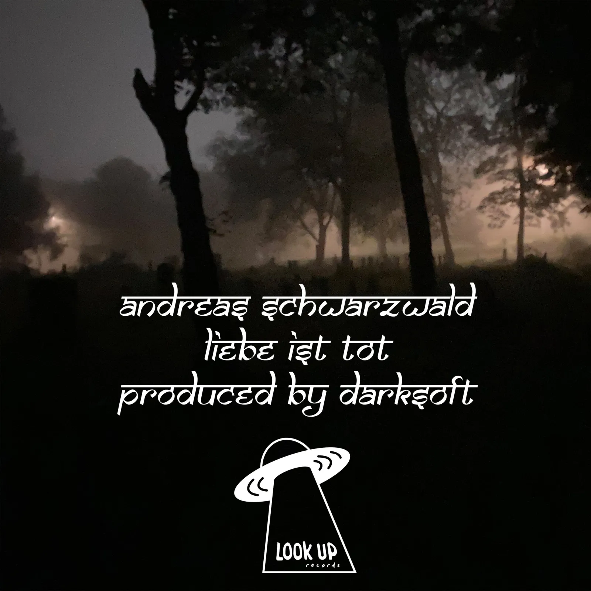
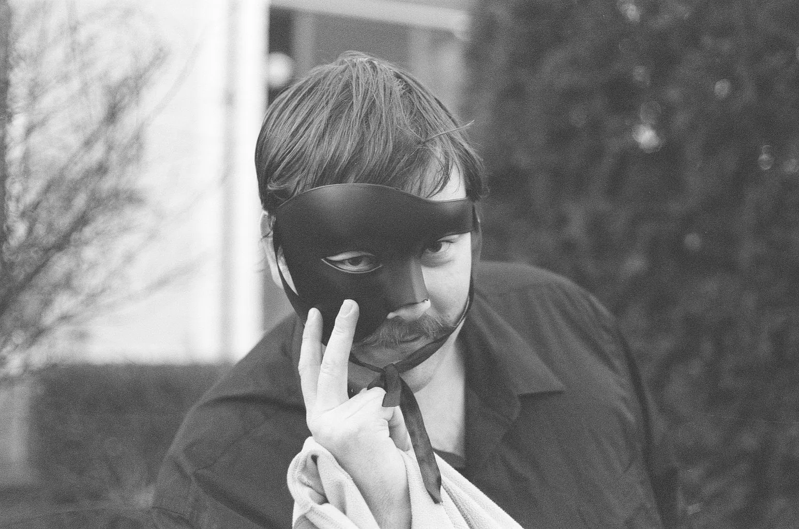

<figure><figcaption>Look Up releases Andreas Schwarzwald's EP ‘Liebe ist Tot’ on May 24, 2024.</figcaption></figure>

Look Up Records presents a haunting EP by a new masked artist, **Andreas Schwarzwald**. His songs on 'Liebe ist Tot' are of love, death, and wounded idealism, all sung in German.

All songs are by Andreas Schwarzwald. The EP was produced by **Darksoft**. *Liebe ist Tot* and *Der Sensenmann* were mixed by **Nailbeds** (Youryoungbody). *Weltschmerz* was mixed and mastered by **hørd**. *Zum Taufel* was mixed by **vhs sports**.

The EP is released alongside a music video produced by **Brett Davis Jr**. and **Gerald Davis**, starring **Andreas Schwarzwald**, **Achilles**, and **Morgan**.

<iframe src="https://www.youtube-nocookie.com/embed/BkyMef9rJuY" title="Andreas Schwarzwald - Liebe ist Tot" loading="lazy" allow="accelerometer; encrypted-media; gyroscope; picture-in-picture; web-share" referrerpolicy="strict-origin-when-cross-origin" allowfullscreen></iframe>

### Listen to Andreas Schwarzwald

<a class="button" href="https://open.spotify.com/album/6YXe3PK1tiAvUkIx64lRyD?si=ugxT882aS72GI4ETWPrvCA">Spotify</a> <a class="button" href="https://youtu.be/BkyMef9rJuY?si=YyBzAAMCHCN0SV8_">YouTube</a> <a class="button" href="https://music.apple.com/ua/album/liebe-ist-tot-ep/1745654566">Apple Music</a> <a class="button" href="https://andreasschwarzwald.bandcamp.com/album/liebe-ist-tot">Bandcamp</a>

