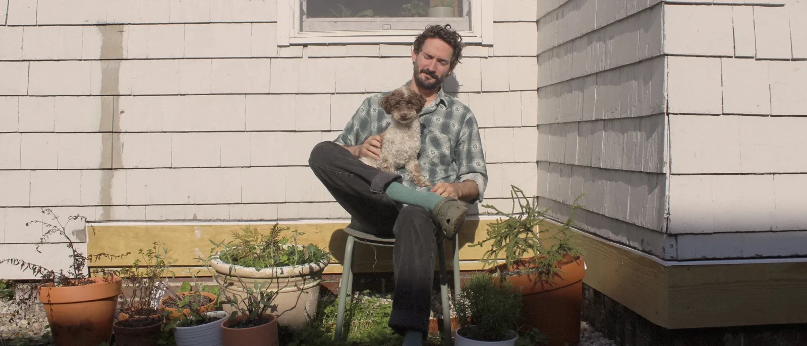
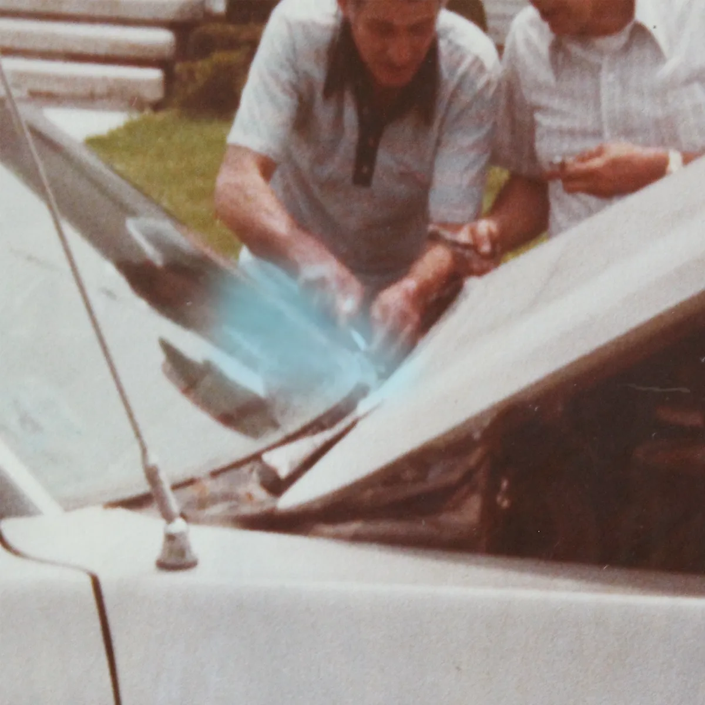
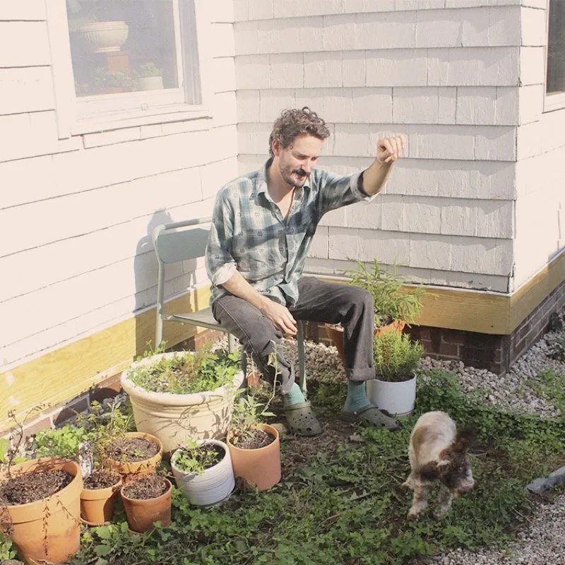

<figure><figcaption>Look Up releases debut State Birds album on Oct 25th, 2024</figcaption></figure>

[**Look Up Records**](/)presents a new artist out of Maine, **State Birds**. Led by DJ Nelson (drummer of dream-pop outfit **Little Oso**), **State Birds** is an amalgamation of years of folk rock, Midwest emo, and crocs.

R.I.Y.L Kurt Vile, Big Theif, Fleet Foxes, Richard Swift, The Dirty Projectors.

The 10-song album features a cast of musicians from New England. All songs were written by [**DJ Nelson**](https://www.instagram.com/puddin_pie_nelson/), a multi-instrumentalist and [visual artist](https://www.instagram.com/puddin_pie_prints/). The album was recorded and produced by [**Darksoft**](https://www.darksoft.band) at his home studio, and was mixed and mastered by Jonathan Benson.

Songs feature [**Emily Irving**](https://www.instagram.com/emilllyirving/) on vocals, [**Andrew Bedard**](https://www.instagram.com/itsdroob/) on saxophone, [**Sam Ellis**](https://www.instagram.com/and_so_sam_goes/) on lead guitar, and [**Alec Hudson**](https://www.instagram.com/alecgator5/) on bass.

The album is released with an awesome lo-fi video for '[**Nashua Watershed**](https://youtu.be/C5SWxZf3jHk?si=0bS8Y8W5wKlb4ZsM),' the title track, filmed at the Presumpscot River. The video was directed by [**Ricardo Lorenzo**](https://www.instagram.com/_ricky.mp4/) and [**Jeannette**](https://www.instagram.com/jentbrrm/).

<iframe src="https://www.youtube-nocookie.com/embed/C5SWxZf3jHk" title="State Birds - Nashua Watershed" loading="lazy" allow="accelerometer; encrypted-media; gyroscope; picture-in-picture; web-share" referrerpolicy="strict-origin-when-cross-origin" allowfullscreen></iframe>

### Listen to State Birds

<a class="button" href="https://open.spotify.com/album/45KV3qQeGSCTAbY4MtILcq?si=qNQvqf0NT8uvjxYEATjcWg">Spotify</a> <a class="button" href="https://www.youtube.com/watch?v=mHscyAfVY_A&list=OLAK5uy_kow0vVpFq_6JPUvI0xv-jWE2Kkx3g4L3c&ab_channel=StateBirds-Topic">YouTube</a> <a class="button" href="https://statebirds.bandcamp.com/album/state-birds">Bandcamp</a> <a class="button" href="https://music.apple.com/us/album/state-birds/1778851162">Apple Music</a>

