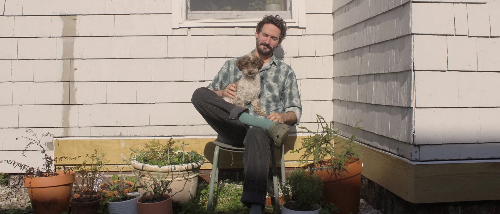
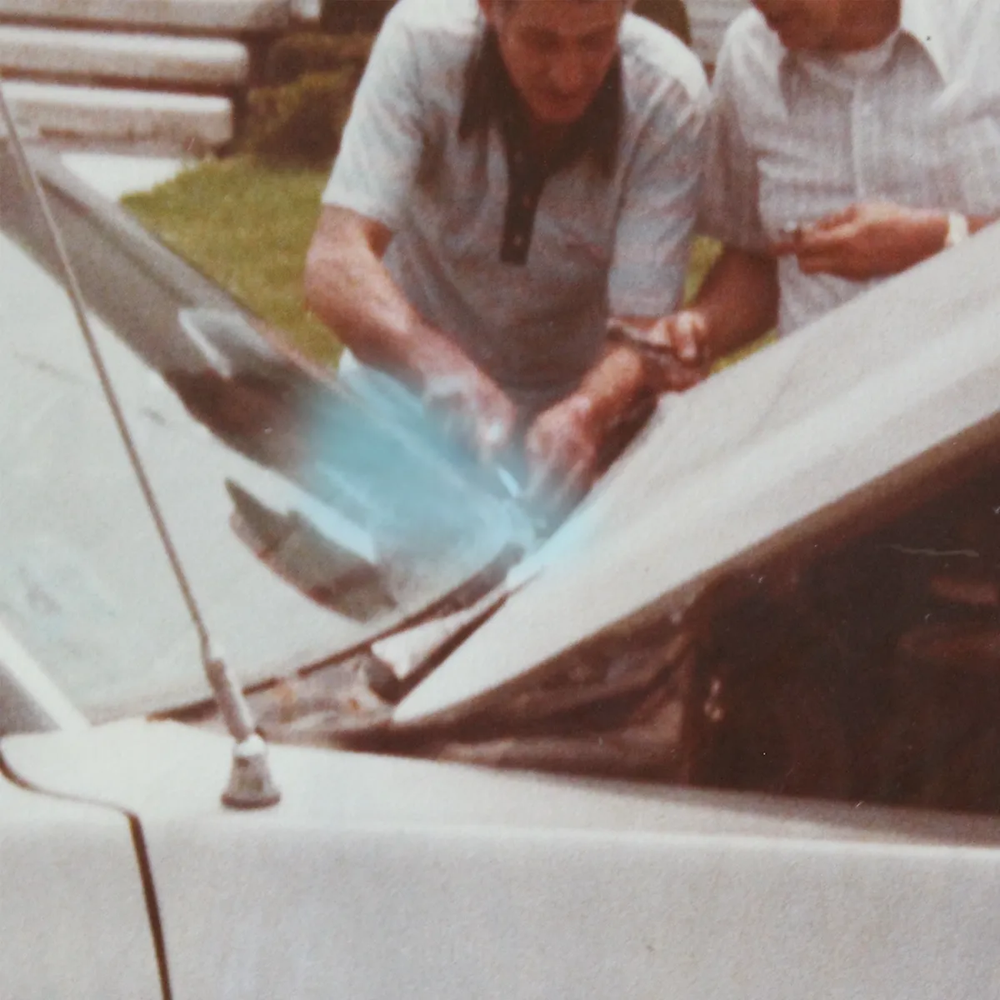

*Timothy O’Brien reviews the debut self-titled album from State Birds*

<figure><figcaption>State Birds’ debut album was released by Look Up Records in October 2024.</figcaption></figure>

The self-titled debut by **State Birds** delivers a captivating fusion of **Midwest emo** and **indie folk rock**, striking a balance between raw emotionality and nostalgic melodies from a wonderful group of musicians who aren't afraid to take us to the explorative corners of the genre.

The Portland, ME-based project features **Emily Irving** (vocals), **Sam Ellis** (lead guitar), **Andrew Bedard** (saxophone), and **Alec Hudson** (bass), with all tracks penned by **DJ Nelson**, a multi-instrumentalist and drummer of dream-pop outfit **Little Oso**. Produced by [**Darksoft**](https://www.darksoft.band) in his home studio and mixed by **Jonathan Benson**, the album's folk roots produce warmth that feels like an intimate conversation wrapped in bittersweet soundscapes.

The band effortlessly transitions between acoustic folk elements and electrifying textures, creating a dynamic listening experience. "**Lawn Chairs**" is a prime example of this delicate balance, starting with quiet acoustic plucking reminiscent of the math rock from Midwest emo. Languidly, it evolves into a full-band crescendo reminiscent of surf rock and a long coastal drive. The song's reflective nature speaks to themes of nostalgia and personal resilience in a way that is just groovy. And the guitar lick in this track will haunt me on so many late autumn walks.

"**Little Free Library**" takes a different route, leaning more into a feeling of folk with its melancholic harmonies and stacked instruments to stretch the folk-rock genre to its limits. The track feels like a homage to simpler, quieter times, tugging at a deep sense of hopeful nostalgia. The warmth in the arrangement of instruments complements the wistful lyrics, creating an inviting yet haunting atmosphere. This track has another guitar riff that is so beautifully obsessive to me, and it seems like it emerged right out of classic folk twang.

The folk influence is apparent in the **Appalachian** gospel style sound that emerges in "**Apple**," where the chorus of voices, twangy strings, and slow wash of drums provide an introspective moment with feelings of spirituality becoming effervescent in the middle of the album.

The following track, "**Old Quilt**," surprises with more grit and a guitar riff blossoming into a heart-wrenching blues melody. The folk is then even more apparent in the next track, "**Little Woods**," which consists of a soulful instrumental melody and a wonderfully brilliant ambient finish.

A particularly standout track is the opening track, "**Nashua Watershed**," which comes with an accompanying lo-fi video filmed at the Presumpscot River and directed by **Ricardo Lorenzo** and **Jeannette**. The video's organic feel perfectly matches the rustic, earthy quality of the music, further emphasizing the band's rootsy folk aesthetic.

While the album is firmly rooted in folk rock's introspective and emotional core, incorporating folk elements gives the songs a timeless, almost pastoral feel. At times, the melodies and themes may seem familiar, but there's an authenticity in the delivery that keeps the listener hooked. The earnestness in both the lyrics and the musicianship shines through, offering a record that feels personal and reflective.

In the end, **State Birds** delivers an album that feels perfectly suited for quiet nights of introspection or long road trips through rural backroads. It pushes the genre's boundaries in really unexpected yet perfectly calculated ways, and it excels in sincerity and emotional resonance, making it a solid, comforting listen for fans of both **Midwest emo** and **folk rock**.

<iframe src="https://www.youtube-nocookie.com/embed/C5SWxZf3jHk" title="State Birds - Nashua Watershed" loading="lazy" allow="accelerometer; encrypted-media; gyroscope; picture-in-picture; web-share" referrerpolicy="strict-origin-when-cross-origin" allowfullscreen></iframe>

### Listen to State Birds

<a class="button" href="https://statebirdsmusic.bandcamp.com/album/state-birds">Bandcamp</a> <a class="button" href="https://open.spotify.com/album/45KV3qQeGSCTAbY4MtILcq?si=qNQvqf0NT8uvjxYEATjcWg">Spotify</a> <a class="button" href="https://music.apple.com/us/album/state-birds/1778851162">Apple Music</a>

