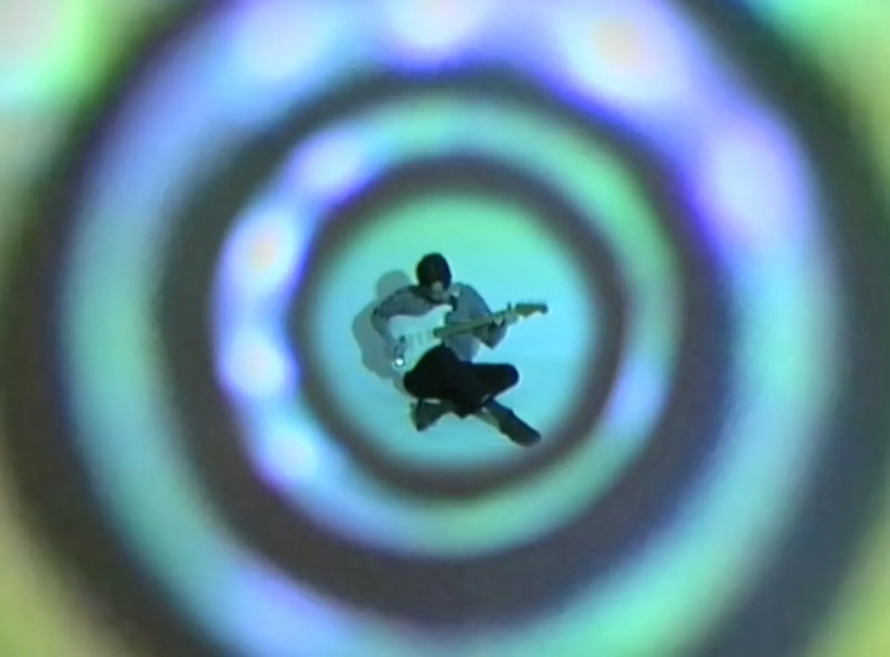
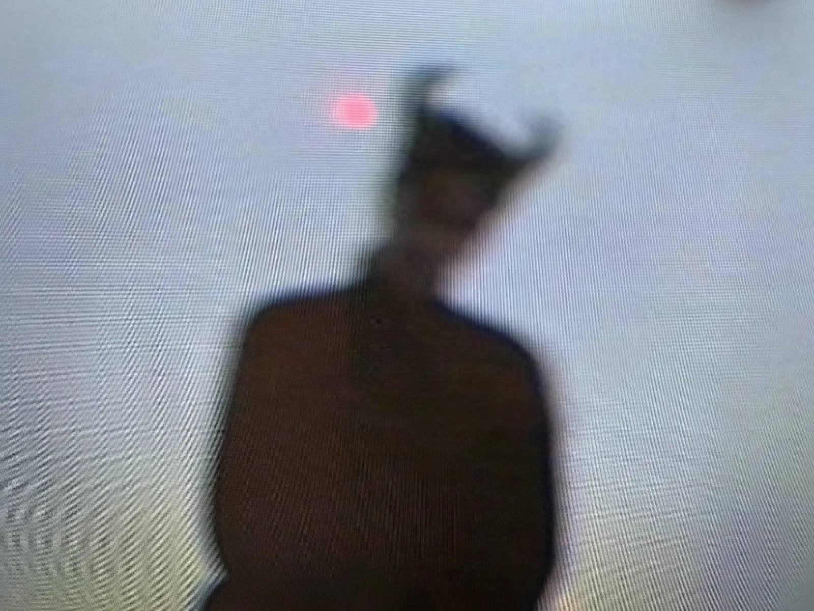

Darksoft’s Rationalism (2025) is a ten-song album released with [**Spirit Goth Records**](https://spiritgoth.com) on Friday, February 21, 2025. All songs were written and recorded by [**Darksoft**](https://www.darksoft.band) in his home studio. The album was mixed and mastered by [**Brian Fisher**](https://briankfisher.com). The artwork is by [**Erica Miller**](https://www.instagram.com/rickysfreshness/).

The album features Portland, Maine's singer-songwriter **Emily Irving** on vocals on track 3, 'Day By Day.' Hannah from synth-pop project [**Dutch Experts**](https://bio.site/dutchexperts) is featured on vocals on track 9, 'No One Knows.'

Rationalism (2025) is a follow-up to Relativism (2024). It's released alongside VHS music videos for 'Devil's In The Details,' 'After All,’ and others. Digital downloads and tapes are available on [**Bandcamp**](https://darks0ft.bandcamp.com).

**Please consider supporting the artist by picking up a** [**piece of merch**](https://darksoft.printful.me)**!**

<figure></figure>

<figure></figure>

<figure></figure>

### Listen to Rationalism

<a class="button" href="https://music.apple.com/us/album/rationalism/1794374201">Apple Music</a> <a class="button" href="https://www.youtube.com/playlist?list=OLAK5uy_kKbVbmn9XQa5ZgA7zpPZF7rm3Ir41fJ2g">YouTube</a> <a class="button" href="https://open.spotify.com/album/7eOL2oXXoh2Ib0r3mHjfXb">Spotify</a> <a class="button" href="https://darks0ft.bandcamp.com/">Bandcamp</a> <a class="button" href="https://album.link/darksoft-rationalism">All other streaming links</a> <a class="button" href="https://darks0ft.bandcamp.com/">Digital download</a>

<figure></figure>

<iframe src="https://www.youtube-nocookie.com/embed/0s5fnKxrPus" title="Darksoft - After All (Music Video)" loading="lazy" allow="accelerometer; encrypted-media; gyroscope; picture-in-picture; web-share" referrerpolicy="strict-origin-when-cross-origin" allowfullscreen></iframe>

<iframe src="https://www.youtube-nocookie.com/embed/QEfcYQIF2AQ" title="Darksoft - Devil&#x27;s In The Details (Music Video)" loading="lazy" allow="accelerometer; encrypted-media; gyroscope; picture-in-picture; web-share" referrerpolicy="strict-origin-when-cross-origin" allowfullscreen></iframe>

1. Devil's In The Details

2. After All

3. Day By Day

4. Some Things You Just Know

5. Everything Else

6. Finders Keepers

7. Late Bloom

8. Better Late Than Never

9. No One Knows

10. Out Of Sight Out Of Mind

## Artist Statement

> "I see Rationalism as a sister album to Relativism, both sonically and thematically. While Relativism delves into the subjective and fluid, my goal with Rationalism was to counter with more clarity and groundedness, focusing on how we come to 'know,' rationalize, and process things. The lyrics explore themes of temporal flow, life's unpredictability, and the transient nature of emotions, relationships, and seasons. They also examine the closeness and distance in human connections, with a recurring desire to strip away the noise of life and focus on what truly matters. It’s a balancing act.”

<figure><figcaption>Still from Darksoft music video for Day By Day</figcaption></figure>

