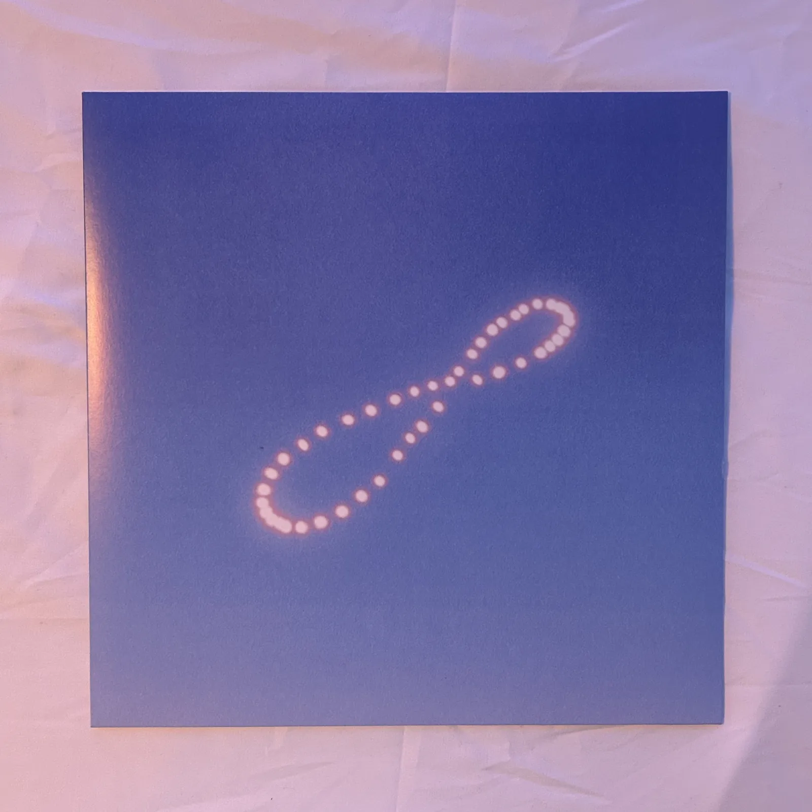
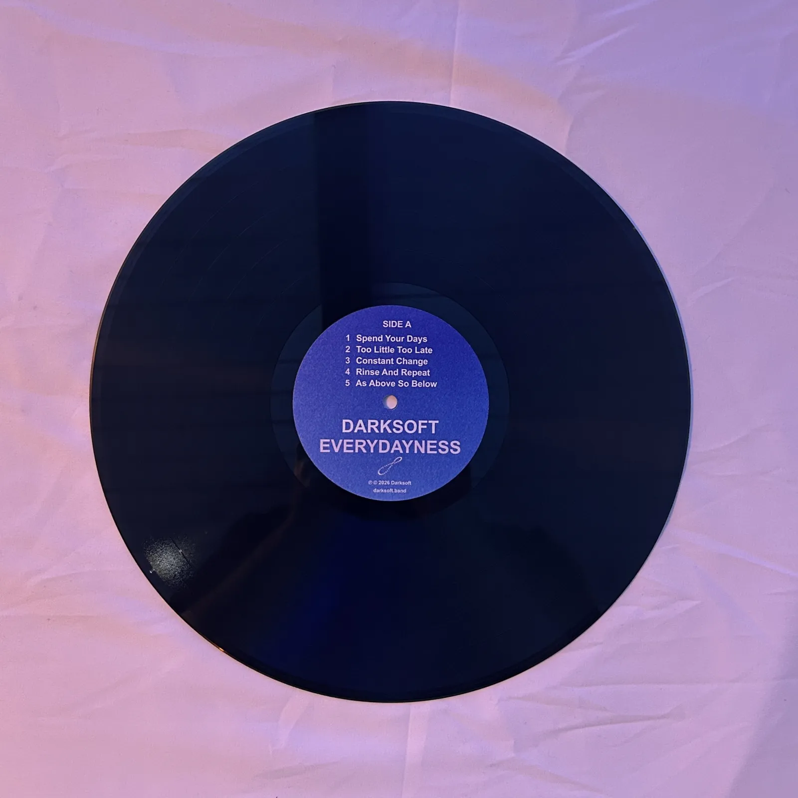
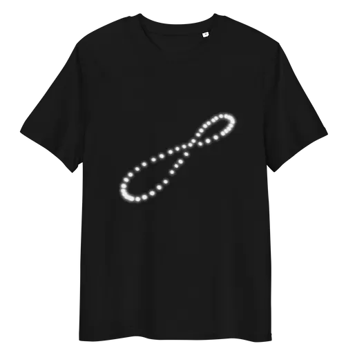
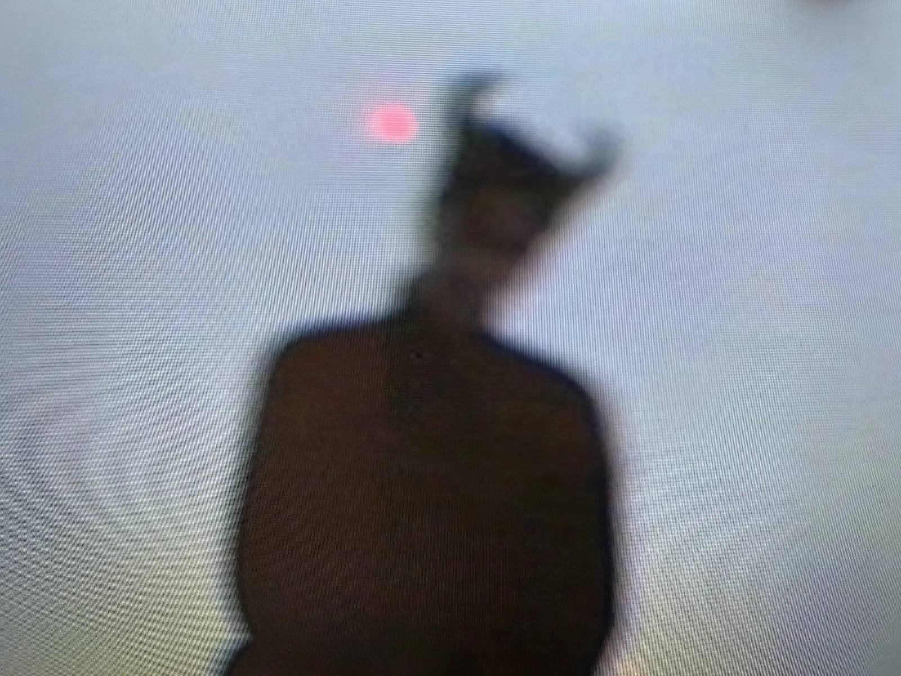

<figure><figcaption>Artwork for Darksoft’s album Everydayness (2026)</figcaption></figure>

### *Everydayness* is Darksoft’s eighth studio album, self-released by Darksoft through Look Up Records on Friday, March 6th, 2026.

<figure><figcaption><a href="https://elasticstage.com/darksoft/releases/everydayness-album"><strong>Pick up vinyl and CD here!</strong></a></figcaption></figure>

**Everydayness is currently available for order on** [**vinyl**](https://elasticstage.com/darksoft/releases/everydayness-album) **and** [**CD**](https://elasticstage.com/darksoft/releases/everydayness-album)**, on-demand via** [**Elastic Stage**](https://elasticstage.com/es/referral/3YJ57FIV), and on tape cassette at live shows.

*Everydayness* blends dream pop and shoegaze, pairing shimmering, jangly guitars with driving drums and introspective lyrics.

The album artwork, by artist [Jameson Martin](https://www.instagram.com/_jameaux_/), features an analemma — an infinity symbol created by photographing the sun from the same spot over the course of a year.

Like the artwork, the concept album reflects on everyday existence, pondering the cyclical nature of life and day-to-day routines. Its goal is to find beauty in the mundane.

All parts were written, played, and recorded by Darksoft using real instruments in his home studio (voice, drumset, guitars, bass, outboard synthesizers, percussion, and sound effects).

The album was mixed and mastered by Brian Fisher. The artwork is by Jameson Martin. The album features vocals by [Lauren Lakis](https://www.instagram.com/laurenlakis/) on track 7, ‘Irons In The Fire.’ Track 5, ‘As Above So Below,’ features vocals by Sandy.

*Everydayness* is released alongside home-made music videos for '[Spend Your Days](https://youtu.be/FQCBqHfKDHg?si=UjrEytASdIXDKffr)' (single released Friday, Jan 16) and 'Too Little Too Late' (single released Friday, Feb 20), and more to come.

### New Everydayness Merch

<figure><figcaption><a href="https://elasticstage.com/darksoft/releases/everydayness-album"><strong>Vinyl and CDs are available here.</strong></a></figcaption></figure>

<figure></figure>

<figure></figure>

<figure></figure>

### Listen to *Everydayness*

<a class="button" href="https://open.spotify.com/album/6uvgARCNYEHRkFtgNoGHnN?si=linM918gTvi3kbWIsIOO0A">Spotify</a> <a class="button" href="https://music.apple.com/us/artist/darksoft/1438263529">Apple Music</a> <a class="button" href="https://www.youtube.com/@Darksoft">YouTube</a> <a class="button" href="https://darks0ft.bandcamp.com/">Bandcamp</a> <a class="button" href="https://www.darksoft.band/">Darksoft.band</a>

<iframe src="https://www.youtube-nocookie.com/embed/FQCBqHfKDHg" title="Darksoft - Spend Your Days (Music Video)" loading="lazy" allow="accelerometer; encrypted-media; gyroscope; picture-in-picture; web-share" referrerpolicy="strict-origin-when-cross-origin" allowfullscreen></iframe>

Official music video for Darksoft’s ‘Spend Your Days,’ the first track off his new album, Everydayness.

### Everydayness Track Order

1. Spend Your Days
2. Too Little Too Late
3. Constant Change
4. Rinse And Repeat
5. As Above So Below
6. Same Ol Same Ol
7. Irons In The Fire
8. Grain Of Salt
9. No News Is Good News
10. Stop And Go

