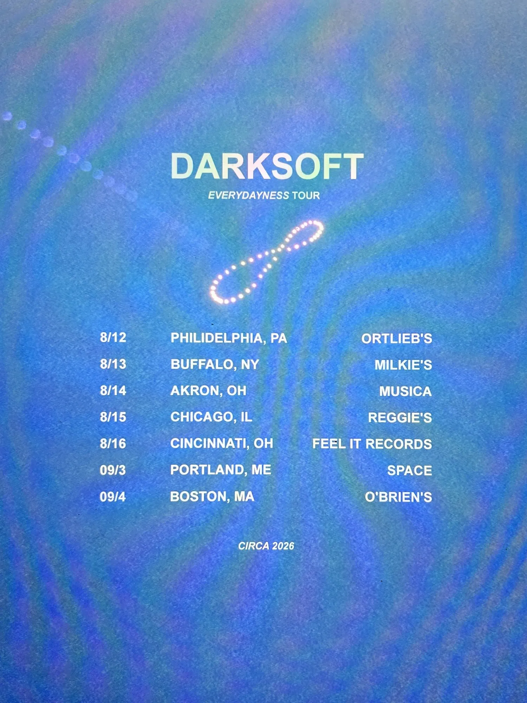
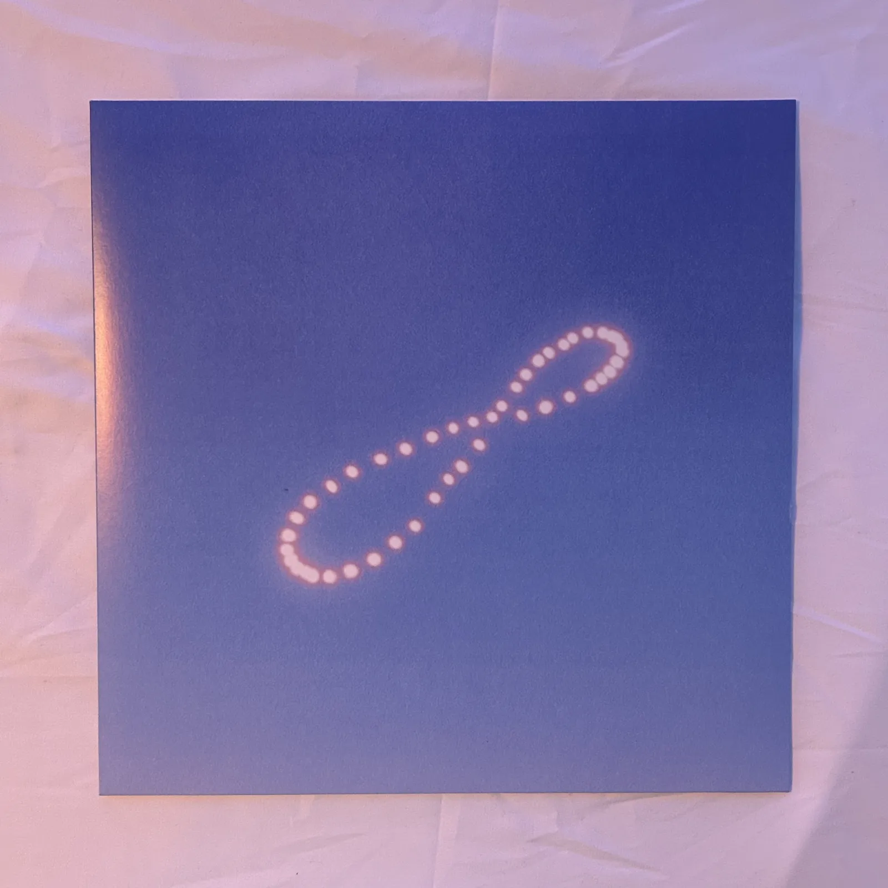
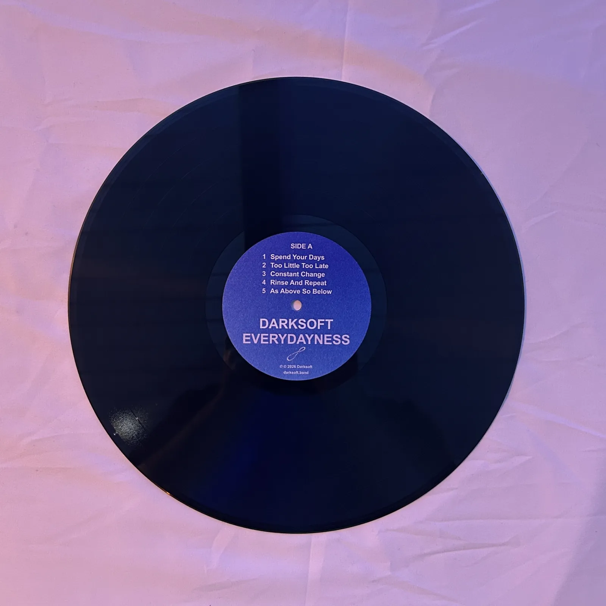
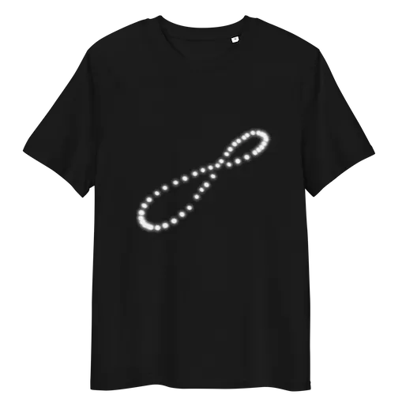
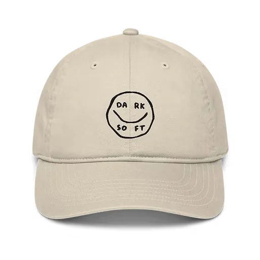

**PORTLAND, Maine.** Portland-based dream pop and shoegaze project [Darksoft](https://www.darksoft.band/) has announced a series of August and September 2026 tour dates supporting the new album [*Everydayness*](https://darks0ft.bandcamp.com/album/everydayness).

The Darksoft Everydayness Tour will visit Philadelphia, Buffalo, Akron, Chicago, Cincinnati, Portland and Boston. Darksoft will perform as a four-piece live band throughout the tour.

## Darksoft Everydayness Tour 2026 Dates

| Date | City | Venue | Tickets |
| --- | --- | --- | --- |
| 8/12 | Philadelphia, PA | [Ortlieb’s](https://ortliebsphilly.com/) | [**Buy tickets**](https://www.eventbrite.com/e/darksoft-with-special-guests-floating-and-christina-ward-tickets-1987323699683) |
| 8/13 | Buffalo, NY | [Milkie’s Elmwood Lounge](https://milkieselmwoodlounge.com/) | Tickets available at the door |
| 8/14 | Akron, OH | [Musica](https://www.theofficialmusica.com/) | [**Buy tickets**](https://dice.fm/partner/tickets/event/8el27r-darksoft-everydayness-tour-with-smokey-honey-bluesband-lovely-weather-jack-and-the-cadavers-14th-aug-musica-akron-tickets) |
| 8/15 | Chicago, IL | [Reggie’s Music Joint](https://www.reggieslive.com/show/darksoft/) | [**Buy tickets**](https://www.reggieslive.com/show/darksoft/) |
| 8/16 | Cincinnati, OH | [Feel It Record Shop](https://www.feelitrecordshop.com/) | Tickets available at the door |
| 9/3 | Portland, ME | [SPACE](https://space538.org/event/darksoft-cigarettes-for-breakfast-crystal-canyon-xo-2026/) | [**Buy tickets**](https://space538.org/event/darksoft-cigarettes-for-breakfast-crystal-canyon-xo-2026/) |
| 9/4 | Boston, MA | [O’Brien’s Pub](https://web.archive.org/web/20260722102944/https://obrienspubboston.com/show/the-dreamtoday-crystal-canyon-darksoft-the-shallows/) | [**Buy tickets**](https://web.archive.org/web/20260722102944/https://obrienspubboston.com/show/the-dreamtoday-crystal-canyon-darksoft-the-shallows/) |

## Darksoft Returns to Chicago

The route was built in part around returning to Chicago, where Darksoft previously performed at the Empty Bottle in 2024 and at a darkwave and post-punk mini-festival at Subterranean in 2025.

> “We absolutely love the Chicago scene and are stoked to get back there this year,” says Darksoft.

For the 2026 Chicago show, Darksoft will perform at [Reggie’s Music Joint](https://www.reggieslive.com/show/darksoft/) with Chicago acts [Ghost Days](https://www.instagram.com/ghost.days/) and [Nothing But Silence](https://nothingbutsilence.bandcamp.com/).

> “We’re also excited to visit towns like Akron, Buffalo, and Philly, where we resonate with the local music and have been building a local base,” Darksoft adds.

## About the Everydayness Tour

The tour supports Darksoft’s latest album, [*Everydayness*](https://darks0ft.bandcamp.com/album/everydayness), a 10-song record self-released through [Look Up Records](/) on March 6, 2026.

The album blends dream pop and shoegaze with jangly guitars, driving drums, and reflective lyrics centered on daily routines, repetition, and finding beauty in the mundane.

Writing for [Vanyaland](https://vanyaland.com/2026/03/20/darksoft-polishes-the-mundane-through-everydayness/), Victoria Wasylak said Darksoft “strikes cathartic gold” on the record, describing its music as “glimmering dream-rock.”

Attendees can expect songs from *Everydayness* alongside live versions of earlier Darksoft tracks, including “Live and Let Live” and “So It Goes,” which have recently gained traction on Instagram Reels.

Darksoft will also sell *Everydayness* cassette tapes and tour T-shirts printed by [Portland Process Prints](https://www.instagram.com/portlandprocessprints/) at the shows. Additional Darksoft merchandise, including *Everydayness* shirts, vinyl records, and CDs, is available through the [official Darksoft merch store](https://www.darksoft.band/merch/).

## About Darksoft

[Darksoft](https://www.darksoft.band/) is a solo recording project based in Portland, Maine, supported by a full band for live performances. The music combines dream pop, shoegaze, indie rock, and alternative influences.

As of July 2026, Darksoft has more than 200,000 monthly listeners on Spotify. Darksoft’s music has also been licensed for independent film, advertising, and international television projects.

Listen to *Everydayness* on [Spotify](https://open.spotify.com/album/6uvgARCNYEHRkFtgNoGHnN), [Apple Music](https://music.apple.com/us/artist/darksoft/1438263529), or [Bandcamp](https://darks0ft.bandcamp.com/album/everydayness). Darksoft’s self-produced music videos are also available on [YouTube](https://www.youtube.com/watch?list=PLbdzXhgu493J7dQ4tjOsjOVwbqlOBQeEr&v=1DEuXKneAOY).

## Tickets and More Information

Use the ticket links in the tour schedule above or visit the [official Darksoft tour page](https://www.darksoft.band/#tour) for the latest concert information.

For press, booking, and general inquiries, contact [darksoftband@gmail.com](mailto:darksoftband@gmail.com).

Follow Darksoft on Instagram at [@darks0ft](https://www.instagram.com/darks0ft/).

<figure><figcaption><a href="https://elasticstage.com/darksoft/releases/everydayness-album"><strong>Vinyl and CDs are available here.</strong></a></figcaption></figure>

<figure></figure>

<figure></figure>

<figure></figure>

### Listen to *Everydayness*

<a class="button" href="https://open.spotify.com/album/6uvgARCNYEHRkFtgNoGHnN?si=linM918gTvi3kbWIsIOO0A">Spotify</a> <a class="button" href="https://music.apple.com/us/artist/darksoft/1438263529">Apple Music</a> <a class="button" href="https://www.youtube.com/@Darksoft">YouTube</a> <a class="button" href="https://darks0ft.bandcamp.com/">Bandcamp</a> <a class="button" href="https://www.darksoft.band/">Darksoft.band</a>

<iframe src="https://www.youtube-nocookie.com/embed/FQCBqHfKDHg" title="Darksoft - Spend Your Days (Music Video)" loading="lazy" allow="accelerometer; encrypted-media; gyroscope; picture-in-picture; web-share" referrerpolicy="strict-origin-when-cross-origin" allowfullscreen></iframe>

Official music video for Darksoft’s ‘Spend Your Days,’ the first track off his new album, Everydayness.

<figure><figcaption>Artwork for Darksoft’s album Everydayness (2026)</figcaption></figure>
