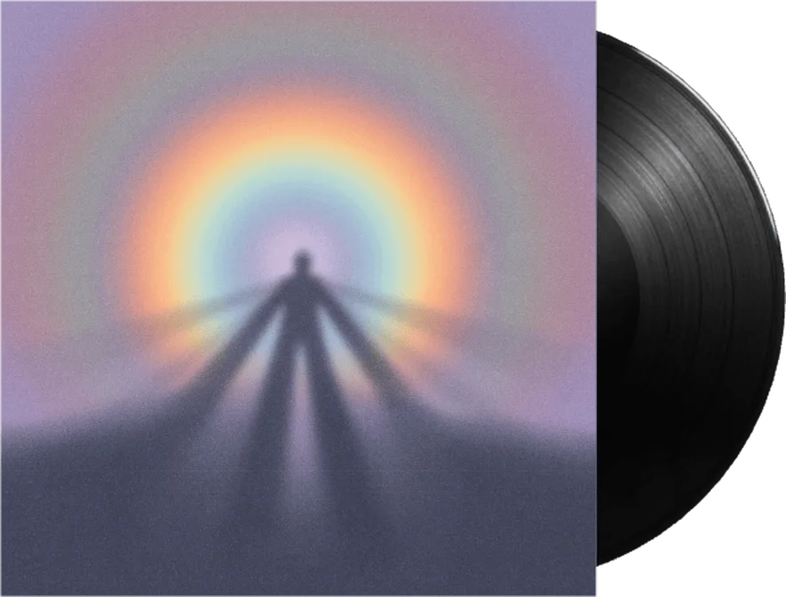
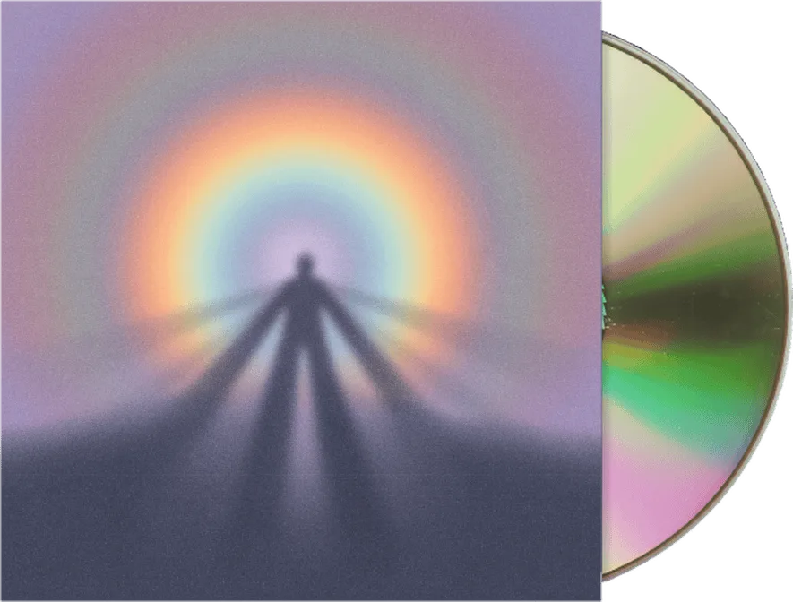

[Darksoft](/darksoft)'s ninth studio album, *Ultraview*, comes out on all digital platforms on **Friday, February 12, 2027** on Look Up Records. Spotify users can [pre-save the album and see the tracklist here](https://open.spotify.com/prerelease/5zv5cgrEU5SxtkwMpnHGK6).

<a class="button solid" href="https://open.spotify.com/prerelease/5zv5cgrEU5SxtkwMpnHGK6">Pre-Save Ultraview</a>

Ahead of the digital release, vinyl and CDs are available to order now, exclusively through [Elastic Stage](https://elasticstage.com/darksoft/releases/ultraview-album), which presses on demand and ships worldwide.

  <figure><a class="button" href="https://elasticstage.com/darksoft/releases/ultraview-album">Order Ultraview on Vinyl</a></figure>
  <figure><a class="button" href="https://elasticstage.com/darksoft/releases/ultraview-album">Order Ultraview on CD</a></figure>

## About the album

*Ultraview* (2027) is a 10-song indie rock album with dream pop, jangle and shoegaze sounds. Darksoft wrote, recorded and produced it from late 2025 through 2026, playing real instruments in his home studio in Maine. Jacob Tessier contributed additional drums and percussion.

The album was mixed and mastered by [Brian Fisher](https://briankfisher.com/work), a mixing engineer from Massachusetts.

Conceptually, *Ultraview* follows Darksoft's previous album, [*Everydayness*](/catalog/darksoft/everydayness) (2026). Where *Everydayness* looked at everyday life up close, *Ultraview* is about stepping away from it. As Darksoft describes it:

> "My album *Ultraview* is about what happens when you take a step back and view life from afar. Your perspective shifts. With detachment comes revelation. And when you return, things don't look the same as before."

Curious folks can read more about [the meaning of *Ultraview*](https://www.darksoft.band/blog/the-meaning-behind-my-album-ultraview/) on Darksoft's blog.

The songs on *Ultraview* carry a positive sentiment, mixing same ol' same ol' lyrical clichés about detachment, escapism and enlightenment.

The cover artwork, designed by [Jameson Martin](https://www.jamesonmartinart.com), is inspired by a [Brocken spectre](https://en.wikipedia.org/wiki/Brocken_spectre), a natural optical phenomenon that surrounds a person's shadow with a multicolored halo.

## What's next

Ahead of the digital release, Darksoft will put out two singles from *Ultraview*, each with a music video. [Sign up for the newsletter](/newsletter) to hear about them first.
